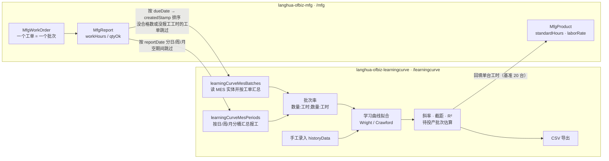

# OFBiz Learning Curve Component

学习曲线（Wright / Crawford）成本估算组件，以 **Apache OFBiz 插件**形式提供。

支持 OFBiz **24.09 及以上**版本，编译目标 **Java 17**（OFBiz 24.09 的最低要求）。

> 两套算式都集中在后面的 [计算公式一览](#计算公式一览)：批次转绘图点、对数拟合与迭代剔除、
> 待投产批次估算、台账耗时率预测；软件报价的四步在 MES 那边（同节附链接）。

## 功能

- `LearningCurve`：学习曲线值对象（斜率、截距、拟合优度、合格/剔除数据）
- `OFBizLearningCurveHandler`：数据转换（Wright / Crawford）、最小二乘拟合、剔除异常点、估算
- `I_OFBizLearningCurve`：接口定义（`WRIGHT = 1`、`CRAWFORD = 2`）
- `LearningCurveServices`：OFBiz 服务门面（可通过服务引擎调用）
- Web 页面：录入历史数据并**保存估算记录**、记录列表、单条详情（含趋势图）与 CSV 导出
- **软件报价**（新增一支）：功能点规模 + 可调的功能点耗时率 / 日费率 / 税率 / 直接非人力成本率 / 软件因素因子
  → 人时、人天、工期、税前 / 含税 / 合计，可保存报价；并用 Wright 拟合台账实测耗时率给出下一个项目的预测
- 口径可切换：`COST`（成本，元）与 `HOURS`（工时，小时），同一套算法
- **与 MES 联动**：按工单取批次（`learningCurveMesBatches`）或按日/周/月取报表期间
  （`learningCurveMesPeriods`），结果直接填进历史批次数据；MES 报表页有「喂进学习曲线」的入口
- 估算记录按 **产品型号 / 项目 + 批次** 两个维度存储（`LearningCurveEstimate` / `LearningCurveBatch`）

## 目录结构

```
langhua-ofbiz-learningcurve/
├── ofbiz-component.xml                  # 组件描述符（OFBiz 入口）
├── build.gradle                         # 第三方依赖（gov.nist.math:jama）
├── config/
│   └── LearningCurveErrorUiLabels.xml   # 多语言错误提示
├── data/
│   └── LearningCurveSecurityPermissionSeedData.xml   # 权限与权限组种子数据
├── entitydef/
│   ├── entitymodel.xml                  # 估算记录 / 批次 / 软件报价实体
│   └── entitygroup.xml                  # 实体分组（org.apache.ofbiz）
├── servicedef/
│   └── services.xml                     # 服务定义
├── widget/
│   ├── LearningCurveCommonScreens.xml   # 登录/错误页 decorator + 页面布局装饰器 lc-decorator
│   └── LearningCurveScreens.xml         # 估算、记录列表、记录详情、软件报价（内容包在 lc-decorator 里）
├── webapp/learningcurve/                # controller.xml + web.xml + 4 个 FTL + decorator.ftl + css/
├── src/main/java/org/langhua/ofbiz/learningcurve/
├── src/test/java/org/langhua/ofbiz/learningcurve/
└── integration-test/LearningCurveServiceIT.java
```

## 部署

组件源码由 OFBiz 的 Gradle 构建编译，因此必须放在 **`plugins/`** 目录下（`hot-deploy/` 只认已编译的 jar）。

```bash
# 1. 复制到 OFBiz 的 plugins 目录（目录名即组件名）
cp -r langhua-ofbiz-learningcurve $OFBIZ_HOME/plugins/learningcurve

# 2. 编译（会自动从 Maven Central 下载 jama）
cd $OFBIZ_HOME && ./gradlew jar

# 3. 启动
cd $OFBIZ_HOME && ./gradlew ofbiz
```

Windows 下用 `gradlew.bat`，`JAVA_HOME` 指向 JDK 17。

启动后可在 **Web Tools → View Components** 中看到 `learningcurve`（Enabled = Y）。

## 服务

| 服务名 | 说明 |
| --- | --- |
| `learningCurveEstimate` | 估算后续 N 个单位的总成本与单位成本，返回 `estimate`、`unitCost` 及拟合参数 |
| `learningCurveParameters` | 仅返回拟合参数（斜率、截距、R²、合格/剔除行数） |
| `learningCurveSaveEstimate` | 计算并**保存**一条估算记录（含历史批次），返回 `estimateId` |
| `learningCurveListEstimates` | 按产品型号（可选）列出已保存记录，按创建时间倒序 |
| `learningCurveChartData` | 返回详情页所需数据：记录头、批次列表、趋势图坐标点、坐标轴最大值 |
| `learningCurveMesBatches` | **从 MES 取历史批次**：按型号把工单汇总成 `数量:工时` 串（可选，没型号就返回空） |
| `learningCurveMesPeriods` | **从 MES 报表按期间取点**：把报工按日/ISO 周/月分桶，每个期间算一个批次（良品数为数量、报工工时为数值），返回 `periods`、`periodCount`、`historyData` |
| `learningCurveSoftwareQuote` | **软件报价试算**：把参数转给 MES 的 `mfgSoftwareEstimate`，返回功能点数、工作量（人时）、工期与各段金额 |
| `learningCurveSaveSoftwareQuote` | 报价并**保存快照**（参数 + 结果），返回 `quoteId` |
| `learningCurveListSoftwareQuotes` | 已保存报价列表（倒序）与合计，`lastQuote` 给表单当默认值 |
| `learningCurvePdrForecast` | 读 MES 软件台账里已完成项目的实测耗时率（工时 ÷ 功能点数），用 Wright 曲线预测下一个项目的耗时率 |
| `learningCurveStandardHours` | **回填预览**：把曲线给出的下一批工时摊成单台，与 MES 型号现用的标准工时对比（不写库） |
| `learningCurveApplyStandardHours` | **回填**：把单台工时写进 MES 型号的 `standardHours`，并记一行 `LearningCurveHoursApply` 台账（旧值不丢） |

参数说明：

| 参数 | 类型 | 必填 | 说明 |
| --- | --- | --- | --- |
| `historyData` | String | 是 | 历史数据，`单位数:成本` 用 `;` 或 `,` 分隔，如 `2:200;3:285;5:450` |
| `newUnitNumber` | Double | 是（estimate） | 需估算的新单位数 |
| `leastSquare` | Double | 否 | 期望拟合优度，默认 `0.95` |
| `methodType` | Integer | 否 | `1` = Wright，`2` = Crawford，默认 `1` |

示例（Web Tools → Run Service → `learningCurveEstimate`）：

```
historyData   = 2:200;3:285;5:450
newUnitNumber = 5
leastSquare   = 0.95
methodType    = 1
```

返回：`estimate ≈ 440.188`（Wright）；`methodType = 2` 时 `estimate ≈ 445.511`（Crawford）。

## Web 页面

部署并启动后访问（需登录，OFBiz 管理员即可）：

```
https://localhost:8443/learningcurve/control/main
```

页面录入历史数据后提交，直接调用 `learningCurveEstimate` 服务并展示估算结果与拟合参数。
访问控制由 `ofbiz-component.xml` 中的 `base-permission="OFBTOOLS"` 决定。

| 路径 | 说明 |
| --- | --- |
| `/learningcurve/control/main` | 估算表单：产品型号、口径（成本/工时）、历史批次、待估算单位数、期望 R²、方法；上方可选「从 MES 取历史批次」与「从 MES 报表取点」（按日/周/月，带起止日期） |
| `POST /learningcurve/control/estimate` | 调用 `learningCurveSaveEstimate` 保存记录，跳转到详情页 |
| `/learningcurve/control/records` | 记录列表，可按产品型号筛选 |
| `/learningcurve/control/recordDetail?estimateId=...` | 详情：估算结果、历史批次、趋势图（SVG）、CSV 下载、**回填成 MES 型号标准工时**（预览 + 回填 + 台账） |
| `/learningcurve/control/exportCsv?estimateId=...` | 导出该记录为 CSV（`text/csv`） |
| `/learningcurve/control/quote` | **软件报价**：功能点规模 + 可调参数（功能点耗时率、日费率、税率、直接非人力成本率、软件因素四项）→ 人时 / 人天 / 工期 / 税前 / 含税 / 合计，并可保存报价；上方给“下一个项目耗时率预测” |
| `POST /learningcurve/control/quoteSave` | 调用 `learningCurveSaveSoftwareQuote` 保存报价（参数 + 结果快照） |
| `/learningcurve/control/exportQuotesCsv` | 导出全部报价为 CSV（UTF-8 带 BOM，Excel 直接开） |
| `POST /learningcurve/control/quoteToProject` | 把一条保存好的报价**建为 MES 的软件项目**（带类别），重复点不会重复建 |
| `POST /learningcurve/control/standardHoursApply` | 把工时口径的估算回填成 MES 型号的标准工时（`estimateId` + `baseQty`）；回填后跳到详情页带 `applied=Y` |

## 软件报价：功能点口径的一支

硬件那支是按批次拟合“越做越快”；软件这支持的是**按规模算价钱**。两者共用同一个组件，但不共用一个模型：

| | 学习曲线（硬件） | 软件报价 |
| --- | --- | --- |
| 输入 | 历史批次 `数量:工时` | 规模（内部/外部接口文件数，或直接填功能点数）+ 参数 |
| 输出 | 待投产批次的人时、斜率、R² | 人时、人天、工期（人月）、税前/含税/合计、元/功能点 |
| 公式 | Wright / Crawford | 未调整功能点 = 35×内部逻辑文件 + 15×外部接口文件；工作量 = 耗时率×功能点×软件因素×开发因素；工期 = 1.277×(工作量/176)^0.404；金额 = 人天×日费率+税+直接非人力成本 |
| 数据源 | MES 的报工 | 公式与默认值在 MES（`mfgSoftwareEstimate`），本组件调它 |

参数都可改，默认取**上一次保存的报价**（新装时取 MES 的默认值：功能点耗时率 40 人时/功能点、日费率 1760、税 6%、直接非人力成本 5%）：

- 耗时率改成台账实测值？页面顶部直接给建议值：用 Wright 曲线拟合 MES 软件台账里已完成项目的实测耗时率
  （实际工时 ÷ 功能点数，一个项目一个点，按 `deliverySeq` → `createdStamp` 排序），点“用这个耗时率试算”一键带入；
- 保存时把参数与结果一起存进 `LearningCurveSoftwareQuote`，以后改费率不影响历史报价；
- 报价可以直接**转成 MES 的软件项目**（`learningCurveQuoteToProject`）：带上规模与参数、`quotedAmount` 取报价合计，
  项目编号回写到报价上，表里那个格就变成指向台账的链接；重复点返回第一次建的项目，不会重复建；
- 报价可**导出 CSV**（`/learningcurve/control/exportQuotesCsv`）：编号、项目、客户、功能点、人时/人天/工期、
  税前/税/含税/直接非人力成本/合计、耗时率、日费率、税率、关联项目、时间、备注；
- MES 没部署时本页仍能打开，只是报价会提示“MES 组件未部署或服务不可用（mfgSoftwareEstimate）”。

> 术语：页面上一律用中文——内部逻辑文件、外部接口文件、未调整功能点、功能点耗时率、软件因素调整因子、
> 开发因素调整因子、直接非人力成本；与国家标准里英文缩写的对应关系见
> `../langhua-ofbiz-mfg/README.md` 的「软件项目」一节里的术语对照表。

## 计算公式一览

所有算式集中在这里，四步：**批次 → 绘图点 → 对数拟合 → 估算**。页面不参与计算，数字都来自服务
（`LearningCurveServices` + `OFBizLearningCurveHandler`）；改文案只改模板，改口径改这里列的常量。
第 6 节是「按期间生成批次」的求和口径（与 MES 报表页同源），软件报价的四步在 MES 那边（第 5 节），
第 7 节是把曲线写回型号标准工时的摊算口径。

### 1. 批次转绘图点

输入是历史批次串 `数量:金额;数量:金额;...`（金额按口径是元或工时）。设第 $i$ 批数量 $x_i$、金额 $y_i$，
之前累计数量 $X_{i-1} = \sum_{j<i} x_j$：

| 方法 | 绘图点 $X$ | 绘图点 $Y$ |
| --- | --- | --- |
| Wright（单位成本曲线） | 第 1 批：$x<10$ 取 $x/2$（$x=1$ 取 1），$x \ge 10$ 取 $x/3$；第 2 批起：$x=1$ 取 1、否则 $x/2$，再加之前累计量 $X_{i-1}$ | $y_i / x_i$（该批单件成本） |
| Crawford（累计平均曲线） | $X_i = \sum_{j \le i} x_j$（累计数量） | $\sum_{j \le i} y_j \big/ X_i$（累计平均） |

Wright 的中点是经验做法（把“一批”看成落在该批中点的那一件），所以两类曲线的斜率不能直接互换比较。

### 2. 对数拟合

对绘图点取自然对数后做一元线性回归（$x'_i = \ln X_i$，$y'_i = \ln Y_i$）：

$$
y' = \text{截距} + \text{斜率} \cdot x'
\quad\text{即}\quad
\hat Y(X) = e^{\text{截距} + \text{斜率} \cdot \ln X}
$$

- 斜率 < 0 表示“越做越省”，越接近 0 越没有学习效应；
- 拟合优度 $R^2 = 1 - \dfrac{SSE}{SST}$，$SSE = \sum (y'_i - \hat y'_i)^2$，$SST = \sum (y'_i - \bar y')^2$；
- **迭代剔除**：$R^2$ 低于「期望 R²」（页面默认 **0.95**）时，每轮剔掉残差最大的一个批次再拟合，
  直到达标或只剩 **3** 个点；被剔掉的批次记在「剔除批次」里，仍留在数据库、图上不参与拟合；
- 全批次都相同（或样本太少）会让最小二乘奇异：服务先判“全部一样 → 直接返回同一个值”，
  再 `catch RuntimeException` 兜底，绝不让页面 500。

### 3. 估算待投产批次

设历史累计数量 $x_0$、要估算的新批数量 $n$：

| 方法 | 公式 |
| --- | --- |
| Wright | $\displaystyle \sum_{i=1}^{n} e^{\text{截距} + \text{斜率} \cdot \ln(x_0 + i)}$ |
| Crawford | $T_1 (x_0 + n)^{b+1} - T_1 x_0^{b+1}$，其中 $T_1 = e^{\text{截距}}$、$b = $ 斜率 |

输出「估算合计」与「单件/单台成本」$= $ 合计 $\div n$（$n \le 0$ 时取 0）。

> 参考换算：学习率 $= 2^{b}$（$b = -0.322$ 约等于 80% 曲线）。页面上只显示斜率，不显示学习率。

### 4. 台账实测耗时率 → 下一个项目预测（`learningCurvePdrForecast`）

- 每个**已完成**（`MFG_SW_DONE`）且功能点、实际工时都 > 0 的项目算一个点：$X = 1$、$Y = \text{实际工时} \div \text{功能点}$，
  按 `deliverySeq` → `createdStamp` 排成序列；
- 用 Wright 拟合这条序列，取“下一单位（$n = 1$）”的估算值作为**下一个项目的功能点耗时率**；
- 样本 < 2 → 返回提示（不报错）；样本耗时率完全相同 → 直接返回同一值（最小二乘会奇异）；
- 页面上「用这个耗时率试算」把预测值带进报价表单的耗时率输入框。

### 5. 软件报价（公式不在本组件）

未调整功能点、工作量、工期、金额四步全在 MES 的 `MfgServices.softwareCost`，本组件只转发参数，
算式与默认值见 `../langhua-ofbiz-mfg/README.md` 的「[计算公式一览](../langhua-ofbiz-mfg/README.md#计算公式一览)」第 8 节。

### 6. 报表按期间取点（`learningCurveMesPeriods`）

MES 报表页的汇总口径搬过来当一个「批次生成器」，本身没有新算式，仍是求和加相除：

| 量 | 公式 |
| --- | --- |
| 期间键 | 日 `yyyy-MM-dd`；周按 `WeekFields.ISO` 出 `yyyy-'W'ww`（如 `2026-W43`，周一为界）；月 `yyyy-MM` |
| 期间数量 $x$ | $\sum_{\text{该期间所有报工}} \text{良品数}$ |
| 期间数值 $y$ | $\sum_{\text{该期间所有报工}} \text{报工工时}$ |
| 单台工时 | $y \big/ x$（页面显示，仅 $x > 0$ 时） |
| 跳过规则 | $x = 0$ 或 $y = 0$ 的期间不进批次串（否则 $y/x$ 除零），计入「跳过期间数」 |

生成的串仍是 `数量:工时;数量:工时;...`，按时间正序，直接进第 1 节的 Wright / Crawford 拟合。

### 7. 曲线回填成标准工时（`learningCurveStandardHours` / `learningCurveApplyStandardHours`）

拟合出来的斜率只有「看」的价值，得落回型号主档才会进成本核算。回填口径就是页面上的「估算单位值」：

| 量 | 公式 |
| --- | --- |
| 基准批量 $n$ | 回填时填的台数（默认取估算里的「待估算单位数」），$n \le 0$ 拒绝回填 |
| 该批合计工时 $H$ | 第 3 节按 $x_0$（历史累计量）、$n$ 算出的估算总额（用估算当时的斜率/截距/期望 R²，不重拟合） |
| 单台标准工时 | $h = H \big/ n$ |
| 差额 | $\Delta h = h - h_{\text{现用}}$；相对差额 $= \Delta h \big/ h_{\text{现用}} \times 100\%$ |

回填时写 `MfgProduct.standardHours = h`、`standardHoursSource = LEARNING_CURVE`、
`standardHoursBaseQty = n`、`standardHoursEstimateRef = estimateId`，并新增一行 `LearningCurveHoursApply`
（`oldHours` / `newHours` / `baseQty` / 斜率 / 截距 / 操作人）。

规则：

- **只有工时口径（`HOURS`）的估算能回填**——成本口径的点没有「小时/台」的含义，页面明确拒绝；
- 型号不存在（MES 没这个型号，或 MES 没部署）只提示，不报错；
- 手工改型号的标准工时（MES 型号页保存时数值变了）来源自动退回 `MANUAL`，回填记录仍在台账里；
- `LearningCurveHoursApply` 只增不改：同一个估算回填两次就有两行，看得出中间谁改过。

## 与 MES 联动：直接从工单取历史批次

手工敲 `2:200;3:285;5:450` 容易抄错，而 MES 组件（`langhua-ofbiz-mfg`）里本来就有真实的批次数据。
估算页上方多了一个「从 MES 取历史批次」的小框：填型号 → 点「取数」→ 页面把结果按工单顺序摆成一张表，
并把 `数量:工时` 串**直接填进下面的历史批次数据**，口径自动切成「工时」。



- 只有 **MES → 本组件** 这一个方向：本组件读 MES 的表，MES 不知道本组件的存在；
- 两个组件跑在同一个 OFBiz、同一个库上，**不复制数据**；MES 没部署时返回空结果 + 提示，不抛异常；
- `/mfg` 与 `/learningcurve` 的登录会话互不共享，脚本里要分别登录；
- MES 内部的完整数据流见 `langhua-ofbiz-mfg` README 的「总体流程」。

规则（`learningCurveMesBatches` 服务里实现）：

- **一个工单 = 一个批次**：数量取该工单所有报工的合格数之和，数值取报工工时之和；
- 按工单的 `dueDate` → `createdStamp` 排序，累计数量才算得对；
- **没有合格数或没有报工工时的工单跳过**（否则单台工时会除零），页面上会写跳过了几个；
- 数字一律用 `Locale.ROOT` 的 `0.###` 格式，小数点固定为 `.`，因为 `parseHistoryData` 用 `Double.parseDouble` 解析；
- 读的是 MES 的实体（`MfgWorkOrder` / `MfgReport`，同一个数据库），**MES 没部署时不会报错**：
  服务返回空结果 + 一句提示，页面照旧能用样例数据估算。

> 注意：`numeric` 字段在 OFBiz 里是 `Long`，`floating-point` 才是 `Double`，
> 直接 `getDouble("qtyOk")` 会 `ClassCastException`，统一走 `Number` 取 `doubleValue()`。

### 按期间取点（`learningCurveMesPeriods`）

工单批次适合「一批一批算」，但 MES 报表页（`/mfg/control/reports`）看的是**按日/周/月汇总的单台工时**，
两边口径不一样。估算页第二个小框「从 MES 报表取点（按期间，可选）」就把报表的口径直接搬过来：

- 输入：产品型号（空 = 全车间）、汇总口径（日 / ISO 周 / 月）、起止日期（空 = 最近 180 天）；
- **一个期间 = 一个批次**：数量 = 该期间报工良品数之和，数值 = 该期间报工工时之和，按时间正序排；
- 良品数为 0 或工时为 0 的期间跳过（除零），页面上写跳过几个；期间键为 `2026-10-22` / `2026-W43` / `2026-10`；
- 结果填进历史批次数据并把口径切成「工时」——与「从 MES 取历史批次」同样的用法；
- 与报表页同一套口径，所以 MES 报表页右下角有一个「喂进学习曲线」链接，把当前区间与汇总口径带过来；
- **没带 `mesGroupBy` / `mesFrom` / `mesTo` 时不生效**：直接打开估算页仍是样例数据，不会被车间数据默默覆盖。

### 回填成 MES 型号的标准工时

估算详情页最后一块「回填成 MES 型号的标准工时」把曲线落回型号主档（算式见第 7 节）：

- 预览表给出**基准批量 / 该批合计工时 / 单台工时（曲线）/ MES 现用标准工时 / 差额 / 现用来源**；
- 基准批量默认为估算里的「待估算单位数」，可以改（例如按下一批 20 台摊）；
- 「回填到型号标准工时」只对**工时口径**的估算出现；成本口径、型号不存在、批量 ≤ 0 都只给提示；
- 回填后台账表（`LearningCurveHoursApply`）列出每次回填的时间、估算号、基准批量、原值、新值与操作人，
  旧值因此不会丢；
- MES 型号页的标准工时旁边会注明「学习曲线回填（基准 N 台，估算 ID）」，手工改过就退回「手工填写」；
- 回填只写 `standardHours`，**不动 `laborRate`**：费率是财务口径，不由曲线给。

### 页面布局：单一装饰器

页面外壳（`<html>` / `<head>` / 样式表 / 顶部导航）只定义一次，和组装 MES 组件（`langhua-ofbiz-mfg`）用同一套做法：

- `widget/LearningCurveCommonScreens.xml` 的 `lc-decorator` 渲染 `webapp/learningcurve/decorator.ftl`；
- `widget/LearningCurveScreens.xml` 的每个屏幕把自己的内容放进 `decorator-section name="body"`；
- 每个屏幕的 `actions` 设 `pageTitle`（页面标题）与 `activeMenu`（当前菜单键：`estimate` / `records`），
  装饰器据此生成 `<title>`、高亮当前菜单项；
- 样式集中在 `webapp/learningcurve/css/lc.css`（`web.xml` 的 `allowedPaths` 加了 `:/css`），
  模板里不再有 `<style>` 块，3 个模板合计减少了约 45 行重复的外壳代码。

加一个菜单项只改 `decorator.ftl`（一行 `navItem`），改配色只改 `lc.css`。

### 配色：跟随 VS Code Dark Modern

和组装 MES 组件用同一套深色配色（白底长时间看着太刺眼）：

| 用途 | 色值 |
| --- | --- |
| 页面底色（编辑器背景） | `#1f1f1f` |
| 顶部导航条（标题栏），`sticky` 常驻、一行、放不下横向滚动 | `#181818` |
| 表头 / 卡片 / 区块 | `#252526` |
| 输入框、下拉、文本域 | `#313131` |
| 行悬停 / 斑马纹 | `#2a2d2e` / `#232323` |
| 正文 / 标题 / 次要说明 | `#cccccc` / `#e7e7e7` / `#9d9d9d` |
| 主按钮与聚焦边框 | `#0078d4` |
| 链接 | `#4daafc` |
| 通过 / 注意 / 异常 | `#89d185` / `#cca700` / `#f14c4c` |

- 颜色全部收在 `:root` 的变量里，换主题只改这一段；`color-scheme: dark` 让原生控件也跟着变深；
- 分隔线用 `--border: #3a3a3a`（比 VS Code 原生的 `#2b2b2b` 亮一档，因为页面底色是 `#1f1f1f`）；
- `h2` / `h3` 自带 `border-top`，区块之间有一条分隔线（详情页的估算结果 / 趋势图 / 历史批次 / 原始输入 各块分开）；
- 只有主操作是蓝色按钮，表格行内的小按钮（删除等）是安静的深灰次要按钮；
- 趋势图是手写 SVG，`<text>` 默认黑色，靠 `svg text { fill: var(--fg-muted) }` 在深色底上才看得见；
  拟合线用 `#4daafc`、实测点用 `#f14c4c`，坐标轴用 `#4b4b4b`；
- 窄屏（≤ 900px）自动减小左右留白、表格字号与 `label` 宽度。

> OFBiz 自带的登录页/错误页用的是框架主题（helveticus），仍为浅色——那属于 OFBiz 主题，不在本组件范围内。

### 网站图标与导航标志

和组装 MES 组件共用一张 logo：`webapp/learningcurve/images/logo-{32,64,180}.png` + `logo.png`（512）。
图标由 `langhua-ofbiz-mfg/tools/make-icons.ps1` 从同一张源图生成，白色背景转成透明（深色界面下才好看），
`decorator.ftl` 里用 `rel="icon"` / `apple-touch-icon` 引用，导航条最左边是
``。
`/images` 本来就在 `web.xml` 的 `allowedPaths` 里，没有改配置。

换 logo 时只跑一次脚本即可，它会同时写两个组件的 `images/` 目录。

## 数据模型

| 实体 | 说明 |
| --- | --- |
| `LearningCurveEstimate` | 估算记录头：`estimateId`（主键）、`productCode`、`measureType`、`methodType`、`leastSquareTarget`、`newUnitNumber`、`estimateTotal`、`estimateUnit`、`slope`、`intercept`、`leastSquareActual`、`qualifiedRows`、`filteredRows`、`historyData`、四个审计时间戳 |
| `LearningCurveBatch` | 历史批次明细：`estimateId` + `batchSeq`（联合主键）、`lotSize`、`lotValue`；通过 `LC_BATCH_EST` 关联头记录 |
| `LearningCurveSoftwareQuote` | 软件报价快照：参数 + 结果一起存，改费率不影响历史报价 |
| `LearningCurveHoursApply` | 标准工时回填台账：`applyId`（主键）、`productCode`、`estimateId`、`baseQty`、`oldHours`、`newHours`、`methodType`、`slope`、`intercept`、`appliedBy`；**只增不改** |

首次启动时 OFBiz 会根据 `entitydef/entitymodel.xml` 自动建表（Derby 下为 `LEARNING_CURVE_ESTIMATE`、`LEARNING_CURVE_BATCH` 等）。
字段类型使用 OFBiz 24.09 的定义（注意：`id-ne` 等旧类型已不存在，主键用 `id`，整数用 `numeric` → Java `Long`）。
回填写入的 `MfgProduct.standardHours*` 三个字段属于 MES 组件，见那份 README。

## 中文编码注意

- 每个 `.ftl` 的**第一行**必须是 `<#ftl encoding="UTF-8"/>`。OFBiz 的 FreeMarker 配置没有设置默认编码，
  会退化为 JVM 默认字符集（中文 Windows + JDK 17 下是 GBK），UTF-8 模板会被按 GBK 解码，输出二次编码的乱码。
- 页面响应头为 `text/html;charset=UTF-8`，源文件请统一保存为 UTF-8（无 BOM）。
- CSV 导出带 UTF-8 BOM，便于 Excel 正确识别中文产品型号。

## 权限

`data/LearningCurveSecurityPermissionSeedData.xml` 定义两个权限：

| 权限 | 说明 |
| --- | --- |
| `LEARNINGCURVE_VIEW` | 查看 / 执行估算 |
| `LEARNINGCURVE_ADMIN` | 组件全部操作 |

`loadAll` 时两者授予 `SUPER` 组；如需授权给其它安全组，追加 `SecurityGroupPermission` 记录即可。

## 集成测试

`integration-test/LearningCurveServiceIT.java` 通过 OFBiz 服务引擎（Web Tools 的
`scheduleServiceSync` + `_RUN_SYNC_=Y`）真正调用服务，覆盖 `learningCurveEstimate` 的 Wright、Crawford
两种算法与非法输入，并通过 `learningCurveSaveEstimate` / `learningCurveListEstimates` /
`learningCurveChartData` 验证「保存 → 列表 → 详情图表」整条链路（含数据库写入），
最后还跑一遍软件报价（`learningCurveSoftwareQuote` → 保存 → 列表）、耗时率预测（`learningCurvePdrForecast`）、
MES 报表取点（`learningCurveMesPeriods`）与标准工时回填（建型号 → 估工时 → 预览 → 回填 → 回读，
成本口径被拒），
共 **52 项断言**，全部通过时退出码为 0。

前置条件：OFBiz 已启动、已执行 `loadAll`、组件已部署。

```bash
javac --release 17 -encoding UTF-8 -d build/it-classes integration-test/LearningCurveServiceIT.java
java -cp build/it-classes LearningCurveServiceIT
# 可选参数：-Dofbiz.url=... -Dofbiz.user=... -Dofbiz.password=...
```

## 单元测试

测试使用 JUnit 4（与 OFBiz 自带测试栈一致），位于 `src/test/java`。
OFBiz 的 `test` 任务会自动包含组件测试源码；也可单独运行：

```bash
javac -encoding UTF-8 -cp "ofbiz.jar:jama-1.0.3.jar:junit-4.13.2.jar:hamcrest-core-1.3.jar" \
      -d build/test-classes $(find src/test/java -name '*.java')
java -cp "build/test-classes:src/main/java:ofbiz.jar:jama-1.0.3.jar:junit-4.13.2.jar:hamcrest-core-1.3.jar:config" \
      org.junit.runner.JUnitCore \
      org.langhua.ofbiz.learningcurve.LearningCurveTest \
      org.langhua.ofbiz.learningcurve.OFBizLearningCurveHandlerTest \
      org.langhua.ofbiz.learningcurve.LearningCurveServicesTest
```

目前共 **40 个用例**：其中 4 个专门覆盖 MES 取数的规则（工单 → 批次换算、跳过没有合格数/工时的工单、
小数点固定为 `.`、空列表不报错），4 个覆盖报表按期间取点（日/周/月分桶与求和、跳过空期间、
未知口径回落 WEEK 且小数点固定为 `.`、空列表不报错），4 个覆盖回填（批量摊成单台、空批量不除零、
差额百分比、曲线给出的单台工时要低于首批），2 个覆盖耗时率序列（一个交付一个点、空序列）。
页面巡检分两组：`verify-lc.ps1`（84 项，主页面 / 记录 / 详情 / 取数链路 / 报表按期间取点 / 标准工时回填）与 `verify-lcq.ps1`
（37 项，软件报价：导航项、参数默认值、400 人时 / 50 人天 / 1.78 人月 / 88000 / 93280 / 97944、
保存后回显、下次默认沿用上次参数、同尺寸重算结果一致、报价 CSV 下载、报价转项目与重复点击不多建）。

## 从 OFBiz 09.04 迁移

本组件最初面向 OFBiz 09.04。迁移到 24.09 时的主要变化：

- `org.ofbiz.base.util.*` → `org.apache.ofbiz.base.util.*`
- 编译目标 Java 1.5 → 17
- `ofbiz-component.xml`：schema 改为 `https://ofbiz.apache.org/dtds/ofbiz-component.xsd`；`<classpath type="jar" location="lib/*"/>` 中的通配符不再被支持
- 依赖 `jama:matrix:1.0.2`（原 langhua 仓库已失效）替换为 Maven Central 上的 `gov.nist.math:jama:1.0.3`（同一个 `Jama` 包/API）
- 旧版 Maven + assembly 打包流程已移至 `legacy/ofbiz-09.04/`

## 开发说明

本次针对 OFBiz 24.09 / Java 17 的代码升级（包名迁移、服务化封装、插件化重构、单元测试补充与编译告警清理），使用 **DeepSeek V4.1 Flash** 辅助开发完成。

界面布局踩坑（与 `langhua-ofbiz-mfg` 共用结论）：

- **装饰器**：`<decorator-screen>` 放在 `widgets` 里，内容写在 `<decorator-section name="body">`，
  装饰器模板用 `sections.render("body")` 输出；屏幕 `actions` 里设的上下文变量（`pageTitle` / `activeMenu`）
  在装饰器里可直接读取。
- **静态资源放行**：`webapp/learningcurve/WEB-INF/web.xml` 的 `ControlFilter` 只放行 `allowedPaths`
  中的前缀，新增 `css/` 就必须加 `:/css`，否则样式表 404。
- **`<screen>` 只能有一个 `<section>`**；模板报错时 OFBiz 仍返回 HTTP 200，所以页面断言要扫
  `FTL stack trace` / `FreeMarker template error`，不能只看状态码。

