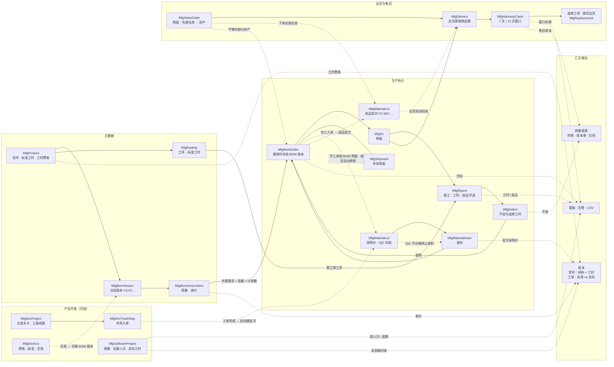
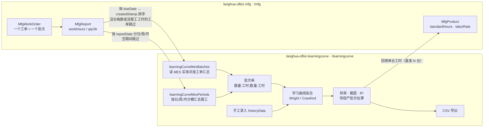

# OFBiz Hardware Assembly (MFG) Component

电子产品硬件组装生产流程管理组件，以 **Apache OFBiz 插件**形式提供。

面向"小批量、多品种、SMT 外协 + 自行组装测试"的模式：**产品/BOM/工艺 → 工单 → 工序报工 → SN 履历 → 不良与返修 → 车间看板**。
支持 OFBiz **24.09 及以上**版本，编译目标 **Java 17**。

> 所有算式集中在后面的 [计算公式一览](#计算公式一览)：齐套欠料与预留、FIFO 推定、保修与售后窗口、售后质量、
> 成本核算、软件报价、学习曲线、库存流水与可发量。页面只负责展示，数字一律由服务算，想改口径改那一节的常量。

## 总体流程

一张图看完数据怎么流（实线 = 主流程，虚线 = 自动联动/横切）：



横向能力（不在图里，避免线条交叉）：

- **附件** `MfgAttachment` 可挂在 产品 / 开发项目 / 工单 / 出货单 / 售后单 上（图片与 PDF 存数据库）；
- **CSV**：BOM、物料批次、测试结果可导入；看板 / 告警 / 欠料可导出；
- **跨组件**：学习曲线组件读本组件的 `MfgWorkOrder` + `MfgReport`，见[与学习曲线组件的关系](#与学习曲线组件的关系)。

## 功能

| 模块 | 内容 |
| --- | --- |
| 产品型号 | 型号、SN 前缀、单台标准工时、**开发阶段**（概念/设计/打样/试产/量产） |
| **附件（通用）** | 任意业务单据挂文件：产品照片、开发项目资料、工单照片、出货签收单、售后凭证；JPG/PNG/GIF（≤ 4 MB）与 PDF（≤ 8 MB），存数据库不丢；图片显示 200px 缩略图，点开看原图，可删除 |
| BOM | CSV 批量导入元件行：`料号,名称,用量,位号,是否关键件,单价`（单价可空） |
| **BOM 版本** | 型号可保留多个 BOM 版本（`型号-V1`、`-V2`…），每个版本独立存行；型号指向“当前使用”的版本，启用新版本时旧版本自动废止；工单创建时冻结所用版本 |
| **产品开发** | 开发项目立项（可选线路：**PCB / 固件 / 外壳**，带料号；目标成本/售价/计划上市日），五道阶段关卡（概念→设计→打样→试产→量产），评审通过自动进入下一阶段 |
| **三条开发线** | 每个项目按线路带自己的步骤清单，逐步打勾，每步可记负责人、供应商、金额、数量、单号与备注；外壳线「外壳入库」完成时自动生成物料批次 |
| **步骤问题清单** | 每一步（或整个项目）可以登记问题：标题、说明、严重度（轻微/一般/严重）、负责人、发现日、截止日；未处理 / 处理中 / 已关闭三态，一键关闭时记处理结果与关闭日；项目列表与步骤表直接显示未结数量 |
| **设计变更 ECO** | 变更单（BOM/工艺/设计/物料替代）走 草稿 → 批准 → 生效；生效时自动切换到指定 BOM 版本 |
| 工艺路线 | 工序模板（组装 / 老化 / 测试 / 包装…），含工位与标准工时 |
| 工单 | 型号 + 计划数量 + 交期 + 客户 + 外协 SMT 厂，编号 `WO-yyMMdd-NNN` |
| SN 管理 | 按工单批量生成 `前缀-yyMMdd-NNNN`，单板全生命周期状态 |
| 工序报工 | 按工单/工序列报工时与合格/不良数量，支持绑定到具体 SN |
| 不良记录 | 不良代码、责任归属（自制/外协/来料）、返修工时 |
| SN 履历 | 一块板：报工记录 + 不良记录 + 所用物料批次 |
| **看板** | 在制工单数/数量、今日工时、今日良率；**告警区（欠料 / 售后窗口到期）**、**售后 KPI（出货台数、售后单、发生率、未结、成本）** + 每日出货/售后柱图 + 责任方成本横条，60 秒自动刷新；**看板 / 告警 / 欠料都能一键导出 CSV** |
| **物料批次** | 采购到货台账：内部批次 `LOT-yyMMdd-NN`、供应商批号/DateCode、到货数量；支持 CSV 批量导入 |
| **来料检验（IQC）** | 批次可标待检 / 合格 / 让步接收 / 不合格并记录不良数与检验人；**不合格批次不能发料**，待检与让步接收仍可用 |
| **发料** | 按工单发料（料号 + 批次 + 数量 + 位号），形成“SN → 工单 → 批次”链路；**发料不得超过该批次可用库存** |
| **库存结存** | 按料号汇总在库 / 可发 / 待检 / 不合格 / 批次 / 金额，带安全库存与建议采购；低于安全库存标红并进看板告警 |
| **出入库流水** | 一条一篇、只增不改：到货入库 / 发料 / 退料 / 报废 / 盘盈亏 / 调整，带**批次结存余额**与工单/单据、操作人；可按料号/批次/类型/日期过滤，可手工补登 |
| **盘点** | 逐批填实盘数，系统算盘盈亏并写成一条流水（不直接改数），盘点单号 `CNT-yyMMdd-NN`，历史可查 |
| **工单预留** | 开工单时按 BOM **自动把齐套料预留出来**（先到先得的批次顺序），其他工单就发不走这批料；发料时自动释放自己预留的那部分，也能一键释放；齐套表多了「已预留」列，欠料按「需求 − 已发 − 已预留」算 |
| **成品库存** | 工单页一键**完工入库**：按已报工的良品数建成品批次 `FG-<工单号>`，单位成本 = 该工单实际成本 ÷ 良品数，重复点只补差额；结存页多一块「成品库存」（按型号看在库 / 已预留 / 可发 / 累计出货 / 金额），出货自动扣、报废与盘点也走同一套流水 |
| **库位与移库** | 库位主档（仓 / 区 / 架，编码就是贴在货架上的号）；到货可指定库位，流水带库位；**移库写一对流水**（出 + 入，单号 `TR-yyMMdd-NN`），批次总量不变；按「批次 × 库位」看结存，来源库位不够会被拒；老批次的货在「未分配库位」里，可一键归位 |
| **销售订单** | 下单（客户 + 多行型号/数量/交期）→ **先把库里已有的成品锁给这张单**（不足的部分记欠货）→ 一键**排产**：只给差的数量开工单（已有工单就加量）→ 工单完工入库后**自动把新成品锁回这张单** → 出货按订单核销并释放预留 → 关单把剩余预留还给库存 |
| **成本核算** | 型号层：BOM 单价 × 用量 + **工时（按工序模板分摊，没有模板时取型号标准工时）** × 工时费率 = 单台成本，可乘批量算总额，并与开发项目的目标成本 / 目标售价对比（超了、亏了分色标出）；工单层：标准成本 vs 实际成本（已发料按批次采购单价 + 报工工时 × 费率 + **外协加工费明细**），逐工序列出标准/实际/差异，差异同时给含外协与不含外协两个口径 |
| **外协费按单分摊** | 工单页按「按台 / 按点 / 整单」逐条记外协费（类型、单价、数量、供应商、对账单、日期），明细合计自动回写工单外协费，并算出**单台分摊**（合计 ÷ 良品数）；有了明细之后整单直填那个输入框就不能再改，避免两套数字打架 |
| **软件项目** | 固件 / 外壳设计 / 上位机 / 平台的开发台账：按功能点口径估规模与工作量（内部/外部接口文件数、功能点耗时率、两个调整因子），算工期、人天、含税报价；同时记实际工时与成本，算出偏差与实测耗时率，为下一个项目做依据 |
| **齐套** | BOM 需求（用量 × 计划数）vs 已发料 + 已预留，自动算出欠料行 |
| **齐套预警** | 按交期列出所有在制工单的欠料明细（欠料行数 / 欠料总量） |
| **外协收发** | 发往 SMT 的套数、回厂板数与不良数、快递单号 |
| **批次追溯** | 反向：批次 → 工单 → SN 数量，用于供应商报批后的召回范围 |
| **FIFO 推定** | 同工单用了多批次时，按发料先后推定各批次覆盖的 SN 区间（仅估算，界面有标注） |
| **返修换件** | 单板级精确记录：SN + 位号/料号 + 原批次 → 新批次 + 原因 + 工时 |
| **出货单** | 出货到客户（可手填 SN 或按工单+数量自动取），出货日即保修起算；**只能发已完工入库的 SN，并自动从成品批次扣减**——没完工的货发不出去 |
| **测试数据** | 测试台 CSV 导入（SN,工位,测试项,测量值,单位,判定），工单自动算一次通过率 |
| **外协厂家** | 厂家档案：收件人、手机号、收货地址、**厂家给我们的客户编号**，一键生成可直接复制的邮寄标签 |
| **售后单** | 客户退回登记：SN → 出货日自动算保修到期与保内/保外，责任归属、返修工时、处理状态，SN 页同步显示售后历史 |
| **淘宝售后合规** | 售后类型（退货退款/换货/维修/仅退款）、淘宝订单号、买家签收日；**7 天无理由（168 小时）与 15 天售后窗口自动计算**，列表标出即将到期；换货自动出出货单，维修自动开返修工单 |
| **买家名单（风控）** | 内部风险名单：手机号为主键、昵称次之，观察 / 人工复核两级，带原因与证据；售后单登记时自动继承风险等级并在页面警示；名单只提示、**不拒绝任何法定售后** |
| **报表（良率 / 工时趋势）** | 按报工汇总，日 / 周 / 月三种口径：良品、不良、良率、工时、单台工时、工单数；给出区间总计与“最差期间”，并可导出两份 CSV（良率趋势 / 工时趋势），**还能一键「喂进学习曲线」**（带上当前区间与汇总口径）——报表里的单台工时直接就变成曲线上的点 |
## 目录结构

```
langhua-ofbiz-mfg/
├── ofbiz-component.xml                  # 组件描述符
├── build.gradle                         # 无第三方依赖（仅用于纳入 Gradle 构建）
├── config/
│   └── MfgUiLabels.xml                  # 状态多语言标签
├── data/
│   └── MfgSecurityPermissionSeedData.xml # 权限与权限组种子数据
├── entitydef/
│   ├── entitymodel.xml                  # 25 个业务实体
│   └── entitygroup.xml
├── servicedef/
│   └── services.xml                     # 65 个服务
├── widget/
│   ├── MfgCommonScreens.xml             # 登录/错误页 decorator + 页面布局装饰器 mfg-decorator
│   └── MfgScreens.xml                   # 14 个页面（内容包在 mfg-decorator 里）
├── webapp/mfg/                          # controller.xml + web.xml + 16 个 FTL + decorator.ftl + attachmentBlock.ftl + css/ + js/
├── src/main/java/org/langhua/ofbiz/mfg/
└── src/test/java/org/langhua/ofbiz/mfg/
```

## 部署

组件源码由 OFBiz 的 Gradle 构建编译，必须放在 **`plugins/`** 目录下：

```bash
cp -r langhua-ofbiz-mfg $OFBIZ_HOME/plugins/mfg
cd $OFBIZ_HOME && ./gradlew jar
cd $OFBIZ_HOME && ./gradlew ofbiz
```

启动后访问（需登录，OFBiz 管理员即可）：

```
https://localhost:8443/mfg/control/main
```

首次启动会根据 `entitydef/entitymodel.xml` 自动建表（Derby 下为 `MFG_PRODUCT`、`MFG_BOM_ITEM`、`MFG_ROUTING`、
`MFG_WORK_ORDER`、`MFG_SN`、`MFG_REPORT`、`MFG_DEFECT`、`MFG_MATERIAL_LOT`、`MFG_MATERIAL_ISSUE`、`MFG_SHIPMENT`、`MFG_REPLACEMENT`、`MFG_DELIVERY`、`MFG_DELIVERY_SN`、`MFG_TEST_RESULT`、`MFG_VENDOR`、`MFG_WARRANTY_CLAIM`、`MFG_ATTACHMENT`）。
工单表会自动新增 `SMT_VENDOR_ID` 列（指向 `MfgVendor`），产品表会自动新增 `WARRANTY_MONTHS`（保修月数，空则按 12），
售后单表会自动新增淘宝侧列（`CLAIM_TYPE`、`TRADE_NO`、`BUYER_NICK`、`SIGNED_DATE`、`SEVEN_DAY_DEADLINE`、
`AFTER_SALE_DEADLINE`、`REFUND_AMOUNT`、`DEDUCT_AMOUNT`、`FREIGHT_PAYER`、`RETURN_TRACKING_NO`、
`RECEIVED_BACK_DATE`、`INSPECT_RESULT`、`VENDOR_CLAIM_STATUS`、`REPAIR_WORK_ORDER_ID`、`EXCHANGE_DELIVERY_ID`、`BUYER_RISK_LEVEL`）。

### 开发 / 生产 / 测试三套并存（同一台机器）

开发时改代码、测试时跑脚本都会往库里写测试数据，所以生产另起一套，互不干扰；
另外还有一套**只用 HTTP 的测试实例**，给浏览器自动化用——自签证书下 Playwright / 内置浏览器
打不开 https 页面，去掉 TLS 就什么都能点、能截图：

| | 开发（dev） | 生产（prod） | 测试（test） |
| --- | --- | --- | --- |
| 安装目录 | `F:\build-ofbiz\apache-ofbiz-24.09.07` | `F:\build-ofbiz\ofbiz-prod` | `F:\build-ofbiz\ofbiz-test` |
| 访问 | `https://localhost:8443/mfg` | `https://localhost:8453/mfg` | `http://localhost:8095/mfg`（只有 http） |
| 端口 | https 8443 / http 8080 / ajp 8009 / naming 1099 / admin 10523 | https 8453 / http 8090 / ajp 8109 / naming 1199 / admin 10623 | http 8095 / https 8444（不用）/ ajp 8139 / admin 10723 |
| 数据库 | 自己 `runtime/data/derby`（测试数据，可随时清空重来） | 自己 `runtime/data/derby`（真实数据，`loadAll` 建库） | 从开发实例复制的一份（可以随便造数据） |
| 启停脚本（`…\Temp\jup`） | `deploy-mfg.bat` / `deploy-lc.bat` / `stop-ofbiz.bat` | `deploy-prod.bat` / `start-prod.bat` / `stop-prod.bat` | `deploy-test.bat` / `start-test.bat` / `stop-test.bat` |

做多份安装的原因：OFBiz 用**内嵌 Derby**（库文件被进程独占，两个进程不能共用一个库），端口又写死在
`framework/base/ofbiz-component.xml`（naming 1099）和 `framework/catalina/ofbiz-component.xml`（http / https / ajp）里；
复制一份改端口最省事。每套各占约 1 GB 左右内存。

**测试实例要改的不只是端口**：`controller.xml` 里 `<security https="true"/>` 的请求会被
`RequestHandler` 302 到 https（那个端口取自 `WebSite.httpsPort`，看着像「莫名回到 8443」）。
仓库里保持 `https="true"` 不变，只改**部署副本**——`deploy-test.bat` 每次 robocopy 之后重跑
`relax-test-https.ps1`（37 个 controller、约 3900 个 request-map，含
`framework/common/webcommon/WEB-INF/common-controller.xml` 里的 `logout`），
并把测试实例的 `framework/webapp/config/url.properties` 改成 `no.http=N` + `port.http=8095`。
`make-test-instance.ps1` 是从开发实例复制出测试实例的一次性脚本。

**容易漏的一个端口：管理套接字**（`org.apache.ofbiz.base.container.AdminServerContainer`，默认 `127.0.0.1:10523`）。
它不在上面两个文件里，而是读系统属性 `ofbiz.admin.port`；多套同时跑时必须各给一个，
否则后启动的那个到 `admin-container` 就报 `Couldn't create server socket(/127.0.0.1:10523)` 并退出。
`start-prod.bat` 用 `-Dofbiz.admin.port=10623`、`start-test.bat` 用 `10723` 处理。

`stop-ofbiz.bat` 只停**开发**实例（按命令行里的 `apache-ofbiz-24.09.07` 匹配），`stop-prod.bat` 停生产
（匹配 `ofbiz-prod`），`stop-test.bat` 停测试（匹配 `ofbiz-test`）——之前 `stop-ofbiz.bat` 会把多套一起杀掉，踩过一次。

上线节奏：分支上改 → `deploy-mfg.bat` / `deploy-lc.bat` 到 **dev** → 跑单元测试、集成测试与巡检 →
需要点按钮验证时再 `deploy-test.bat`，用 `http://localhost:8095/mfg` 在浏览器里点 →
确认后再 `deploy-prod.bat` 到 **prod**。**别在生产实例上跑 `mfg-it.bat` / `verify-*.ps1`**（它们会写测试数据）。

生产实例首次登录 `admin` / `ofbiz`（`loadAll` 建的），**登录后被强制改密码**（见下一节）。

> 空库第一次录真实数据（型号 / BOM / 到货批次的顺序、CSV 模板、常见坑）看
> [`docs/首次使用-主数据录入.md`](docs/首次使用-主数据录入.md)。

### 首次登录强制修改密码

`admin` 还是出厂密码 `ofbiz` 时，`/mfg` 与 `/learningcurve` **都不渲染页面内容**，只显示一张
「请先修改默认密码」的表单（当前密码 / 新密码 / 确认新密码 / 密码提示，新密码至少 5 位）：

- **改密码的规则**：≥ 5 个字符、两次输入一致、**不能和当前密码相同**（OFBiz 自带的
  `updatePassword` 对管理员会跳过「新旧不同」这条，所以 `mfgChangePassword` 自己先查一遍）；
- **改成功后自动退出登录**（`changePasswordSave` → `logout`），请用新密码重新登录；
- 导航条最后一项是 **「退出登录」**（`/mfg/control/logout`，两个 webapp 都有），门禁页上也有；

- 门禁做在装饰器上：`widget/MfgCommonScreens.xml` 的 `mfg-decorator` 调 `mfgPasswordStatus`（`result-map="pwdStatus"`），
  `decorator.ftl` 里 `mustChange` 为真时只输出表单，导航和 `sections.render("body")` 都跳过；
  学习曲线组件在 `lc-decorator` 里调**同一个服务**（`ignore-error="true"`，MES 没部署时不影响它自己的页面）；
- 服务 `mfgPasswordStatus` 用 `isDefaultPassword()` 判断当前登录用户的 `currentPassword` 是否等于出厂值
  （按 `security` 组的 `password.encrypt` 决定是否走 `LoginServices.checkPassword` 比对），返回 `mustChange=Y/N`；
  `mfgChangePassword` 先核对当前密码，再转调 OFBiz 自带的 `updatePassword`（不自己写库）；
- 表单 POST 到 `/mfg/control/changePasswordSave` 或 `/learningcurve/control/changePasswordSave`，两边都落到
  `mfgChangePassword`，成功后 302 回首页，页面就正常了；
- **开关是系统属性 `org.langhua.mfg.requirePasswordChange`，只有等于 `Y` 才启用**（默认关闭）。
  `start-prod.bat` 里 `set JAVA_TOOL_OPTIONS=… -Dorg.langhua.mfg.requirePasswordChange=Y`；
  开发实例的 `ofbiz-server.bat` 显式设成 `N`——巡检脚本与集成测试都用 `admin` / `ofbiz` 登录，
  开着门禁会整片变红。要临时进门禁页调试用 `start-dev-gate.bat`（同一个属性设成 `Y`）；
- 忘了新密码：停实例 → `gradle loadAdminUserLogin -PuserLoginId=admin` 把 `admin` 重置回 `ofbiz` → 重启，
  门禁页又会出来；
- 不想走门禁也能改密码：OFBiz 自带的 `/partymgr/control/ProfileEditUserLogin`（需要 `PARTY_ADMIN` 权限）。

> 门禁只管「当前登录用户仍是出厂密码」这一种情况；换成别的弱密码它不管，安全边界靠运维自己把握（小厂内网使用）。

### 用户账号（加人 / 停人 / 重置密码）

`/mfg/control/users`（导航最后一项「用户账号」）是给老板/管理员用的账号页，不用去 OFBiz 原生的 Party Manager：

| 做什么 | 怎么用 |
| --- | --- |
| 加一个账号 | 填账号（小写字母/数字/点/下划线/短横线，≤ 20 位）+ 姓名 + 安全组 + 初始密码（留空 = `ofbiz`）→ 保存 |
| 改姓名 / 换组 | 账号填已有账号再保存（账号名不区分大小写，`Zhang` 和 `zhang` 是同一个）；一个账号只属于一个组，换组会把旧组设为过期 |
| 停用 / 启用 | 行尾的「停用 / 启用」按钮；被停用的账号登录会被 OFBiz 拒绝 |
| 重置密码 | 行尾「重置密码」→ 密码回到 `ofbiz`，该账号下次登录会被门禁要求改新密码 |

- 建账号走 OFBiz 的 `createPersonAndUserLogin`（建 `Person` + `UserLogin`，密码按 `security` 的
  `password.encrypt` 规则哈希，不自己写库），再写一行 `UserLoginSecurityGroup`；
- **谁能管账号**沿用 OFBiz 自己的规矩：有 `PARTYMGR_UPDATE` 或 `PARTYMGR_ADMIN` 的人（`admin` 在两套库里都有）。
  没这个权限的人打开页面只能看清单，服务里也会拒绝写入；
- **防锁死**：不能停用自己、不能改自己的安全组；
- **连续输错密码会被 OFBiz 锁住**：`security.properties` 的 `max.failed.logins`（默认 3）次错密码后账号被禁用，
  `login.disable.minutes`（默认 30）分钟后自动恢复；等不了就由另一个管理员在账号页点一次「启用」——
  **启用同时会把失败次数清零**，不用改密码；
- 安全组下拉只列**能进本组件**的组（有 `OFBTOOLS_VIEW`、`MFG_VIEW`/`MFG_ADMIN`、`LEARNINGCURVE_VIEW`/`LEARNINGCURVE_ADMIN`
  之一的组），默认 `SUPER`——全新库里只有 `SUPER` 有这些权限，所以新账号也放进 `SUPER`；
- 还没有细粒度角色控制：登录进来的账号在插件里能做所有事（服务只校验 `auth`，没有按 `MFG_VIEW`/`MFG_ADMIN` 拦）。
  需要「仓管不能看成本」这类分工，要先给服务加权限点；
- 安全组本身（及其权限）仍要在 OFBiz 里维护：`/webtools` 的 Entity/Service 工具，或者
  `/partymgr/control/ProfileEditUserLoginSecurityGroups`。

### 角色与权限

页面上只出现**与本系统有关**的账号：安全组带 `MFG_*` / `LEARNINGCURVE_*` 权限的，
或者能管账号的管理员组（`PARTYMGR_ADMIN`）。电商、财务等其它应用的账号、
以及框架自己用的系统账号（`isSystem=Y`，如 `system`）都不显示。`admin` 这类系统管理员始终显示。

#### 权限点

| 权限 | 管什么 |
| --- | --- |
| `MFG_VIEW` | 进入本组件的页面、看数据（各角色组都有） |
| `MFG_PRODUCTION` | 建工单、报工、生成 SN、登记不良、外协收发/换件、齐套预留与释放、完工入库、外协费 |
| `MFG_STOCK` | 收货批次、来料检验、发料、库存流水、盘点、库位与移库、料号安全库存 |
| `MFG_ENG` | 型号、BOM（含导入/版本）、工序、开发项目与步骤、问题清单、变更单、软件项目 |
| `MFG_SALES` | 销售订单、出货单、售后单、买家名单 |
| `MFG_COST` | 成本、单价、毛利、售后成本率、看板的责任方成本 |
| `MFG_ADMIN` | 以上全部（写服务里的兜底） |

#### 角色组（`data/MfgSecurityPermissionSeedData.xml`）

| 组 | 给谁 | 权限 |
| --- | --- | --- |
| `MFG_BOSS` | 老板 / 全能 | 全部 + `MFG_COST` |
| `MFG_FOREMAN` | 车间主管 | `MFG_VIEW` + `MFG_PRODUCTION` |
| `MFG_WAREHOUSE` | 仓管 | `MFG_VIEW` + `MFG_STOCK` |
| `MFG_ENGINEER` | 工程 / BOM | `MFG_VIEW` + `MFG_ENG` |
| `MFG_SALES` | 销售 / 售后 | `MFG_VIEW` + `MFG_SALES` + `MFG_STOCK`（要能出货） |
| `SUPER` | 系统管理员 | 全部（`loadAll` 建的新库里 `admin` 在 `SUPER`；演示库/老库里 `admin` 通常在 `FULLADMIN`，同样能过所有检查） |

各组同时拿到 `OFBTOOLS_VIEW`，否则进不了 webapp。**学习曲线的页面还要 `LEARNINGCURVE_VIEW`**；
这行权限不写进本组件的种子文件（没装学习曲线组件时外键会失败），需要时在 `/webtools`
给对应组补一条 `SecurityGroupPermission`。

#### 实际拦在哪儿

- **写操作**：每个改数据/发料的写服务开头都查区域权限，没有就返回
  「没有权限做这个操作（需要 MFG_xxx）；请管理员在「用户账号」里调整你的角色」，页面上的红框就是它；
- **成本**：`mfgProductCost` / `mfgWorkOrderCost` 没有 `MFG_COST` 时返回 `denied=Y`（不报错），
  型号页/工单页把成本块、BOM 单价列、外协费金额整块换成一句提示；看板的责任方成本、
  售后成本卡片同样隐藏；质量指标页整页要 `MFG_COST`；
- **导航**：装饰器调 `mfgPermissions` 拿到当前账号的区域开关，没有的区域不显示菜单项；
- **读**：列表/详情不按区域拦（同一个人能看，只是改不了），靠「能进系统」这一层就够——账号只能由管理员从
  「用户账号」页建，可选的安全组也只有上面这些。

> 只有 `SUPER` / `MFG_ADMIN` / OFBiz 管理员（`PARTYMGR_UPDATE`）能过所有检查。判断写在
> `MfgServices.can()` 里，所以演示库（`admin` 在 `FULLADMIN`）和全新库（`admin` 在 `SUPER`）行为一致。


## 数据模型

| 实体 | 说明 |
| --- | --- |
| `MfgProduct` | 产品型号：`productCode`（主键）、`snPrefix`（**≤ 10 字符**，空时取型号编码）、`standardHours`、`standardHoursSource`（`MANUAL` / `LEARNING_CURVE`）、`standardHoursBaseQty`、`standardHoursEstimateRef`、`laborRate`（工时费率，成本核算用）、`warrantyMonths`（保修月数，默认 12）、`devStageId`（开发阶段）、`currentBomVersionId`（当前 BOM 版本）、状态 |
| `MfgBomItem` | 旧版单表 BOM 行（`productCode` + `lineSeq`）。**已停用**，首次读取时自动冻结为 `型号-V1` 版本，新代码只用版���表 |
| `MfgBomVersion` | BOM 版本：`bomVersionId`（主键，`型号-Vn`，**长型号编码会被截短到 20 个字符**）、`versionNo`、`statusId`（DRAFT/RELEASED/OBSOLETE）、`effectiveDate`、`basisVersionId`（从哪版复制）、`ecoId`（哪张变更单引入） |
| `MfgBomVersionItem` | 版本内 BOM 行：`bomVersionId` + `lineSeq`（联合主键）、`componentCode`、`qty`、`designators`、`isKeyPart`、`unitPrice`（单价，成本核算用，可空） |
| `MfgAttachment` | 通用附件：`ownerTypeId` + `ownerId` + `seq`（联合主键）、`fileName`、`contentType`、`fileSize`、`fileData`（`byte-array` → BLOB）、`note`；`ownerTypeId` 取值 `MFG_ATT_PRODUCT` / `MFG_ATT_DEV_PROJECT` / `MFG_ATT_WORK_ORDER` / `MFG_ATT_DELIVERY` / `MFG_ATT_CLAIM`，序号从 1 递增 |
| `MfgProductImage` | 旧版产品照片（`productCode` + `seq`）。**已停用**，首次读取产品时自动复制进 `MfgAttachment` |
| `MfgRouting` | 工序模板：`productCode` + `opSeq`（联合主键）、`opName`、`workCenter`、`stdHours` |
| `MfgWorkOrder` | 工单：`workOrderId`、`productCode`、`plannedQty`、`statusId`、`dueDate`、`customerName`、`smtVendor`、`bomVersionId`（建单时冻结的 BOM 版本）、`outsourceAmount`（外协加工费，整单，计入实际成本）、`completeDate`（完工入库日） |
| `MfgSn` | 单板：`sn`（主键）、`workOrderId`、`productCode`、状态 |
| `MfgReport` | 报工：`reportId`、`workOrderId`、`opSeq`、`sn`（可选）、`operatorName`、`workHours`、`qtyOk`、`qtyNg` || `MfgDefect` | 不良：`defectId`、`workOrderId`、`sn`、`opSeq`、`defectCode`、`qty`、`responsibility`、`repairHours` |
| `MfgMaterialLot` | 物料批次（元件与成品共用一张表）：`lotId`（元件 `LOT-yyMMdd-NN` / 成品 `FG-WO-…`）、**`lotKindId`**（`MFG_LOT_COMPONENT` / `MFG_LOT_PRODUCT`，空值当元件）、`workOrderId`（成品批次来自哪张工单）、`componentCode`（成品批次里就是型号）、`supplierName`、`supplierLot`（DateCode）、`receivedQty`（到货量）、**`onHandQty` / `reservedQty` / `availableQty`（都由流水求和得出）**、`receivedDate`、`unitPrice`（采购单价，成品则是单位成本）、**`receivedAmount`（这一批的实付总额；单价由它 ÷ 数量 算，便宜料 0.0291 不会被 2 位小数舍成 0.03）**；来料检验：`inspectStatusId`（MFG_IQC_PENDING/PASS/CONCESSION/FAIL）、`rejectedQty`、`inspectDate`、`inspector`、`inspectNote` |
| `MfgMaterialIssue` | 发料：`issueId`、`workOrderId`、`componentCode`、`lotId`、`qty`、`directionId`（发料 / 退料）、`issuedDate`、可选 `designators` / `snFrom` / `snTo` |
| `MfgInventoryDetail` | **库存流水（只增不改）**：`lotId` + `seqId` 主键、`movementTypeId`（RECEIPT/ISSUE/RETURN/SCRAP/COUNT/ADJUST/**TRANSFER**/**RESERVE/RELEASE**）、`quantityDiff`（带符号）、`reservedDiff`（预留增减，不动在库）、`salesOrderId` + `salesOrderItemSeq`（订单预留归属哪一行）、`locationId`（发生在哪个库位）、`unitCost`、`workOrderId`、`physicalInventoryId`、`referenceNo`、`operatorName`、`effectiveDate` |
| `MfgStockLocation` | 库位：`locationId`（贴在货架上的编码）、`locationName`、`locationTypeId`（MFG_LOC_WAREHOUSE / ZONE / BIN）、`parentLocationId`、`note` |
| `MfgPurchaseReceipt` | 采购到货单（一次淘宝订单/一张送货单）：`receiptId`（PR-yyMMdd-NN）、`supplierName`、`supplierOrderNo`（店铺订单号）、`receiptDate`、`freightAmount`（整单运费，**记期间费用**）、`allocationId`（MFG_ALLOC_NONE，预留 BY_AMOUNT / BY_QTY）、`note` |
| `MfgPurchaseReceiptLine` | 到货单行：`receiptId` + `lineSeq`、`lotId`（一个批次只能挂在一张单上）、`componentCode`、`qty`、`unitPrice`、`goodsAmount` |
| `MfgOutsourceFee` | 外协费明细：`workOrderId` + `seqId` 主键、`feeTypeId`（SMT/模具/外发组装/外协测试/其他）、`basisId`（按台/按点/整单）、`rate`、`qty`、`amount`、`vendorName`、`referenceNo`、`feeDate`、`note` |
| `MfgStockSetting` | 料号主档与安全库存：`componentCode` 主键、`componentName`、`unitOfMeasure`、`minimumStock`、`reorderQty`、`supplierName` |
| `MfgStockCount` | 盘点记录：`physicalInventoryId`（CNT-yyMMdd-NN）、`countDate`、`counterName`、`lotId`、`bookQty`、`countedQty`、`varianceQty` |
| `MfgSalesOrder` | 销售订单：`salesOrderId`（SO-yyMMdd-NN）、`customerName`、`customerPo`、`orderDate`、`dueDate`、`statusId`（MFG_SO_OPEN / PLANNED / SHIPPED / CLOSED / CANCELLED） |
| `MfgSalesOrderItem` | 订单行：`salesOrderId` + `lineSeq` 主键、`productCode`、`qty`、`shippedQty`、`workOrderId`（排产生的工单）、`lineDueDate` |
| `MfgShipment` | 外协收发：`shipmentId`、`workOrderId`、`directionId`（`MFG_SHIP_OUT` / `MFG_SHIP_IN`）、`qty`、`defectQty`、`carrier`、`trackingNo` |
| `MfgReplacement` | 返修换件：`replacementId`、`sn`、`componentCode`、`oldLotId` → `newLotId`、`qty`、`reason`、`hours` |
| `MfgDelivery` | 出货单：`deliveryId`（DO-yyMMdd-NN）、`customerName`、`customerPo`、`deliveryDate`、`carrier`、`trackingNo`、`workOrderId` |
| `MfgDeliverySn` | 出货明细：`deliveryId` + `sn`（联合主键），一个 SN 只能出一次货 |
| `MfgTestResult` | 测试结果：`resultId`、`sn`、`workOrderId`、`station`、`testItem`、`measureValue`、`unitOfMeasure`、`passFail`、`testDate` |
| `MfgVendor` | 外协厂家：`vendorId`（V-yyMMdd-NN）、`vendorName`、`vendorType`、`contactName`（收件人）、`contactMobile`、`addressText`、`customerCode`（厂家给我们的编号） |
| `MfgWarrantyClaim` | 售后单：`claimId`（RMA-yyMMdd-NN）、`sn`、`workOrderId`、`customerName`、`deliveryId` / `deliveryDate`（保修起算）、`warrantyEndDate`、`inWarranty`、`receivedDate`、`issueDesc`、`statusId`、`responsibility`、`repairHours`、`closedDate`；淘宝侧：`claimType`（RTN/EXCH/REPAIR/REFUND_ONLY）、`tradeNo`、`buyerNick`、`signedDate`、`sevenDayDeadline`、`afterSaleDeadline`、`refundAmount`、`deductAmount`、`freightPayer`、`returnTrackingNo`、`receivedBackDate`、`inspectResult`、`vendorClaimStatus`、`repairWorkOrderId`、`exchangeDeliveryId` |
| `MfgBuyerFlag` | 买家风险名单：`buyerKey`（`TB:手机号` 或 `TB:N:昵称`）、`channelId`、`buyerNick`、`receiverName`、`receiverMobile`、`addressText`、`riskLevel`（WATCH/BLOCK）、`reasonCode`、`evidenceNote`、`statusId`（ACTIVE/RELEASED）、`releasedDate` |
| `MfgDevProject` | 开发项目：`projectCode`（DEV-yyMMdd-NN）、`projectName`、`productCode`（可空，与型号解耦）、`trackId`（PCB/固件/外壳/空）、`partCode`（板号或外壳料号）、`stageId`（概念/设计/打样/试产/量产）、`statusId`、`ownerName`、`targetCost`、`targetPrice`、`plannedLaunchDate`、`actualLaunchDate` |
| `MfgDevTrackStep` | 线路步骤状态：`projectCode` + `stepId`（联合主键）、`statusId`（TODO/DOING/DONE/SKIPPED）、`plannedDate`、`doneDate`、`ownerName`、`vendorName`、`amount`、`qty`、`referenceNo`（合同号/付款凭证/快递单）、`lotId`（外壳入库生成的批次） |
| `MfgDevStageReview` | 阶段关卡评审：`projectCode` + `stageId`（联合主键）、`plannedDate`、`doneDate`、`resultId`（PASS/CONDITIONAL/FAIL）、`reviewer`、`note` |
| `MfgDevEco` | 设计变更单：`ecoId`（ECO-yyMMdd-NN）、`productCode`、`projectCode`、`ecoTypeId`（BOM/工艺/设计/物料）、`reason`、`changeSummary`、`statusId`（DRAFT/APPROVED/APPLIED/CANCELLED）、`fromBomVersionId` → `toBomVersionId`、`requestedBy`、`approvedBy`、`effectiveDate` |
| `MfgDevStepIssue` | 步骤问题：`issueId`（ISSUE-yyMMdd-NN）、`projectCode`、`stepId`（可为空 = 项目级）、`title`、`detail`、`severityId`（LOW/MEDIUM/HIGH）、`statusId`（OPEN/DOING/CLOSED）、`ownerName`、`foundDate`、`dueDate`、`closedDate`、`resolution` |
| `MfgSoftwareProject` | 软件项目台账：`projectCode`（SW-yyMMdd-NN）、`categoryId`（固件/外壳设计/上位机/平台）、`productCode`、`devProjectCode`、`statusId`、`deliverySeq`（同类第几次）、规模 `ilfCount`/`eifCount`/`ufp`、估算参数 `swfBase`/`swfReuse`/`swfPreInvest`/`swfQuality`/`rdf`/`pdrHoursPerFp`/`dayRate`/`taxRate`/`dncRate`、`plannedDays`（估算冻结）、`plannedStartDate`/`plannedEndDate`、实际 `actualHours`/`actualCost`、`quotedAmount` |

## 服务

| 服务名 | 说明 |
| --- | --- |
| `mfgPasswordStatus` | 当前登录用户是否还得出厂密码（`mustChange=Y`），供装饰器做「首次登录强制改密码」的门禁 |
| `mfgChangePassword` | 改密码：先核对 `currentPassword`，再转调 OFBiz 的 `updatePassword` |
| `mfgUserList` | 账号清单：姓名（来自 `Person`）、安全组、启用状态、是否出厂密码、能否管理账号（`canManage`）；可选的组只列能进本组件的（有 `OFBTOOLS_VIEW` 或 `MFG_*` / `LEARNINGCURVE_*` 权限） |
| `mfgUserSave` | 建账号（`createPersonAndUserLogin` 建人与登录，再写安全组）或改姓名/组/状态；不改密码 |
| `mfgUserResetPassword` | 把账号密码重置回 `ofbiz`（走 OFBiz 的 `updatePassword`），下次登录被门禁拦住要求改 |
| `mfgPermissions` | 当前账号能进哪些区域（`canView` / `canProduce` / `canStock` / `canEng` / `canSales` / `canCost` / `isAdmin` / `manager`），装饰器用它隐藏菜单，页面用它隐藏成本块 |
| `mfgProductSave` / `mfgProductList` / `mfgProductDetail` | 型号维护与查询（含当前 BOM 版本的行、工艺路线、版本数）；工时改了就把 `standardHoursSource` 退回 `MANUAL`；`snPrefix` 超 10 字符直接报错（不填时默认取型号编码） |
| `mfgBomImport` | 从 CSV 导入 BOM 到指定版本（缺省为当前版本），`replace=N` 时追加而不清空；第 6 列单价可空；**型号还没有版本时，导入的这个版本直接成为当前版本**；`format` 可指定 `MFG` / `FRITZING`，留空自动识别（见下一节） |
| `mfgBomItemSave` | 改一行 BOM：不给 `lineSeq` 新增（行号取下一个可用值，型号没版本时自动建一个），给 `lineSeq` 修改，`delete=Y` 删除；可改用量/位号/关键料/单价，用量必须 > 0，单价留空即清掉 |
| `mfgBomVersionCreate` / `mfgBomVersionActivate` / `mfgBomVersionList` | 新建下一版（可复制当前行）、启用某版（旧版转废止、型号指向新版）、列出各版本 |
| `mfgBomMigrateLegacy` | 把旧单表 BOM 冻结为版本（幂等，可重复调用） |
| `mfgAttachmentSave` / `mfgAttachmentList` / `mfgAttachmentDelete` | 任意单据的附件：存（base64，供脚本与测试用）、列表（不返回字节）、删除；页面上传走下面的 multipart 事件 |
| `mfgRoutingSave` | 新增/更新一道工序 |
| `mfgWorkOrderCreate` / `mfgWorkOrderList` / `mfgWorkOrderDetail` | 工单维护；详情含工序进度、SN、不良、累计工时 |
| `mfgSnRegister` / `mfgSnDetail` | 批量生成 SN；按 SN 查完整履历 |
| `mfgReportCreate` | 报工（工时 + 合格/不良数，可绑定 SN） |
| `mfgDefectCreate` | 登记不良与返修工时 |
| `mfgDashboard` | 看板数据 |
| `mfgLotSave` / `mfgLotList` | 物料批次台账（到货、已发、剩余）；新建批次默认 MFG_IQC_PENDING |
| `mfgLotInspect` | 记录来料检验结果（待检/合格/让步接收/不合格 + 不良数 + 检验人） |
| `mfgIssueSave` | 向工单发料（校验批次属于该料号、来料检验未失败、**不超过该批次可用量**），同时记一笔库存流水 |
| `mfgWorkOrderMaterials` | 齐套（BOM 需求 vs 已发 + 已预留）、发料清单、外协收发汇总、预留数量与还差多少 |
| `mfgShipmentSave` | 记录发往 SMT（`MFG_SHIP_OUT`）与回厂收货（`MFG_SHIP_IN`） |
| `mfgTraceByLot` | 反向追溯：批次 → 工单 → SN 数（召回范围），并给出 FIFO 推定 SN 区间 |
| `mfgLotImportCsv` | 从 CSV 批量导入到货批次 |
| `mfgShortageList` | 在制工单的欠料清单（按交期排序） |
| `mfgReplacementSave` | 登记单板级换件（原批次 → 新批次） |
| `mfgDeliverySave` / `mfgDeliveryList` / `mfgDeliveryDetail` | 出货单（SN 绑定、防重复出货、保修起算）；**只发完工入库的 SN**，每台从成品批次 `FG-<工单号>` 扣一笔 ISSUE 流水，库存不够则拒 |
| `mfgTestImportCsv` / `mfgTestResultList` | 测试结果 CSV 导入与查询 |
| `mfgVendorSave` / `mfgVendorList` | 外协厂家档案（含邮寄标签） |
| `mfgWorkOrderVendor` | 给工单指定外协厂家（收货信息随之显示在工单页） |
| `mfgClaimCreate` | 登记售后单：按 SN 找出货单与产品保修月数，自动算 `warrantyEndDate` 与保内/保外；再按买家签收日算 7 天（168 小时）与 15 天窗口 |
| `mfgClaimUpdate` | 处理售后单：状态、类型、检测结论、退款/扣款、运费承担、退回单号与回库日、索赔状态、返修工时；修正签收日会重算两个窗口 |
| `mfgClaimList` / `mfgClaimDetail` | 售后单列表（按 SN / 类型 / 状态过滤，带剩余小时与即将到期计数）与详情（含换货出货单、换出新机、返修工单、换件与不良数） |
| `mfgClaimExchange` | 换货：自动取同型号未出货的一台（或指定 `newSn`），生成出货单并置为已出货，售后单转 `MFG_RMA_REPLACED` |
| `mfgClaimRepair` | 维修：为退回的单板开一张返修工单，返工工时与换件照常记录 |
| `mfgBuyerFlagSave` / `mfgBuyerFlagList` | 买家风险名单维护与列表（手机号打码显示，可解除/恢复） |
| `mfgBuyerFlagCheck` | 发货前按手机号（自动去格式）或昵称查名单，返回命中项与最高风险等级 |
| `mfgBuyerRiskList` | 按买家昵称聚合售后历史（单数、退款合计、最后收件日）并给出建议等级，仅建议不自动拉黑 |
| `mfgQualityReport` | 售后质量报表：退货/换货/返修/成本率 + 金额 + 按型号、责任方、批次、失效天数、检测结论分解 + 红线判定 |
| `mfgDashboardTrends` | 看板数据：近 N 天每日出货/售后序列（已按最大值缩放到百分比）+ 售后 KPI + 责任方成本 |
| `mfgAlerts` | 看板告警：欠料工单（欠料行数、欠料总量、前三个料号）与售后窗口告警（7 天 / 15 天，已过期或 24 小时内到期），按“紧急 → 剩余时间”排序 |
| `mfgTrendReport` | 良率与工时趋势：按日 / 周 / 月汇总报工（良品、不良、良率、工时、单台工时、工单数），给出区间总计与最差期间；未知汇总口径自动换成按月 |
| `mfgInventoryMove` | 登一笔库存流水：到货 / 发料 / 退料 / 报废 / 调整（盘点走单独的盘点服务）；负数超可用量被拒；带工单的发料与退料同时写发料记录，齐套与成本跟着变 |
| `mfgStockSummary` | 按料号汇总在库 / 可发 / 待检 / 不合格 / 批次 / 金额，带上安全库存与建议采购，标出低于阈值的料号；首次访问会给旧批次补建流水（幂等） |
| `mfgInventoryLedger` | 流水查询：按料号 / 批次 / 类型 / 日期过滤，带每笔之后的**批次余额** |
| `mfgStockSettingSave` | 维护料号主档与安全库存（阈值、补货量、供应商） |
| `mfgStockCount` / `mfgStockCountList` | 盘点：记录账面数与实盘数，**差异写成一条盘盈亏流水**并重算结存；历史盘点单可查 |
| `mfgPurchaseReceiptSave` | 存到货单的头：供应商 / 店铺订单号 / 到货日 / **整单运费**（可改）；运费只接受非负数，`allocationId` 现在只允许 `MFG_ALLOC_NONE` |
| `mfgPurchaseReceiptLineSave` | 把一个到货批次挂到单上（数量/单价默认取批次，事后可改；一个批次只能挂一张单）、改行、`delete=Y` 差行；发成品批次会被拒 |
| `mfgPurchaseReceiptList` | 到货单列表（行数 / 货款 / 运费 / 合计）+ 本页的货款合计、运费合计、采购支出合计、运费占货款比例 |
| `mfgPurchaseReceiptDetail` | 一张单的行明细与合计，加上“还没挂在任何单上的元件批次”供下拉选择 |
| `mfgPurchaseFreightTrend` | 采购支出按期间（日 / ISO 周 / 月）汇总：单据数、货款、运费、采购支出、运费占货款；报表页与 `freightCsv` 共用这个服务 |
| `mfgReceiptFromOrder` | 照一张店铺订单（淘宝）一行一个料建单并入库：`料号,名称,数量,实付金额`，后端一次完成**建批次 + 到货流水 + 到货单行**；单价 = 金额 ÷ 数量（0.0291 不会被舍成 0.03）；**同一订单号再来一次只复用单据、跳过已有行** |
| `mfgSettingsView` / `mfgSettingsSave` | 系统设置（存在 `SystemProperty`，资源 `mfg`）：识图接口地址 / 模型名 / 密钥。**密钥只存不回显**，留空表示不修改，`clear=Y` 清除；接口地址必须是 http(s)。只有管理员可用 |
| `mfgWorkOrderReserve` | 按工单 BOM 自动预留齐套料：按批次先后在「可发」里挑，能挑多少挑多少，写 `MFG_MOVE_RESERVE` 流水（不动在库），返回预留总数与还差多少 |
| `mfgWorkOrderRelease` | 释放该工单的全部预留（写反向的 `MFG_MOVE_RELEASE` 流水），已发料的部分不受影响 |
| `mfgWorkOrderComplete` | 完工入库：按已报工的良品数建成品批次 `FG-<工单号>` 并写 `MFG_MOVE_RECEIPT`，单位成本 = 实际成本 ÷ 良品数；工单置 MFG_COMPLETED、SN 置 MFG_COMPLETED；重复调用只补差额 |
| `mfgProductStock` | 成品库存（按型号）：在库 / 已预留 / 可发 / 累计出货 / 金额 / 批次数 / 最新入库日 |
| `mfgSalesOrderSave` | 存销售订单与明细行（`lines` 文本：`型号,数量[,交期]`；行号即顺序），新增或修改后**自动先锁在库** |
| `mfgSalesOrderReserve` | 给订单的未完成行预留成品：按批次先后在可发量里挑，写 `MFG_MOVE_RESERVE`（带订单号与行号） |
| `mfgSalesOrderPlan` | 把还差的数量排产：每个欠货行建一张工单（或给已有工单加量），把工单号回写到行上，订单转 MFG_SO_PLANNED |
| `mfgSalesOrderClose` | 关单并释放该订单全部预留，状态转 MFG_SO_CLOSED |
| `mfgSalesOrderList` / `mfgSalesOrderDetail` | 订单列表（行数 / 数量 / 已预留 / 已出货 / 欠货）与详情（行明细 / 预留流水） |
| `mfgLocationSave` / `mfgLocationList` | 库位主档与库位列表（每个库位的在库量、批次数；未分配库位的存量也报） |
| `mfgLocationStock` | 按「批次 × 库位」看结存（可按库位 / 料号过滤） |
| `mfgStockTransfer` | 移库：校验来源库位余额，写一对 `MFG_MOVE_TRANSFER`（出 -qty / 入 +qty，同一单号），返回移库单号与目标库位余额 |
| `mfgWorkOrderOutsourceSave` | 工单外协费“整单直填”（负数被拒；**已有外协明细时拒绝**，要求改明细，避免两个数字打架） |
| `mfgOutsourceFeeSave` / `mfgOutsourceFeeDelete` | 外协费明细增改删；金额按计价方式自算（按台 × 台数 / 按点 × 点数 / 整单），保存后重算工单外协费合计与单台分摊 |
| `mfgOutsourceFeeList` | 工单的外协费明细、合计、单台分摊（含已报工良品数与计划数） |
| `mfgDevProjectSave` / `mfgDevProjectList` / `mfgDevProjectDetail` | 开发项目立项与查询（列表带阶段、关卡进度、未结变更数） |
| `mfgDevStageSave` | 登记关卡评审；通过/有条件通过时项目自动进入下一阶段，进到量产时填实际上市日并转为已量产 |
| `mfgDevStepSave` | 写入一个线路步骤的详情（状态、计划/完成日、负责人、供应商、金额、数量、单号、备注），空值即清空 |
| `mfgDevStepStatus` | 只改步骤状态（页面上的开始/完成按钮），首次完成时自动填完成日 |
| `mfgDevStepIssueSave` / `mfgDevStepIssueStatus` / `mfgDevStepIssueList` | 步骤问题：登记/修改（编号 `ISSUE-yyMMdd-NN` 自动生成，步骤必须属于当前线路）、只改状态（关闭时写关闭日，重开清空）、按项目列出（未结优先、严重度优先） |
| `mfgDevEcoSave` / `mfgDevEcoList` / `mfgDevEcoDetail` | 变更单登记与查询（详情带来源/目标 BOM 版本与可选版本列表） |
| `mfgDevEcoApprove` / `mfgDevEcoApply` / `mfgDevEcoCancel` | 批准、生效（可切换 BOM 版本）、取消；重复生效与已生效后取消都会被拒绝 |
| `mfgProductCost` | 型号成本：`qty` 台的材料 / 工时 / 合计，加上目标成本差、目标售价与毛利；带逐行金额与缺单价行数 |
| `mfgWorkOrderCost` | 工单成本：标准（BOM 单价 + 工序标准工时 × 费率）vs 实际（已发料按批次单价 + 报工工时 × 费率 + 外协加工费），逐工序列出标准/实际/差异，差异给含外协与不含外协两个口径，并给出被排除的无单价笔数 |
| `mfgSoftwareEstimate` | 软件报价四步：未调整功能点 = 35×内部逻辑文件 + 15×外部接口文件、工作量 = 耗时率×功能点×两个调整因子、工期 = 1.277×(工作量/176)^0.404、金额 = 人天×日费率 + 增值税 + 直接非人力成本；参数都可传，缺省取 2019 案例值 |
| `mfgSoftwareProjectSave` / `mfgSoftwareProjectList` | 软件项目台账维护与查询（规模、估算快照、实际工时、偏差、实测耗时率、已完成项目的耗时率中位数） |

示例（Web Tools → Run Service → `mfgBomImport`）：

```
productCode = B5X
csv         = R0402-10K,10K 0402 resistor,4,R1-R4,N,0.05
              C0402-100N,100nF 0402 capacitor,6,C1-C6,N,0.02
              U1-BT5-SOC,Main SoC,1,U1,Y,18.5
              BAT-18650,18650 cell,1,BT1,Y,12
```

### BOM 导入支持的格式（`BomFormat`）

`mfgBomImport` 先认格式再解析，页面上也可以手动指定（`format=MFG|FRITZING`，留空 = 自动识别）：

| 格式 | 长什么样 | 怎么解析 |
| --- | --- | --- |
| `MFG`（本系统） | `料号,名称,用量,位号,关键料,单价`，逗号或 Tab，`#` 开头是注释 | 直接按列取；位号里有逗号要加引号 `"R1,R2"` |
| `FRITZING` | 首行 `Label;Part Type;mn;mpn;part number;`，中间一段 `Amount;...`，分号分隔 | 用量取 `Amount` 段（没有这段就数 `Label` 行数），位号取 `Label` 段合成 `J1,J3`；**料号用 `part number`，没有就退化成名称（全大写）**；表头行跳过 |

- 两种格式的料号都必须是 **≤ 20 个字符**（`componentCode` 是 `id` 类型），超了会直接报
  「料号太长（最多 20 个字符）：…」，不会写半截再报数据库错；
- Fritzing 里没有物料号的元件（电阻电容常见），导入后用名称当料号，建议在页面上改成实际采购料号；
- 服务结果带 `bomFormat`（`MFG` / `FRITZING`），页面上也会显示识别到的格式。

**导入可以直接选文件**：BOM 导入那一栏是 multipart 表单，`<input type="file" name="file">` 选中一个
`.csv` / `.txt` 就按文件内容导入（同时填了文本框时**以文件为准**）；文件按 UTF-8 解码，出现非法字节时
退回 GBK（中文 Windows 里 Excel 另存的 CSV 就是 GBK），文件上限 2 MB。浏览器这一侧只做转发：
`MfgImportEvents.bomImport`（`/mfg/control/bomImport`）把文件或文本读出来交给 `mfgBomImport`，
解析、格式识别与校验仍然全在那个服务里，所以无文件、文件太大、料号太长这些错都是同一套提示。

**BOM 行可以直接改**（「当前 BOM」表里的每个单元格就是输入框）：用量、位号、关键料、单价改完点该行的
「保存」，点「删除」就删掉这一行；表下面的「新增 BOM 行」可以手加一行。都走服务 `mfgBomItemSave`
（`/mfg/control/bomItemSave`）：不给 `lineSeq` 就是新增（行号取 `nextBomLineSeq`，型号还没有版本时
顺手建一个并设为当前版本），给 `lineSeq` 就是改，`delete=Y` 就是删；用量必须 > 0，单价可以留空（留空即
清掉单价），改完页面会提示「已保存 BOM 行 N」。单价是成本核算的输入，所以没有 `MFG_COST` 权限的人看不到
单价列（与成本块同一套软拦截）。

**保存不刷新整页**：页面里有一小段脚本，把这几个按钮的提交改成 POST 到
`/mfg/control/bomItemSaveJson`（同一服务的 JSON 出口，`MfgBomEvents.saveLine`，回
`{"ok":true,"message":"已保存 BOM 行 10"}`），成功后只重新取一次页面并把 `#bomBlock` 的内容换掉，
所以滚动位置、表单里没保存的输入都还在，行尾只多一句「已保存 / 失败原因」。浏览器不支持 `fetch`
或脚本被禁用时，表单照旧提交 `/mfg/control/bomItemSave` 走 302 回本页——两条路的校验与提示完全一样。

**加一种新格式**（嘉立创、KiCad、Altium…）：在 `MfgServices.BomFormat` 里加一个常量、
在 `detectBomFormat()` 里识别它的表头/分隔符、写一个返回同样六列的解析方法，然后在
`parseBom()` 里分发即可——页面的下拉选项也跟着加一行。单测在 `MfgServicesTest` 的
`detectsTheBomFormat` / `parsesAFritzingBom` 里，照着加就行。

## 页面

所有列表页（工单/产品/产品开发/设计变更/物料批次/齐套/出货/厂家/售后单/买家名单/客户名单/库存/流水/
销售订单/到货单）都带 **关键词搜索 + 过滤 + 分页**：默认每页 20 条，页脚统一是 `pager.ftl` 那个宏——
「第 X / Y 页，共 N 条」+ 首页 / 上一页 / 页码窗口（当前页 ±2，带 …）/ 下一页 / 末页，
还能切 **每页 20 / 50 / 100 条**；翻页、换条数都**保留当前搜索与过滤条件**，没填的筛选不会留在链接里。
分页与搜索都是内存内完成（数据量小），服务结果统一带 `totalCount` / `page` / `pageCount` / `pageSize` / `search`。

**列表的行可以就地展开**（工单 / 产品 / 出货单 / 销售订单 / 采购到货）：点行上的「3 ▸」就在这一行下面
展开明细，再点收起。明细只带**当前这一页**的行，所以列表不会因为展开功能变慢；展开状态靠 CSS
（`tr[data-lines]` 默认 `display: none`，`expand.js` 加上 `open`），换页、刷新后都是收起的。

**按钮不会因为连点而发两次**：同一张表单 1.2 秒内只提交一次（第二次点击被吞掉，按钮同时变灰，
等请求结束才恢复），行上的「3 ▸」600 毫秒内只认一次——双击不会出现“开了又关”。截图识别那类需要几秒的
按钮在整个等待期间都是灰的。

| 列表 | 展开后 |
| --- | --- |
| 工单 `main` | 齐套欠料（需求 / 已发 / 已预留 / 还缺 / 关键件）+ 工序进度（标准工时 vs 已报工时），行上用「欠 N」标出缺料条数 |
| 产品 `products` | 当前版本 BOM 的每一行（料号 / 名称 / 用量 / 单价 / 金额 / 位号 / 关键件） |
| 出货单 `delivery` | 这一单发了哪些 SN |
| 销售订单 `salesOrders` | 每一行（型号 / 数量 / 已预留 / 已出货 / 欠货 / 对应工单），**数量可以直接改**，保存后只换掉列表块、不刷新整页，欠货与合计跟着重算 |
| 采购到货 `receipts` | 行号 / 批次 / 料号 / 名称 / 数量 / 单价 / 货款，数量与单价可以就地改（见下文到货单一节） |

| 路径 | 说明 |
| --- | --- |
| `/mfg/control/main` | 工单列表 + 新建工单（含产品型号下拉） |
| `/mfg/control/products?productCode=...` | 产品型号、**照片上传与删改**、**BOM 版本（查看/新建下一版/启用）**、BOM 导入（带单价，**可按本系统 CSV 或 Fritzing 导出导入，选文件或直接粘贴**）与**逐行修改（用量/位号/关键料/单价，可增删行）**、工艺路线维护、**成本（单台 / 批量）**——材料/工时/合计、目标成本对比与毛利，缺单价会提示；标准工时旁边注明来源（手工填写 / 学习曲线回填 + 基准台数 + 估算号） |
| `/mfg/control/attachmentUpload` | POST multipart，字段 `file` + `ownerTypeId` + `ownerId` + `back`（回跳页面）+ 可选 `note` |
| `/mfg/control/attachment?ownerTypeId=...&ownerId=...&seq=...` | 输出文件字节；`seq` 缺省取最新一件，`thumb=1` 对图片输出最长边 200px 的 JPEG 缩略图；PDF 直出 |
| `/mfg/control/attachmentDelete` | POST `ownerTypeId` + `ownerId` + `seq` + `back`，删除后回跳 |
| `/mfg/control/dev?projectCode=...` | 产品开发：立项与改动、线路与步骤进度（每步带未结问题数）、步骤台账与快速推进、**步骤问题清单（登记 / 关闭 / 重开）**、五道关卡评审、项目下的变更单、**项目资料附件** |
| `/mfg/control/eco?ecoId=...` | 设计变更：新建变更单、按状态筛选、指定目标 BOM 版本、批准 / 生效 / 取消 |
| `/mfg/control/workOrder?workOrderId=...` | 工单详情：工序进度、报工、SN 生成、不良登记、**工单附件（首件/不良照片/外协快递单）**、**成本（标准 vs 实际，含外协与逐工序差异）**、**外协费明细（按台/按点/整单 + 单台分摊）**、齐套与预留、**完工入库与成品批次块** |
| `/mfg/control/sn?sn=...` | 单板履历：报工、不良、所用物料批次 |
| `/mfg/control/dashboard` | 车间看板：生产卡片 + **告警（欠料 / 售后窗口 / 软件项目）** + 售后 KPI + 每日柱图 + 责任方成本 + 最近报工，60 秒自动刷新 |
| `/mfg/control/software` | 软件项目：功能点估算试算（内部/外部接口文件数或直接填功能点 + 两个调整因子 + 耗时率 + 费率/税率）、估算结果表、项目台账（计划 vs 实际人天、偏差、实测耗时率、超期标记） |
| `/mfg/control/softwareProjectSave` | POST 保存/更新软件项目（编号留空自动生成） |
| `/mfg/control/reports` | 报表：良率与工时趋势（按日 / 周 / 月，可定区间），六个汇总卡片 + 最差期间 + 趋势表；**采购与运费块**（到货单数 / 货款 / 运费 / 采购支出 / 运费占货款 + 按期间的表与合计行 + CSV）；页尾「喂进学习曲线」把区间与口径带到 `/learningcurve/control/main` |
| `/mfg/control/yieldCsv` | 良率趋势 CSV：`期间,汇总方式,良品,不良,良率%,工单数` + 合计行 |
| `/mfg/control/hoursCsv` | 工时趋势 CSV：`期间,汇总方式,工时,良品,单台工时,工单数` + 合计行 |
| `/mfg/control/devIssueSave` / `/mfg/control/devIssueStatus` | POST 登记问题 / 只改问题状态（关闭时写关闭日） |
| `/mfg/control/workOrderOutsource` | POST 整单直填外协费（`workOrderId` + `outsourceAmount`；有明细时会被拒） |
| `/mfg/control/outsourceFeeSave` / `/mfg/control/outsourceFeeDelete` | POST 加/删一条外协费明细（`workOrderId` + `feeTypeId` + `basisId` + `rate` + `qty` + `seqId`（删除时）） |
| `/mfg/control/dashboardCsv` | 看板导出：`区段,名称,数值` 三段合一（生产卡片、每日趋势、责任方成本、告警） |
| `/mfg/control/alertsCsv` | 告警导出：`级别,类型,编号,对象,截止,剩余小时,说明` |
| `/mfg/control/shortageCsv` | 欠料导出：一行一个缺料元件（`工单,型号,交期,客户,料号,名称,需求,已发,欠料`），直接给采购用 |
| `/mfg/control/materials` | 物料批次台账、收货登记、CSV 批量导入、按批次反向追溯 |
| `/mfg/control/stock` | **库存结存**：上半部按料号看在库/可发/待检/不合格/批次/金额，安全库存与建议采购；下半部是**成品库存**（按型号看在库/已预留/可发/累计出货/金额）；可只看低于阈值，带安全库存维护表单 |
| `/mfg/control/stockMoves` | **出入库流水**：一笔一行，带批次余额；按料号/批次/类别（元件/成品）/类型/日期过滤，可手工补登报废/退料/调整 |
| `/mfg/control/stockCount` | **盘点**：逐批填实盘数 → 盘盈亏入流水；下方列最近盘点记录 |
| `/mfg/control/inventoryMove` | POST 登一笔库存流水（`lotId` + `movementTypeId` + `qty` ± `workOrderId` / `referenceNo` / `operatorName` / `note`） |
| `/mfg/control/stockSettingSave` | POST 保存料号安全库存（`componentCode` + `minimumStock` + `reorderQty`） |
| `/mfg/control/stockCountSave` | POST 登记盘点（`lotId` + `countedQty` + `counterName`） |
| `/mfg/control/workOrderReserve` / `/mfg/control/workOrderRelease` | POST 按 BOM 预留齐套料 / 释放该工单的预留（`workOrderId`），完成后回工单详情页 |
| `/mfg/control/workOrderComplete` | POST 完工入库（`workOrderId` + 可选 `completeDate`），回工单详情页 |
| `/mfg/control/salesOrders` | **销售订单**：列表 + 新建（客户、客户订单号、日期、多行 `型号,数量[,交期]`）、状态过滤 |
| `/mfg/control/salesOrder` | **订单详情**：行明细（数量/已预留/已出货/欠货/派生工单）、预留流水、按订单出货表单、改明细 |
| `/mfg/control/salesOrderReserve` / `.../salesOrderPlan` / `.../salesOrderClose` | POST 先锁在库 / 排产 / 关单释放预留 |
| `/mfg/control/settings` | **系统设置**（管理员）：识图接口地址 / 模型名 / 密钥（密钥只存不回显，留空不修改，可一键清除）、已配置状态与来源（本页保存 / 启动参数 -D） |
| `/mfg/control/locations` | **库位与移库**：库位列表（在库量 / 批次数）、新建库位、移库表单、批次 × 库位结存、最近移库 |
| `/mfg/control/receipts` | **采购到货单**：采购支出汇总（货款 / 运费 / 合计 / 运费占比）、单据列表与搜索、建单与改单、把到货批次挂到单上、移出、行金额 |
| `/mfg/control/locationSave` / `/mfg/control/stockTransfer` | POST 保存库位 / 移库（`lotId` + `fromLocationId`（可空 = 未分配）+ `toLocationId` + `qty`） |
| `/mfg/control/shortage` | 齐套预警：按交期列出欠料工单与明细 |
| `/mfg/control/delivery` | 出货单：新建、列表、明细（**签收单 / 快递面单附件**）；出货后 SN 变为 `MFG_SHIPPED` |
| `/mfg/control/vendors` | 外协厂家：档案维护 + 可复制的邮寄标签（收件人/手机/地址/客户编号） |
| `/mfg/control/claims` | 售后单：登记（类型/订单号/买家/签收日）、按 SN/类型/状态过滤、7 天与 15 天窗口倒计时、处理（检测结论、退款、运费、索赔）、换货与开返修工单、**照片与检测报告附件** |
| `/mfg/control/buyers` | 买家名单：登记/解除、发货前查询命中、售后历史汇总与建议等级 |
| `/mfg/control/quality` | 质量指标：四率 + 成本率、钱花在哪、按型号/责任方/批次/失效时间/检测结论分解、红线告警 |
| `/mfg/control/users` | **用户账号**：账号清单（姓名 / 安全组 / 启用状态 / 是否还在用出厂密码 / 建立日期），新建账号、改组、停用/启用、重置密码；**只列与本系统有关的账号**（`MFG_*`／`LEARNINGCURVE_*` 组或管理员组），系统账号与其它应用的账号不显示；只有能管账号的人（OFBiz 的 `PARTYMGR_UPDATE` / `PARTYMGR_ADMIN`）看得到表单，其他人只能看提示 |
| `/mfg/control/userSave` | POST 建账号或改姓名/安全组/启用状态（`userLoginId` + 可选 `personName` / `groupId` / `enabled` / `password` / `passwordHint`） |
| `/mfg/control/userResetPassword` | POST 把某个账号的密码重置回出厂密码 `ofbiz`，该账号下次登录会被强制改密码 |

邮寄标签旁边有 **「复制标签」按钮**：脚本在静态文件 `webapp/mfg/js/copyLabel.js`，
页面只引 `<script src="/mfg/js/copyLabel.js"></script>`（`web.xml` 的 `allowedPaths` 里加了 `:/js`）。
优先用 `navigator.clipboard`（需要 HTTPS，本机 OFBiz 就是 HTTPS），失败时回退到 `document.execCommand('copy')`，
复制成功后按钮短暂显示「已复制」。

> 因为脚本是外部的，将来 OFBiz 把 `Content-Security-Policy` 从 `Report-Only` 改为强制模式也不需要改动（`default-src 'self'` 允许同源脚本）。

访问控制由 `ofbiz-component.xml` 的 `base-permission="OFBTOOLS"` 决定；
`data/MfgSecurityPermissionSeedData.xml` 定义 `MFG_VIEW` / `MFG_ADMIN`，**只授予 `SUPER`**。
不要授给 `FULLADMIN`：全新库（`gradle loadAll`）里没有这个权限组，`SEC_GRP_PERM_GRP` 外键会失败，
`--load-data` 整批回滚（踩过，21 分钟后才报 BUILD FAILED）。

## 页面布局：单一装饰器

页面外壳（`<html>`/`<head>`/样式表/顶部导航）只在一个地方定义，避免 14 个模板各写一遍：

- `widget/MfgCommonScreens.xml` 的 `mfg-decorator` 渲染 `webapp/mfg/decorator.ftl`；
- `widget/MfgScreens.xml` 的每个屏幕把自己的内容放进 `decorator-screen` 的 `body` 段：

```xml
<widgets>
    <decorator-screen name="mfg-decorator" location="component://mfg/widget/MfgCommonScreens.xml">
        <decorator-section name="body">
            ...原有内容...
        </decorator-section>
    </decorator-screen>
</widgets>
```

- 每个屏幕的 `actions` 里设两个上下文变量：`pageTitle`（页面标题）和 `activeMenu`（当前菜单键）；
- `decorator.ftl` 用 `<@navItem>` 宏输出导航，`activeMenu` 匹配的那一项加粗高亮，`<#if sections??>${sections.render("body")}</#if>` 输出页面内容；
- 样式集中在 `webapp/mfg/css/mfg.css`（`web.xml` 的 `allowedPaths` 加了 `:/css`），模板里不再有 `<style>` 块。

所以**加一个菜单项**或**改一次配色**都只改 `decorator.ftl` / `mfg.css` 两个文件，
模板只负责自己的表格和表单；模板里保留 `<h1>` 作为页面正文标题。

### 配色：跟随 VS Code Dark Modern

整天对着屏幕，白底确实刺眼，所以两个组件（本组件与学习曲线）统一用 VS Code 的深色配色：

| 用途 | 色值 | 用在哪 |
| --- | --- | --- |
| `--bg` | `#1f1f1f` | 页面底色（对应编辑器背景） |
| `--bg-bar` | `#181818` | 顶部导航条（对应标题栏/活动栏），`position: sticky` 常驻 |
| `--bg-widget` | `#252526` | 表头、卡片、宏区块（对应侧边栏/部件） |
| `--bg-input` | `#313131` | 输入框、下拉、文本域 |
| `--bg-hover` / `--bg-odd` | `#2a2d2e` / `#232323` | 行悬停、斑马纹 |
| `--fg` / `--fg-strong` / `--fg-muted` | `#cccccc` / `#e7e7e7` / `#9d9d9d` | 正文 / 标题 / 次要说明 |
| `--accent` | `#0078d4` | 主按钮、聚焦边框、当前菜单指示条 |
| `--link` | `#4daafc` | 链接 |
| `--ok` / `--warn` / `--error` | `#89d185` / `#cca700` / `#f14c4c` | 通过 / 注意 / 异常与红色提示条 |

细节：

- 所有颜色只出现在 `:root` 的变量里，换主题改这一段就够；`color-scheme: dark` 让原生控件（日期选择、下拉、滚动条）也跟着变深；
- **分隔线比 VS Code 原生的 `#2b2b2b` 亮一档**（`--border: #3a3a3a`）：页面底色是 `#1f1f1f`，照搬原生值几乎看不见；
  导航条下边缘、表格边框、分页脚、区块分隔线全用同一个值；
- **区块之间有一条分隔线**：`h2` / `h3` 自带 `border-top`（配 `padding-top`），长页面（产品与 BOM、售后单、开发项目）
  的各块不再糊成一片；模板里手写的 `style="font-size:1em;margin-top:1.2em"` 已删掉，交给样式表统一；
- 导航条是**一行**，放不下时横向滚动（`white-space: nowrap` + 细滚动条），不会换行成三排；
- **页面上只有一个蓝色按钮**：主操作（保存/创建/查询/上传）是 `#0078d4`，表格行内的小按钮（删除/启用/恢复）改成安静的深灰次要按钮；
- 表格斑马纹与悬停用背景差而不是描边，长时间看不容易累；
- 模板里原本写死的浅色（图片边框 `#ddd`、图表图例 `#b00000`、SVG 轴 `#999`）都已换成深色值；
  学习曲线趋势图的 SVG 文字默认是黑色，靠 `svg text { fill: var(--fg-muted) }` 才在深色底上可读；
- 窄屏（≤ 900px，车间平板）自动减小左右留白与表格字号。

> OFBiz 自带的登录页/错误页用的是框架主题（helveticus），仍为浅色——那属于 OFBiz 主题，不在本组件范围内。

### 网站图标与导航标志

- 源图 `F:\build-ofbiz\langhua-logo.png`（400×400，白底）。深色界面下白底很扎眼，所以生成时**把白色转成透明**
  （白色→透明的渐变，保留抗锯齿边缘），再按去白后的实际外框居中缩放；
- 四份尺寸，两个组件各存一套（`webapp/mfg/images/`、`webapp/learningcurve/images/`；
  `/images` 本来就在 `web.xml` 的 `allowedPaths` 里，不用改配置）：

| 文件 | 尺寸 | 用在哪 |
| --- | --- | --- |
| `logo-32.png` | 32 | 浏览器标签页图标（`<link rel="icon" sizes="32x32">`） |
| `logo-64.png` | 64 | 标签页高分屏 + 导航条左侧标志（``） |
| `logo-180.png` | 180 | `rel="apple-touch-icon"`（添加到桌面 / 书签） |
| `logo.png` | 512 | 备用大图，给以后做邮件抬头、导出 PDF 用 |

- `decorator.ftl` 的 `<head>` 里三行 `link`，`<body>` 里导航第一条 `<p class="nav">` 后紧跟
  ``；
  CSS 用 `height: 1.7em` 跟着字号缩放（约 27px）、`vertical-align: -.42em` 视觉居中，`alt=""` 因为旁边就是菜单文字；
- 换 logo 只需跑一次：`powershell -ExecutionPolicy Bypass -File tools\make-icons.ps1 -Source <新图>`，
  脚本会同时写两个组件的 `images/` 目录。

## 与学习曲线组件的关系

组装报工产生**真实工时**，正是学习曲线需要的输入。两个组件跑在同一个 OFBiz 实例、同一个库上，
学习曲线**直接读** MES 的表（不复制数据），代码上只有**两个**联动点：服务 `learningCurveMesBatches`
（按工单折批次）与 `learningCurveMesPeriods`（按日/周/月折期间，就是本组件报表页的口径）。
本组件报表页的「喂进学习曲线」链接是后者的入口。



| 事项 | 说明 |
| --- | --- |
| 依赖方向 | 只有 **mfg → 学习曲线**（学习曲线读 MES 的 `MfgWorkOrder` / `MfgReport`）；MES 不依赖学习曲线 |
| 部署要求 | 同一个 OFBiz、同一个数据库；MES 没部署时那两个服务返回空结果 + 提示，**不抛异常**，学习曲线照旧能用手工数据 |
| 数据口径（按工单） | 数量 = 该工单报工合格数之和，数值 = 报工工时之和；一个工单折成一个批次 |
| 数据口径（按期间） | 一个日 / ISO 周 / 月 = 一个批次，数量 = 该期间良品数之和，数值 = 该期间工时之和；与本组件报表页同一套口径 |
| 会话 | `/mfg` 与 `/learningcurve` 的登录**互不共享**，脚本要分别登录；报表页的链接点过去要再登一次 |
| 回填 | 拟合结果已经能一键写回 `MfgProduct.standardHours`（学习曲线详情页的「回填到型号标准工时」，旧值记在 `LearningCurveHoursApply`）；软件报价仍靠人看 |

因此 `langhua-ofbiz-learningcurve` 的手工录入 `historyData` 已经被「按批次取的实际工时」与
「按期间取的报表点数」替代，报表页那个链接就是直接入口。


## 集成测试

`integration-test/MfgServiceIT.java` 通过 OFBiz 服务引擎（Web Tools 的 `scheduleServiceSync` + `_RUN_SYNC_=Y`）
真正调用服务，覆盖 M1 全链路：

```
productSave → bomImport → routingSave → productDetail
           → workOrderCreate → snRegister → reportCreate → defectCreate
           → workOrderDetail → dashboard
           → lotSave → issueSave → shipmentSave → workOrderMaterials → traceByLot
           → shortageList → lotImportCsv → FIFO 推定 → replacementSave
           → testImportCsv → deliverySave → 重复出货拒绝
           → vendorSave → workOrderVendor
           → claimCreate → claimDetail → claimList → snDetail（含售后）→ claimUpdate（关闭）
           → claimRepair → claimExchange → 重复开单拒绝
           → buyerFlagSave → buyerFlagCheck → 售后单继承风险等级 → 解除后不再命中
           → 脱敏手机号被拒绝 → qualityReport（四率 + 成本 + 红线）
           → dashboardTrends（序列 + KPI）
           → 列表分页（totalCount / pageCount）+ 关键词搜索
           → bomVersionCreate（复制当前行）→ bomImport 到指定版本（追加）
           → bomVersionActivate → productDetail 用的是新版行 → bomMigrateLegacy 幂等
           → devProjectSave → devProjectList → devProjectDetail（五道关卡）
           → devStageSave（概念过关 → 自动进设计）→ 非法阶段被拒
           → devEcoSave（指定目标版本）→ 草稿不能直接生效
           → devEcoApprove → devEcoApply（切到目标 BOM）→ 重复生效被拒
           → PCB 项目：五步清单不含固件步骤 → 快速完成 → 步骤详情（负责人/供应商/单号）
           → 拿固件步骤去改 PCB 项目被拒
           → 外壳项目：入库不填数量被拒 → 填数量完成 → 自动生成物料批次（重复完成不重建）
           → 产品附件：base64 存入 → 列表带 contentType → 文件名去路径 → 拒绝 zip → 拒绝未知 owner 类型
           → 售后单挂 PDF（同一个服务、另一个 owner）
           → 删除后列表为空
           → 非法报工（workHours = 0）/ 错料发料（批次不属于该料号）/ 非法售后状态
           → 成本：带单价的 BOM + 工时费率 → productCost（材料 3.32 / 工时 20.00 / 合计 23.32，10 台 233.20）
           → 目标成本差 3.32、毛利 6.68 → 工单标准 23.32 / 总额 116.60 → 发 2 个 0.5 元的批次 → 实际材料 1.00
           → 告警：7 天窗口已过的售后单 + 欠料工单都进 mfgAlerts（含 ERROR 级别与计数）
           → 软件：10 个功能点 → 400 人时 / 50 人天 / 1.78 人月 / 税前 44000 / 含税 46640 / 合计 48972
           → 台账：项目编号自动生成、计划人天冻结 → 记 480 人时 → 实测耗时率 48 → 超期项目进看板告警
           → 成本细化：ITMFG 有工序模板 → 标准工时按工序合计 0.45 → 外协费 120.50（负数被拒）
           → 工单实际合计 = 材料 + 工时 + 外协，逐工序给出标准/实际/差异
           → 问题清单：编号自动生成 → 未结 1 / 严重 1 → 关闭后未结 0 → 重开 → 拿别的线路的步骤登记被拒
           → 趋势：按日 / 周 / 月汇总报工，未知口径回落按月，工时为 0 时不报错
           → 库存：到货 10 → 发 4 剩 6 → 再发 7 被拒 → 报废 1 剩 5 → 退 1 剩 6
           → 流水含到货/发料/报废/退料与余额；盘点实盘 4 → 盘亏 2；安全库存 20 → 低于阈值 + 建议采购 50 + 看板告警
           → 预留：3 台 × 2 个/台 → 开工单自动预留 6、还差 0；可发从 10 降到 4
           → 发 2 个 → 留下的预留跟着减到 4（发的是自己预留的那部分）→ 释放剩余 4 → 可发回到 8
           → 成品：报工 1 台 → 完工入库（批次 FG-WO-…，单位成本含外协费）→ 重复完工不再入库
           → 出货 1 台 → 成品在库减 1、成品流水出现该出货单号；同一台不能发两次
           → 销售订单：下单 = 在库 + 2 台 → 先锁在库（可发清零、欠 2）→ 排产开出工单 → 完工后自动回锁 → 出货 2 台核销 → 关单把剩余预留还给库存
           → 库位：两个库位 → 到货 10 台放在 A → 移 4 台到 B（A 剩 6 / B 有 4，批次总量仍 10）→ 移 99 台被拒
           → 外协费：按台 30 元 × 3 台良品 = 90 → 再加一条整单 50 → 合计 140、单台 46.67
           → 有明细后整单直填被拒 → 删掉一条后合计回 90，成本块的 actualTotal 含这 90
```

共 380 项断言，全部通过时退出码为 0。文件的字节输出（含缩略图、CSV 下载）用页面脚本验证（见下方“页面巡检”），
因为它需要一个真正的浏览器会话。测试是**可重复执行**的：每次创建/更新产品型号 `ITMFG`、替换其 BOM、
新建一张工单、物料批次与出货单，以及相应的报工、不良、发料、收发、换件与测试数据；
BOM 版本与变更单会每次新增一版，所以编号会一直往上走，不影响断言。
库存与预留那几项用**带时间戳前缀的料号/型号**，避免结存数字在多次运行之间累计。

前置条件：OFBiz 已启动、已执行 `loadAll`、mfg 组件已部署。

```bash
javac --release 17 -encoding UTF-8 -d build/it-classes integration-test/MfgServiceIT.java
java -cp build/it-classes MfgServiceIT
# 可选参数：-Dofbiz.url=... -Dofbiz.user=... -Dofbiz.password=...
```

## 单元测试

```bash
javac --release 17 -encoding UTF-8 -cp "ofbiz.jar:junit-4.13.2.jar:hamcrest-core-1.3.jar" \
      -d build/test-classes src/test/java/org/langhua/ofbiz/mfg/MfgServicesTest.java \
      src/main/java/org/langhua/ofbiz/mfg/MfgServices.java
java -cp "build/test-classes:ofbiz.jar:junit-4.13.2.jar:hamcrest-core-1.3.jar" \
      org.junit.runner.JUnitCore org.langhua.ofbiz.mfg.MfgServicesTest
```

覆盖 BOM / 批次 / 测试结果 CSV 解析（引号、缺列、CRLF、注释行、大小写归一、Tab 分隔与 UTF-8 BOM）、SN 列表拆分、FIFO 推定切片、
邮寄标签格式、SN / 工单编号格式，保修到期日、7 天 / 15 天窗口、剩余小时与运费承担，
以及买家匹配键、手机号归一化与打码、风险等级建议、名单到期判定，还有百分比、日期差与失效分档、售后成本计算、红线判定、看板坐标轴与柱高缩放、关键词过滤与分页切片，
以及 BOM 版本号生成与下一版号推导、开发阶段阶梯与关卡推进规则、变更单状态与类型校验、三条线路的步骤目录与首个未完成步骤推导、附件类型白名单（含 PDF）与 owner 类型白名单、文件名清洗、成本合计与目标差 / 毛利换算（含两位小数取整、目标售价为空时的处理）、CSV 单元格转义与数量格式化、软件报价四步公式与耗时率中位数、趋势期间的日/周/月标签与良率/单台工时、库存流水符号与不合格批次可用量为 0、预留怎么占掉可发量、成品批次命名与单位成本分摊、订单行欠货与待排产量、订单行文本解析、库位类型、外协费计价与单台分摊、问题排序与校验（共 82 个用例）。

## 页面巡检（PowerShell）

服务层的断言由集成测试覆盖，**页面渲染与二进制输出**用一组 PowerShell 脚本配真实登录会话来查
（`verify-m*.ps1`，日志写在 `F:\build-ofbiz\mfg-m*.txt`）：

| 脚本 | 覆盖 | 断言数 |
| --- | --- | --- |
| `verify-m11.ps1` | 8 个列表页的关键词搜索、过滤、翻页、编码、全站无模板报错 | 55 |
| `verify-m12.ps1` | 12 个页面的布局：一个 `<html>`、一条导航、一个高亮项、样式表、无内联 `<style>`、无 FTL 报错 | 102 |
| `verify-m13.ps1` | 产品开发的线路与步骤、变更单流程、BOM 版本块 | 49 |
| `verify-m28.ps1` | 通用附件：页面上的宏、multipart 上传 → 列表 → 原图（`image/png`）→ 缩略图（`image/jpeg`）→ 下载文件名 → `err=type` / `err=nofile` / `err=owner` → 删除 → 404 → PDF 直出 → 开发项目 / 工单 / 售后单 / 出货单四处挂附件 | 59 |
| `verify-m29.ps1` | 网站图标与导航标志：favicon、brand 图、四个尺寸、全站渲染（`/mfg` 与 `/learningcurve` 各登一次，两个 webapp 会话独立） | 43 |
| `verify-m31.ps1` | 来料检验：四个状态、建批次 → 判不合格 → 发料被拒 → 让步接收 → 放行 | 21 |
| `verify-m32.ps1` | 成本核算：产品页成本块（材料/工时/合计/目标成本/毛利）、**标准工时来源标记**、批量重算、BOM 单价与金额列、无单价时告警、工单成本块（标准 vs 实际、发料后实际材料跟着批次单价走） | 39 |
| `verify-m33.ps1` | 看板告警与 CSV 导出：告警区结构、三个导出链接、`text/csv` 与下载头、表头列数、行内容（工单号、缺料元件、看板三段） | 30 |
| `verify-m34.ps1` | 软件项目：导航项、估算试算（10 功能点 → 400 人时 / 50 人天 / 1.78 人月 / 44000 / 46640 / 48972）、保存与编号、台账的计划 vs 实际与实测耗时率、超期项目进看板告警 | 30 |
| `verify-m35.ps1` | 报表与成本细化：报表页（导航、六个卡片、趋势表、日/周/月切换、未知口径回落、**喂进学习曲线的链接带区间与口径**）、两份 CSV（BOM + 表头列数 + 合计行 + 周标签）、产品页按工序分摊工时、工单页工序成本表与外协费表单与登记、开发页问题清单（登记 → 列表 → 关闭 → 重开） | 57 |
| `verify-m36.ps1` | 库存：结存页（导航、卡片、13 列表头、安全库存表单）、流水页（表头、余额、报废入账、超量被拒）、盘点（表单、盘点单号、差异、备注）、安全库存低于阈值标红与建议采购、告警 CSV 里出现该料号、工单预留（齐套表七列、预留/释放按钮、两次 POST 都正常渲染）、**成品链路**（完工按钮 → 重复完工不入库 → 成品批次块与流水 → 成品结存表 → 出货扣减到 0 → 重复发货被拒） | 63 |
| `verify-m37.ps1` | 销售订单：列表（导航、新建表单、状态过滤）、下单后详情（行明细、三个按钮、出货表单）、先锁在库、排产（生工单）、关单（状态转 CLOSED） | 26 |
| `verify-m38.ps1` | 库位与移库：库位页（导航、卡片、两个表单）、新建两个库位、到货放到库位 A、按库位看结存、移 4 到 B（两边余额对、流水两条同单号、备注）、超量移库被拒 | 24 |
| `verify-m39.ps1` | 外协费按单分摊：工单页三个表单、加一条按台明细（0.00 金额与对账单号）、删除后消失、非法计价方式被拒 | 16 |

> 这些脚本在断言页面内容，不只是看 HTTP 200：OFBiz 的模板错误也是 200 + 一页堆栈，
> 所以每个页面都要扫 `FTL stack trace` / `FreeMarker template error`。

## 追溯精度说明（重要）

SMT 为外协，且对方**不提供上料 / 换料记录**，因此追溯精度分三层：

| 层级 | 精度 | 数据来源 |
| --- | --- | --- |
| 工单级 → 批次集合 | **准确** | 物料全部自采，发料由我方登记（`MfgMaterialIssue`） |
| FIFO 推定 SN 区间 | **估算** | 同工单多批次时，按发料先后与数量比例拆分 SN 序列 |
| 单板换件 | **准确** | 组装 / 返修环节由我方操作，登记 `MfgReplacement` |
| 出厂 → 客户 | **准确** | 出货单把 SN 绑定到客户与出货日（保修起算），一个 SN 只能出一次 |
| 保修判定 | **准确** | 售后单按出货日 + 型号保修月数算到期日；未出货的 SN 一律判为保外 |

所以“召回排查”的推荐做法：先用批次反向追溯圈定工单与推定 SN 区间，再到 SN 页看是否有换件记录确认。

## 电商售后规则对应（淘宝）

依据《淘宝网七天无理由退货规范》（ruleId 5507，2025-07-28 修订）与《淘宝平台争议处理规则》（ruleId 99），
售后单里把平台要求落成了字段与校验：

| 平台要求 | 系统中的落点 |
| --- | --- |
| 7 天无理由 = 签收**次日零时**起满 **168 小时** | `MfgServices.sevenDayDeadline()`：签收日 + 8 天 00:00，存入 `SEVEN_DAY_DEADLINE` |
| 售后入口：确认收货后 15 天内 | `MfgServices.afterSaleDeadline()`：签收日 + 15 天 23:59:59 |
| 数码/家电类**必须**支持 7 天无理由；智能商品（激活即贬值）卖家可选 | `claimType` 区分 `RTN`（退货退款）与 `REFUND_ONLY`，登记时必选 |
| 商品完好：配件/说明书/三包卡齐全，无激活、无难以恢复的使用痕迹 | `deductAmount`（缺件/赠品折价扣款）+ `inspectResult` 检测结论 |
| 运费“谁过错谁承担”：卖家责任来回运费我方；无理由退回买家承担 | `freightPayer`（登记时按类型给默认值，处理时可改） |
| 质量问题举证：肉眼不可识别时卖家要出合格证/执行标准等，送检费卖家承担 | `inspectResult=QUALITY` 后可将检测成本记入 `repairHours` / `note`，`vendorClaimStatus` 向 SMT/供应商索赔 |
| 质量问题属实须承担退货、更换、维修 | `mfgClaimExchange`（换货自动出出货单）/ `mfgClaimRepair`（开返修工单） |
| 判定后需主动召回 | 已有的“批次 → 工单 → SN 区间”反向追溯 + `mfgTraceByLot` |

> 规则会变，落地前建议再核对一次商家中心的最新文本；本组件的期限常量集中在
> `MfgServices.SEVEN_DAY_HOURS` / `AFTER_SALE_DAYS` / `DEADLINE_WARNING_HOURS`，改一处即可。

## 买家名单（内部风控，不是拒卖清单）

`/mfg/control/buyers` 维护一份内部风险名单，解决“同一个买家反复无理由退货 / 空包 / 调包”的问题，
但**刻意不阻断业务**：

| 项目 | 说明 |
| --- | --- |
| 匹配键 | **买家昵称优先**（订单上一定有）`TB:N:nil`；没有昵称时才用手机号 `TB:13800002222`；手机号必须 11 位真号，**脱敏号（138****2222）直接拒绝**，否则不同买家会撞同一个键 |
| 等级 | `WATCH` 观察（只提示）/ `BLOCK` 人工复核（发货前必看） |
| 原因 | `FREQ_RETURN` 高频无理由退货、`EMPTY_BOX` 空包少件、`SWAP` 调包、`ABUSE_7DAY` 滥用 7 天无理由、`FAKE_CLAIM` 虚假质量问题、`THREAT` 差评勒索 |
| 证据 | `evidenceNote` 存聊天截图/开箱视频文件名/平台申诉单号，日后申诉用 |
| 生效与失效 | `statusId` + `releasedDate` 可手动解除；`expiresDate` 默认 12 个月自动失效，**不做永久拉黑** |
| 效果 | 售后单登记时自动把当时的风险等级快照到 `MfgClaim.buyerRiskLevel`，售后单页显示警示条；名单**不拦截**登记、换货或出货 |
| 隐私 | 列表只显示打码号码（`139****6666`），原始号码仅用于表单回填；不保存身份证等实名信息 |
| 建议名单 | 售后历史汇总按昵称聚合：单数 ≥ 3 或退款 ≥ 500 元建议观察，≥ 5 或 ≥ 1000 元建议人工复核（阈值是 `MfgServices.RISK_WATCH_*` / `RISK_BLOCK_*` 常量） |

> **为什么昵称优先**：淘宝订单里收件人姓名/手机号经常是脱敏或平台隐私号（`张**`、`138****2222`、临时号码），
> 拿不到可靠的真实号码；买家昵称与订单号则是明文。若将来通过打单 ERP 拿到真实号码，
> 存进 `receiverMobile` 即可参与匹配，`buyerKey` 仍以昵称为主，不需改结构。

> **合规红线**：质量问题三包与 7 天无理由是法定义务，名单只能改变“怎么发/怎么留证”，不能改变“是否服务”。
> 若买家投诉歧视，有 `evidenceNote` 与解除机制才说得清。

## 产品开发与 BOM 版本：规则说明

**附件（通用，代替原来的产品照片）**

- 附件存在数据库（`MfgAttachment.fileData` 是 `byte-array` → BLOB），**不写到 webapp 目录**，
  所以重新部署组件、清 `build` 都不会丢；备份跟数据库一起走；
- 一张表服务所有单据：`ownerTypeId` 说"挂在哪类记录上"（`MFG_ATT_PRODUCT` 产品 / `MFG_ATT_DEV_PROJECT` 开发项目 /
  `MFG_ATT_WORK_ORDER` 工单 / `MFG_ATT_DELIVERY` 出货单 / `MFG_ATT_CLAIM` 售后单），`ownerId` 是那条记录的主键，
  `seq` 在同一 `ownerTypeId + ownerId` 下从 1 递增。以后要给供应商、批次挂文件，只加一个 owner 类型常量；
- 页面只用一个宏：`webapp/mfg/attachmentBlock.ftl` 的 `<@attachmentBlock ownerTypeId ownerId back title attachments/>`，
  产品页、开发项目页、工单详情页、出货页、售后页各自 `<#include "attachmentBlock.ftl">` 后调用一次；
  列表数据来自 `mfgAttachmentList`（widget 的 result-map，如 `imageResult` / `attachmentResult`）；
- 页面上传表单是 `enctype="multipart/form-data"`，字段名 `file`，外加隐藏的 `ownerTypeId` / `ownerId` / `back`，
  由 `MfgAttachmentEvents.upload` 处理：OFBiz 的 `UtilHttp.getParameterMap` 已经把 multipart 解析好
  （文件字段是 `ByteBuffer`，另有 `_file_fileName` / `_file_contentType` / `_file_size` 三个伴生参数）；
- 校验：只收 JPG / PNG / GIF / PDF（浏览器给了 `application/octet-stream` 时按扩展名猜），图片 ≤ 4 MB、PDF ≤ 8 MB，
  文件名只保留最后一段并把怪字符换成 `_`；出错时不报 500，而是 `302` 回原页面并带 `?err=` 码
  （`type` 类型不支持 / `size` 超过大小 / `nofile` 没选文件 / `owner` 记录还不存在），宏里再翻成人话；
- 序号只增不减：删掉中间某件不会重排，最新一件 = 序号最大的一件；
- 查看/下载走 `/mfg/control/attachment`，**经过 controller 的 `auth="true"`**，不是公开目录；
  图片带 `thumb=1` 时用 `ImageIO` 现场缩放成 JPEG（最长边 200px），并带 `Cache-Control: private, max-age=86400` 与 ETag，
  列表里 20 行缩略图不会反复传原图；PDF 不缩放（`thumb=1` 直接返回原文），并带 `Content-Disposition: inline; filename=...`；
- 旧表 `MfgProductImage` 已停用：第一次读产品时把旧照片复制进 `MfgAttachment`（`ownerTypeId=MFG_ATT_PRODUCT`），
  幂等；旧的 `/mfg/control/productImage*` 地址保留为兼容别名，指向同一套事件。

**BOM 版本**

- 版本号从 1 开始，版本主键是 `型号-Vn`（如 `BT5-V2`），一个型号可以有多个版本；
  **主键是 `id` 类型（20 个字符）**，而型号编码本身最多也 20 个字符，所以型号编码长到放不下版本号时
  会截短型号部分（`orpah-client-demo-bb` 的 V1 是 `orpah-client-demo-V1`，仍是 20 位）；
  两个长编码截短后撞到一起时，后一个会在版本号前加序号（`…-de-1-V1`），不会写库失败；
- 新建版本默认**复制当前版本的行**，再在页面上改（改完可以一直保持草稿，不影响生产）；
- 「启用此版本」会把该版本设为 `MFG_BOM_RELEASED` 并把型号的 `currentBomVersionId` 指过去，
  同一型号之前处于 `RELEASED` 的版本自动转 `MFG_BOM_OBSOLETE`（历史版本仍可查、可再启用）；
- 工单创建时把当时的 `currentBomVersionId` 冻结到 `MfgWorkOrder.bomVersionId`，
  **齐套与发料按工单的版本算**；老工单不受新版本影响；
- 旧的单表 `MfgBomItem` 已停用：第一次读某个型号的 BOM 时，把旧行原样冻结成 `型号-V1` 并启用，
  之后代码只读版本表（`mfgBomMigrateLegacy` 可手动触发，幂等）。

**开发项目与阶段**

- 阶段阶梯固定五级：`概念 → 设计 → 打样 → 试产 → 量产`；
- 项目与型号**解耦**：立项时可以先不选型号（还只是个想法），量产前再关联；
- 型号自身也有 `devStageId`，用于列表上快速看出“这型号处在哪个阶段”，与项目的阶段互不覆盖；
- 关卡评审结论为 通过 / 有条件通过 时，项目自动进入下一阶段；进到 量产 时自动填实际上市日并置为已量产；
  评审结论为 不通过 时项目停在原阶段。

**三条开发线（线路 + 步骤）**

阶段是项目级的粗颗粒，线路步骤是执行层的细颗粒，两者独立：一个「外壳开发」项目同样要过一次「打样」关卡。

| 线路 | 步骤清单（有序，由代码里的目录决定） |
| --- | --- |
| PCB 开发 `MFG_TRACK_PCB` | 面包板验证 → 原理图 → PCB 布线 → 样板打样 → 手焊测试 |
| 固件开发 `MFG_TRACK_FIRMWARE` | 固件开发 → 烧录 → 功能测试 |
| 外壳开发 `MFG_TRACK_ENCLOSURE` | Gerber/PNP 导入 Blender 设计 → 3D 打印与装配确认 → 注塑厂家签合同 → 付款 → 生产外壳 → 外壳入库 → 产品组装 |
| （空） | 不带步骤，只用五级阶段管理 |

- 步骤目录写在代码里（`MfgServices.PCB_STEPS` / `FIRMWARE_STEPS` / `ENCLOSURE_STEPS`），表 `MfgDevTrackStep` 只存“走到哪了”，
  因此改流程只改代码、不用改数据；步骤 id 与线路不匹配会被直接拒绝；
- 每个步骤可记：状态（未开始/进行中/已完成/跳过）、计划日、完成日、负责人、供应商、金额、数量、单号（合同号/付款凭证/快递单）、备注；
- 页面每行有「开始 / 完成」快速按钮（只改状态，不动其它字段），细节用下面的「更新步骤详情」表单；
- 列表上直接显示 `步骤 3 / 5` 与**当前步骤**，哪条线卡在哪一步一眼能看出来；
- **外壳入库 → 物料批次**：把「外壳入库」置为已完成时，用项目的 `partCode` 和该步骤填的 `qty` 自动生成一个
  `MfgMaterialLot`（供应商、单号也带过去），批次号回填到步骤上，重复完成不会重复建批次；
  之后组装仍按正常流程人工开生产工单（`/mfg/control/main`），批次的领用与前面对 BOM/批次追溯完全一致。

**设计变更（ECO）**

- 状态流转只有一条路：`草稿 → 批准 → 生效`，`草稿`/`批准` 可以取消，`生效` 之后不能改也不能取消；
- 生效时如果指定了目标 BOM 版本，会做一次“启用该版本”的动作（旧版本转废止），
  变更单与版本双向可查：版本上有 `ecoId`，变更单上有 `fromBomVersionId → toBomVersionId`；
- 没指定目标版本的变更（比如工艺、外观）只记录说明与生效日，不动 BOM。

## 成本核算：标准成本与实际成本

小厂最想知道的就两句话：**这一台该花多少钱**、**这批实际花了多少，差在哪**。所以成本只算两项，
数据全部来自已经在用的表，不另建成本台账（算式索引见「[计算公式一览](#计算公式一览)」第 7 节）：

| 层 | 公式 | 数据来源 |
| --- | --- | --- |
| 材料（单台） | Σ BOM 行 `用量 × 单价` | `MfgBomVersionItem.unitPrice`（BOM 导入第 6 列或手工填） |
| 工时（单台） | **工序模板的 `stdHours` 合计** × `laborRate`；没有工序模板时用 `standardHours × laborRate` | `MfgRouting.stdHours`，否则 `MfgProduct.standardHours` |
| 标准合计 | 材料 + 工时，乘批量得总额 | — |
| 目标对比 | `单台成本 − 开发项目.targetCost`；毛利 = `targetPrice − 单台成本` | 最新一个 `MfgDevProject`（同型号可能有好几个项目，取 `createdStamp` 最新的） |
| 实际材料 | Σ 发料 `数量 × 批次单价` | `MfgMaterialIssue` + `MfgMaterialLot.unitPrice` |
| 实际工时 | Σ 报工 `workHours × laborRate` | `MfgReport` |
| 实际外协 | 工单上的 `outsourceAmount`（SMT 加工费、模具费、外发组装费） | `MfgWorkOrder.outsourceAmount` |
| 差异 | `实际合计（材料 + 工时 + 外协） − 标准单台成本 × 良品数`；页面另给一个**不含外协**的口径 | — |
| 逐工序 | 每道工序：标准 = `stdHours × 费率 × 良品数`，实际 = 该工序报工工时 × 费率，差异 = 实际 − 标准；报工里出现模板没有的工序号时单列「工艺外工序」，工时不会丢 | `MfgRouting` + `MfgReport.opSeq` |

规则：

- **采购运费不进料价**：淘宝上一个订单常常混着买电阻和芯片，运费也是整单一次。分摊到单价上怎么算都会失真
  （按数量摊会把小件的单价抬高几倍，按金额摊又让贵料的成本跟着运费走），所以系统把运费记在
  [采购到货单](#采购到货单运费是整单的) 上当**期间费用**：批次单价仍是你实付的单价，
  工单的实际材料成本也只含货款，运费在到货单页单独合计，并给出“运费占货款”的比例供结算参考。
  将来真要分摊，`MfgPurchaseReceipt.allocationId` 已经留了 `MFG_ALLOC_BY_AMOUNT` / `MFG_ALLOC_BY_QTY` 两个值；
- **标准工时优先看工序模板**：有工序就按工序工时合计（页面注明“按工序分摊”），没有才退回型号上的 `standardHours`；
  两者不一致时页面上会提醒，避免“改了工序但成本没变”；
- **型号的标准工时能由学习曲线写回**：`standardHours` 旁边注明来源（`standardHoursSource`：学习曲线回填写
  「学习曲线回填（基准 N 台，估算 ID）」，手填写「手工填写」）；在型号页改了数值，来源自动退回手工，
  但学习曲线那边的回填台账（`LearningCurveHoursApply`）仍保留旧值；回填只改工时、不改 `laborRate`；
- **型号的标准工时能由学习曲线写回**：`standardHours` 旁边注明来源（`standardHoursSource`：
  学习曲线回填就写「基准 N 台，估算 ID」，手填就是「手工填写」）；在型号页改了数值，来源自动退回手工，
  但学习曲线那边的回填台账（`LearningCurveHoursApply`）仍保留旧值；回填只改工时、不改 `laborRate`；
- **外协加工费单列**：SMT 加工费、模具费、外发组装费记在工单上（`outsourceAmount`），计入实际成本；
  标准成本里没有这一项，所以差异给两个口径：不含外协（和以前可比）与含外协（真实的“这批到底花了多少”）；
- **没填单价就说没填，不当成 0**：`unitPrice` 可空，缺价的 BOM 行 / 批次不计入金额，另给出
  `missingPriceCount` 与 `issuesWithoutPrice`，页面上黄条提示，避免“成本偏低却看不出来”；
- 数值统一两位小数（`round2`），乘法先算后舍入，避免逐行舍入误差累积；
- `targetPrice` 为空或 ≤ 0 时不算毛利（返回 `null`，页面显示「—」），不出现除零；
- 成本表在**产品页**（单台 / 批量，可改数量重算）与**工单详情页**（标准 vs 实际），
  两张表分别带 `id="productCost"` / `id="workOrderCost"`，页面巡检按 id 切片断言，不依赖中文；
- 服务 `mfgProductCost` / `mfgWorkOrderCost` 都是只读的（`use-transaction="false"`），
  也可以在 Web Tools → Run Service 里直接查。

## 采购到货单：运费是整单的

淘宝上买元件，一个订单里常混着好几样，运费也是整单一次付的。**直接把运费平均到单价上是错的**：

- 按数量平均：100 个电阻和 2 颗芯片一起摊，电阻的单价会被抬高好几倍，芯片几乎不承担；
- 按金额平均：运费跟着贵料走，但小件的真实成本又被低估；
- 干脆不算：工单实际材料成本系统性偏低，看板上的“材料差异”失真。

所以这个系统把运费记在**采购到货单**（`/mfg/control/receipts`）这一层，当作**期间费用**处理：

- 一张单 = 一次采购：供应商、店铺订单号（淘宝订单号）、到货日、**整单运费**、备注；
- 把这次到货的**物料批次挂到单上**（一个批次只能挂一张单，成品批次不能挂），每行记录数量、单价与货款；
- 页面顶部汇总**货款合计 / 运费 / 采购支出合计 / 运费占货款**，运费单独可见、可对比；
- **批次单价与 BOM 单价都保持实付价**，工单实际材料成本只含货款——运费不会悄悄改变某个料的单价；
- 想让“含运成本”进成本，用页面上的比例整体估算（例如运费占货款 4.5%，就在毛利测算里给材料加 4.5%），
  而不是改料价；
- 将来要真的分摊：`MfgPurchaseReceipt.allocationId` 已经留了 `MFG_ALLOC_BY_AMOUNT`（按金额）与
  `MFG_ALLOC_BY_QTY`（按数量）两个值，现在只接受 `MFG_ALLOC_NONE`，打开时分摊额写到行上即可，
  不需要改表结构。

### 按月看运费

报表页（`/mfg/control/reports`）下半部分是「采购与运费」：卡片给出区间的到货单数、货款、运费、
采购支出与运费占货款，表里一个期间一行（跟着报表上方的按日 / 按周 / 按月切换），最后一行是合计；
右上「导出采购运费 CSV」下载同一张表（七列 + 合计行 + UTF-8 BOM，Excel 双击直接开）。数据来自服务 `mfgPurchaseFreightTrend`，与到货单页共用 `receiptSummary` 的口径，所以两处数字不会打架。

### 照着订单截图入库

淘宝/天猫的订单页、结算页都能看到这几项：**订单号、店铺、商品名、拍了几件=多少个、实付金额、含运费**。
把「一行一个料」的明细填进到货单页的「从淘宝订单建单并入库」框，一次提交就完成入库与单据：

```
料号,名称,数量,实付金额
CAP-104-50V,瓷片电容器 104 0.1uF 100NF 50V,100,2.91
```

- **数量按“个”填**：截图上「拍1件=100个」就是 100，不要填 1；
- **金额填实付**（优惠后、不含运费的货款）：单价 = 金额 ÷ 数量 = 0.0291，页面显示 4 位小数；
  单价列只能存 2 位小数，所以**批次上同时存 `receivedAmount`（实付总额，2 位、精确）**，
  成本计算优先用它 ÷ 数量（`lotUnitCost`），便宜料不会因为 0.03 的舍入每百个多算 9 分；
- **到货日自己选**：订单截图上那个日期是**下单日**，货一般 3~4 天后才到，所以识别不会去填到货日
  （提示里会写“截图上的 2026-10-18 是下单日”），**留空就是今天**；
- **运费照截图的“含运费”填**：0 就填 0，否则填实付运费（`含运费: ￥2.00` 就是 2.00，不是包邮）；
  识别时还会拿**实付款**对一遍：货款 + 运费 = 实付，对不上就按“实付 − 货款”改正并在提示里说明（避免模型想出一个运费）；
- **同一个订单号再提交不会重复入库**（重复行会被跳过，后来补的运费会累加到单上）；
- **退款/关闭的单不入库**：截图上有「退款成功」「退款中」「交易关闭」时，页面出现红框「按规矩不入库」，
  并且**把这个订单号记进下面的「退款 / 关闭的单」列表**——以后手工粘同一个订单号也进不来；
  截图没写字、但你知道退了款的，可以在那个列表里手工登记；记错了就点「撤掉标记」；
  钱退回来了、料一般也没留下，真入了库就是凭空多出一批货。（旧库要跑一次 `tools/refunded-order.sql`）
- **同一张单再次导入会先问您**：页面发现订单号已经在库里、且有相同料号时，会列出现有数量与货款，
  问“要用这次的数字覆盖吗？”——确定就改写原行（批次、入库流水一起改），取消就什么都不动；
  不回答也会先跳过，**不会再加一行同料号的明细**；
- **点两下也不会出问题**：整张单的入库是一个事务——要么批次、入库流水、到货单行全写进去，
  要么一样都不留。就算同一张单被同时提交两次，也不会出现“库里有这批料、到货单上看不见”的半截数据，
  页面只会提示这单正在入库（可能重复点了一次）。万一库里真出过这种孤儿批次（老版本留下的），
  到「库存 → 流水」按报废冲掉，备注写清原因即可；
- **料号长到 100 个字符都能存**（`componentCode` 是 `name` 类型）。淘宝上常见把整个封装写成料号
  （`QFN16-0.65-QFN20-0.4-2.54`），这种**原样保存**，不截不缩，**词之间的空格也保留**
  （`5.5V1.5F C型 21*7.5` 不会变成 `5.5V1.5FC217.5`）；订单上没印料号时直接用商品名当料号；
  只有超过 100 个字符才会缩成 `QFN16-0.65-6f1a2b` 这种（前 ~93 位 + 整串的短 hash，同一个料号每次缩成同一个），
  全称留在名称里。**旧库要跑一次 `tools/part-code-100.sql`**（停在库上加宽列，步骤写在文件头）；新库不用；
- **料号可以重命名**：「物料批次」页的「料号重命名」框填旧料号 + 新料号，批次 / 发料 / 到货单行 /
  BOM（当前版本与历史版本）/ 售后换件 / 安全库存一次改全，改完直接跳到新料号的列表并提示改了几行；
  识别时用商品名当的料号、或者以前被缩短拼在一起的料号，都在这里纠正；
- 截图里只有一行时，也可以先选文件识别再人工核对（见下面“识别截图”）；
- **改完单头点「保存单据」不会刷新页面**：旁边直接显示“已保存到货单 PR-…（运费 2.00）”，
  被拒时显示红色原因（例如运费填了负数），输入框里的内容不会被冲掉；
- **列表里直接看明细**：到货单一般也就一两个商品，所以点一下「行数」（如 `1 ▸`）就在这一行下面展开
  行号 / 批次 / 料号 / 名称 / 数量 / 单价 / 货款，再点收起；要改单头或挂批次再点单号进详情；
- **展开后能直接改数量与单价**：改完点该行的「保存」，货款按 数量 × 单价 重算，单据的货款/合计和页面
  上方的汇总一起更新，**不刷新整页**（数量填 0 会被拒，提示在列表上方）；
- **列表翻页（全站统一）**：每个列表页底部都是「第 x / y 页，共 n 条」、首页 / 上一页 / 页码 / 下一页 / 末页，
  还能切**每页 20 / 50 / 100 条**，翻页和换条数都会带着当前的搜索词与过滤条件；
- 想分两步也可以：先到「物料批次」建批次，再到到货单里挂上去，两条路走同一张表。

### 识别截图

截图里的字本质上是一次 OCR + 结构化：**谁识别都行，必须人工核对后再入库**。现在常见的两种用法：

1. **聊天里识别（无需配置）**：把截图发给编辑器里的助手，让它输出上面的四列，粘进框里核对；
2. **页面内识别（需要配置）**：在「系统设置」页（`/mfg/control/settings`，管理员可见）填上识图接口地址、模型名与密钥，
   保存即生效——不用再改启动脚本；也可以继续用系统属性 `org.langhua.mfg.vision.endpoint` / `.model` / `.key`，
   数据库里的值优先。图可以**选文件、直接 `Ctrl+V` 粘贴、或拖进那个框**（三种都行，粘贴最省事），
   再点「识别并填入」把结果填进框里；没配时按钮会提示而不报错。
   识别结果一律先填进可编辑的框，**人能改**，提交才写库。
3. **保存后先点「测试连接」**：它拿一张 1 像素的图去调接口，当场告诉你地址 / 模型 / 密钥哪一项不对：
   - `HTTP 404` → 地址没写全：只填域名时会自动补成 `/v1/chat/completions`，已经带 `/v4` 这类版本号的会补 `/chat/completions`；
   - `HTTP 401/403` → 密钥不对；`HTTP 400` → 模型名不对，或者这个模型不支持看图；
   - 返回「返回的内容里没有订单明细」→ 后半句是**模型的原话**：它可能说这不是订单页（比如截的是别的页面），
     也可能说看不见图（纯文本模型）；换一张订单/商品明细的截图再试，或者手工填。

地址与模型要配对，现成能用的几组：阿里云百炼 `https://dashscope.aliyuncs.com/compatible-mode/v1/chat/completions` +
`qwen-vl-max`；智谱 `https://open.bigmodel.cn/api/paas/v4/chat/completions` + `glm-4v-plus`；
DeepSeek `https://api.deepseek.com/v1/chat/completions` + **`deepseek-flash`**（官方文档里 Vision 一栏打勾，
**`deepseek-v4-pro` 不看图**，填它就会回空明细）；OpenAI `https://api.openai.com/v1/chat/completions` + `gpt-4o-mini`；
本地 ollama `http://127.0.0.1:11434/v1/chat/completions` + `qwen2-vl`（密钥随便填）。**模型名要先确认它能看图**。

## 看板告警与 CSV 导出

看板顶部只回答一个问题：**今天必须处理什么**。所以告警集中在一处，口径固定：

| 告警 | 级别 | 触发条件 |
| --- | --- | --- |
| 欠料 | 紧急（ERROR） | 未完工工单的齐套差额 > 0（与齐套预警页同一套数字，只是按工单汇总） |
| 7 天无理由窗口 | 已过期 → 紧急；≤ 24 小时 → 预警 | 未结售后单的 `sevenDayDeadline` |
| 15 天售后窗口 | 同上 | 未结售后单的 `afterSaleDeadline` |

- 排序：紧急在前，同级按剩余小时数升序（最紧迫的在最上面）；页面只列前 20 条，其余看 CSV；
- 欠料明细与告警共用 `shortageRows()`（一行一个缺料元件），所以页面、告警、CSV 不会出现三份数字；
- 导出三份 CSV：
  - `/mfg/control/dashboardCsv`：`区段,名称,数值`，把卡片、每日趋势、责任方成本、告警写进同一个文件，开会用一份就够；
  - `/mfg/control/alertsCsv`：`级别,类型,编号,对象,截止,剩余小时,说明`；
  - `/mfg/control/shortageCsv`：一行一个缺料元件，采购直接拿去对单；
- 文件带 **UTF-8 BOM**，中文 Excel 双击就能正确打开（否则会被当成 ANSI）；数字一律用小数点、不用千分位，方便再导入；
- 下载走事件（`MfgExportEvents`）+ `<response type="none"/>`，和附件下载一个套路，不会多渲一页盖在文件后面。

## 软件项目：按功能点估算 + 实际数据回流

固件、外壳设计、上位机、平台这些“敲键盘的活”，成本不由 BOM 决定，而由**规模 × 生产率**决定。
本组件按《软件研发成本度量规范》的四步来算，同时把真实工时记下来，让下一次估算有依据
（算式索引见「[计算公式一览](#计算公式一览)」第 8 节）：

| 步骤 | 公式 | 默认值（取自 2019 年西部云谷评估案例，页面可改） |
| --- | --- | --- |
| 规模 | 未调整功能点 $= 35 \times$ 内部逻辑文件 $+ 15 \times$ 外部接口文件（预估功能点法，也可直接填功能点数） | — |
| 工作量 | 人时 $=$ 功能点耗时率 $\times$ 功能点 $\times$ 软件因素调整因子 $\times$ 开发因素调整因子 | 耗时率 40 人时/功能点，开发因素 1 |
| 工期 | 人月 $= 1.277 \times (\text{人时}/176)^{0.404}$ | 人月折算系数 176 |
| 报价 | 人天 $=$ 人时 / 8；税前 $=$ 人天 × 日费率；再加增值税与直接非人力成本 | 日费率 **1760** 元/人天（2019 案例是 880，现按新的口径加倍），税 6%，直接非人力成本 5% |

术语对照（标准里的英文缩写，只在这里出现一次，页面上一律用中文）：

| 中文术语 | 标准缩写 | 说明 |
| --- | --- | --- |
| 内部逻辑文件 | ILF | 系统自己维护、自己使用的数据组 |
| 外部接口文件 | EIF | 系统只读、由外部维护的数据组 |
| 未调整功能点 | UFP | 35 × 内部逻辑文件 + 15 × 外部接口文件（预估功能点法） |
| 功能点耗时率 | PDR | 每功能点花多少人时，40 人时/功能点 是预估功能点口径的行业基准 |
| 软件因素调整因子 | SWF | 规模、业务领域、应用类型、质量特性带来的修正，页面上拆成“基础 + 复用 + 前期投入 + 质量”四项相加 |
| 开发因素调整因子 | RDF | 开发语言与团队背景带来的修正，无特殊要求取 1 |
| 调整后工作量 | AE | 人时，= 功能点耗时率 × 功能点 × 两个调整因子 |
| 直接非人力成本 | DNC | 差旅、设备、外包等非人力支出，按含税额的比例估 |

**软件因素调整因子怎么来**（案例里的做法，页面拆成四个可填项）：定制开发从 **1.5** 起，
有成熟产品可复用 **−0.5**，前期方案设计已投入 **+0.1**，有 CMMI/ISO 质量体系 **+0.05** → 合计 1.15。
移动端这类可以大量复用的部分在案例里直接取 0.1；支撑平台 / 数据资源中心取 0.75。

**两条用法**（对应两个目的）：

1. **自用管理**：每做完一个固件版本 / 一版外壳设计，就把规模、估算人天、实际工时填进台账。
   页面自动算出**偏差**（实际 − 计划）与**实测耗时率**（实际工时 ÷ 功能点数），
   并给出已完成项目的**耗时率中位数**——这就是“下一版该按多少人时算”的依据；
   超人天或超期的项目会进看板告警（`MFG_ALERT_SOFTWARE`）。
2. **对外报价**：同一个公式，改日费率 / 税率 / 非人力成本率即可出**税前 / 含税 / 合计**，
   并给出工期与所需人天；也可以拿台账里的实测耗时率替换行业基准 40。

> 口径提醒：40 人时/功能点是**预估功能点**（只数内部/外部接口文件）的口径，
> 与明细功能点（再数输入、输出、查询）的 6~7 人时/功能点 **相差约六倍**，两者不能混用。

## 计算公式一览

这一节把所有算式集中列出，正文其它小节只讲“为什么这么算”。**页面不参与计算**，数字都来自服务；
想调口径，改表里注明的常量（`MfgServices` 顶部的 `public static final`）即可，不用动页面。

### 1. 齐套与欠料（`kittingLines` / `shortageRows`）

| 项 | 公式 |
| --- | --- |
| 单行需求 | $\text{需求} = \text{BOM 单台用量} \times \text{工单计划数量}$ |
| 单行已发 | $\text{已发} = \sum \text{该元件的发料数量}$（按 `componentCode` 汇总所有 `MfgMaterialIssue`） |
| 单行已预留 | $\text{已预留} = \sum$ 本工单在该元件上的 `MFG_MOVE_RESERVE − MFG_MOVE_RELEASE` |
| 齐套差额 | $\text{欠料} = \max(0,\ \text{需求} - \text{已发} - \text{已预留})$ |
| 算不算缺 | 欠料 $> 0.0001$ 才计入（浮点容差），所以“刚好齐套”不会误报 |
| 汇总 | 齐套页按工单逐行；看板与 CSV 把每个未完工工单的缺料行摊平（一行一个元件），三处共用 `shortageRows()` |

### 2. FIFO 推定 SN 区间（`fifoSlice`，**估算**）

设工单 SN 共 $n$ 条（按序号），第 $k$ 次发料数量 $q_k$，累计总量 $T = \sum q_k$，
该次之前的累计发料 $B = \sum_{i<k} q_i$：

$$
\text{起点} = \left\lfloor \frac{B}{T} \times n \right\rfloor, \qquad
\text{终点} = \left\lceil \frac{B + q_k}{T} \times n \right\rceil - 1
$$

闭区间，两端夹在 $[0, n-1]$；发料总量为 0 时返回“无法推定”。SMT 不提供换料记录，所以这是估算值。

### 3. 保修与售后窗口（`warrantyEndDate` / `sevenDayDeadline` / `afterSaleDeadline`）

| 期限 | 公式 | 常量 |
| --- | --- | --- |
| 保修到期 | 出货日 + 保修月数（型号 `warrantyMonths`，空或 ≤ 0 时按 12） | 默认 12 个月 |
| 7 天无理由截止 | 签收日 + 8 天 00:00（= 签收次日起满 168 小时） | `SEVEN_DAY_HOURS = 168` |
| 15 天售后截止 | 签收日 + 15 天 23:59:59 | `AFTER_SALE_DAYS = 15` |
| 是否在 7 天内 | 收货日 ≤ 签收日 + 7 天（含当天） | — |
| 剩余小时 | $m = $ 距截止的分钟数；$m \ge 0$ 时 $\lfloor m/60 \rfloor$，$m < 0$ 时 $-\lceil (-m)/60 \rceil$；无截止返回 0 | — |
| 即将到期 | $0 \le \text{剩余小时} \le 24$ | `DEADLINE_WARNING_HOURS = 24` |

> 未出货的 SN 一律判为保外；`hoursLeft = 0` 既可能是“没设截止”，也可能真的是 0 小时，
> 所以判断有没有截止要看截止时间是否为 `null`。

### 4. 售后质量与红线（`qualityReport`）

| 项 | 公式 | 常量/位置 |
| --- | --- | --- |
| 单笔售后成本 | $\text{退款} + \text{运费} + \text{修复工时} \times 60$ | 卖家承担运费 20 元/单，工时 60 元/小时（`QUALITY_FREIGHT_COST` / `QUALITY_HOURLY_RATE`） |
| 退货率 / 换货率 / 返修率 / 售后率 | 对应单数 ÷ **出货台数** × 100% | 分母为 0 时显示 `-`，不出现除零 |
| 30 天返修率 | 出货后 0~30 天内回来的售后数 ÷ 出货台数 | — |
| 售后成本率 | 售后成本合计 ÷ 销售额 | 销售额 = Σ 出货台数 × 型号 `salePrice` |
| 单台售后成本 | 售后成本合计 ÷ 出货台数 | — |
| 红线 | 30 天返修率 > **2%**、售后成本率 > **5%** → 页面标红 | `QUALITY_REPAIR_RATE_LIMIT` / `QUALITY_COST_RATE_LIMIT` |
| 可疑批次 | 该批次售后次数 $\ge 3 \times$ 平均每批次售后次数，且 > 1 次 | `QUALITY_LOT_FACTOR = 3` |
| 售后年龄分档 | 出货日 → 收货日的天数：0-30 / 31-90 / 91-180 / >180 / 未知 | `ageBucket` |
| 换货单不算销售 | `note` 以「换货」开头的出货单不计入出货台数与销售额 | — |

### 5. 买家风险建议（`suggestRiskLevel`）

| 条件 | 建议 |
| --- | --- |
| 售后单数 $\ge 3$ **或** 累计退款 $\ge 500$ 元 | 观察（`WATCH`） |
| 售后单数 $\ge 5$ **或** 累计退款 $\ge 1000$ 元 | 人工复核（`BLOCK`） |
| 名单有效期 | 12 个月自动失效（`RISK_VALID_MONTHS`），不做永久拉黑 |

阈值是 `RISK_WATCH_CLAIMS` / `RISK_WATCH_REFUND` / `RISK_BLOCK_CLAIMS` / `RISK_BLOCK_REFUND`；
名单**只提示不拦截**，法定售后照办。

### 6. 看板与告警（`dashboard` / `dashboardTrends` / `alerts`）

| 项 | 公式 |
| --- | --- |
| 每日出货台数 | 该日出货单绑定的 SN 件数（换货单不计） |
| 每日售后数 | 该日收货的售后单数 |
| 柱高百分比 | $\text{round}(\text{值} \div \text{该系列最大值} \times 100)$，非零最少 **2%**，最大值为 0 时按 100%（`percentOfMax`） |
| 告警级别 | 逾期 → 紧急（ERROR）；$\le 24$ 小时 → 预警（WARN）；欠料一律紧急 |
| 告警排序 | 级别（紧急在前）→ 剩余小时升序；页面只列前 20 条，其余看 CSV |
| 欠料告警 | 未完工工单中 `shortage > 0` 的元件（与齐套页同一套数字） |

### 7. 成本核算（`mfgProductCost` / `mfgWorkOrderCost`，见上文「成本核算」）

| 项 | 公式 |
| --- | --- |
| 工时（单台） | 有工序模板时 $\sum \text{工序标准工时}$，否则型号 ``standardHours``；再 $\times$ 工时费率 |
| 材料（单台） | $\sum \text{BOM 行用量} \times \text{单价}$（缺单价的行走 `missingPriceCount`，不当 0） |
| 单台成本 | 材料 + 工时；批量 = 单台 × 数量 |
| 目标差 | 单台成本 − 目标成本（`targetCost`） |
| 毛利 | 目标售价（`targetPrice`）− 单台成本；售价空或 ≤ 0 时返回空，页面显示「—」 |
| 实际材料 | $\sum \text{发料数量} \times \text{批次单价}$ |
| 实际工时 | $\sum \text{报工工时} \times \text{工时费率}$ |
| 外协明细金额 | 按台 $= \text{单价} \times \text{台数}$（台数留空取良品数，再不行取计划数）；按点 $= \text{单价} \times \text{点数}$；整单 $= \text{单价}$ |
| 实际外协 | $\sum$ 外协明细的金额（没拆明细时就是工单上直填的整单金额，两者不共存） |
| 外协单台分摊 | $\text{外协合计} \div \text{良品数}$（良品为 0 时用计划数，都为 0 时记 0）；工单页与成本块都展示这个数 |
| 差异（含外协） | 实际材料 + 实际工时 + 外协 − 标准单台成本 × 良品数 |
| 差异（不含外协） | 上式 − 外协（和往期可比） |
| 逐工序 | 标准 = `stdHours` × 费率 × 良品数；实际 = 该工序报工工时 × 费率；差异 = 实际 − 标准 |
| 取整 | 一律 `round2`（乘法先算后舍入，避免逐行误差累积） |

**采购运费不进这道算式**（见下一节）：实际材料只用批次单价，运费在到货单上单独合计。

### 7b. 采购到货与运费（`purchaseReceiptList` / `purchaseReceiptDetail`，见上文「采购到货单」）

| 项 | 公式 |
| --- | --- |
| 行货款 | $\text{货款} = \text{数量} \times \text{单价}$，`round2` |
| 单张货款合计 | $\text{货款合计} = \sum \text{行货款}$ |
| 单张采购支出 | $\text{支出} = \text{货款合计} + \text{整单运费}$（运费**不摊进任何一行**） |
| 运费占货款 | $\text{运费} \div \text{货款合计} \times 100\%$（货款为 0 时记 0，不做除法） |
| 列表合计 | 对筛选后的单据分别汇总货款、运费与支出，比例同上一行 |
| 按期间汇总 | 同一个口径按 `periodKey`（日 / ISO 周 / 月）分桶：单据数、货款、运费、支出、比例的合计行都是分桶后相加再 `round2` |

### 8. 软件项目与报价（`softwareCost`，见上文「软件项目」）

| 步 | 公式 | 默认值 |
| --- | --- | --- |
| 规模 | $\text{未调整功能点} = 35 \times \text{内部逻辑文件} + 15 \times \text{外部接口文件}$（也可直接填功能点） | — |
| 软件因素 | $\text{软件因素调整因子} = \text{基础} + \text{复用} + \text{前期投入} + \text{质量}$ | 基础 1.5 |
| 工作量 | $\text{人时} = \text{功能点耗时率} \times \text{功能点} \times \text{软件因素} \times \text{开发因素}$ | 耗时率 40 人时/功能点，开发因素 1 |
| 人天 | $\text{人时} \div 8$ | `HOURS_PER_DAY = 8` |
| 工期 | $\text{人月} = 1.277 \times (\text{人时} \div 176)^{0.404}$（人时为 0 时取 0） | `SCHEDULE_FACTOR` / `SCHEDULE_EXPONENT` / `HOURS_PER_MONTH` |
| 税前 | $\text{人天} \times \text{日费率}$ | 1760 元/人天 |
| 增值税 | 税前 × 税率 | 6% |
| 含税 | 税前 + 增值税 | — |
| 直接非人力成本 | 含税 × 非人力成本率 | 5% |
| 合计 | 含税 + 直接非人力成本 | — |
| 元/功能点 | 含税 ÷ 功能点（功能点为 0 时取 0） | — |
| 偏差率 | $(\text{实际人天} - \text{计划人天}) \div \text{计划人天} \times 100\%$（计划为 0 时空着） | 计划人天在保存时冻结 |
| 实测耗时率 | $\text{实际工时} \div \text{功能点}$（两者都 > 0 才有值） | — |
| 基准耗时率 | 已完成项目实测耗时率的**中位数**（偶数个取中间两个的平均） | 空样本返回 0 |
| 软件告警 | 实际人天 > 计划人天，或计划结束日已过 → 紧急；距计划结束 $\le 3$ 天 → 预警 | `MFG_ALERT_SOFTWARE` |

### 9. 学习曲线（兄弟组件 `langhua-ofbiz-learningcurve`）

细节写在那个组件的 README 里，这里只列要点：Wright / Crawford 两法都把批次转成「累计点」后取自然对数，
再用最小二乘拟合 $\ln y = \text{截距} + \text{斜率} \cdot \ln x$，$R^2 = 1 - \dfrac{SSE}{SST}$；
$R^2$ 低于期望值（默认 0.95）时逐点剔除误差最大的批次重拟合，直到达标或只剩 3 个点。

| 方法 | 绘图点 | 下一批估算 |
| --- | --- | --- |
| Wright | $X$：第 1 批 $x=1$ 取 1、$x<10$ 取 $x/2$、$x \ge 10$ 取 $x/3$；第 2 批起 $x=1$ 取 1、否则 $x/2$，再加之前累计量；$Y = $ 该批金额 ÷ 批数量 | $\sum_{i=1}^{n} e^{\text{截距} + \text{斜率} \cdot \ln(x_0 + i)}$，$x_0$ = 历史累计量 |
| Crawford | $X = $ 累计数量，$Y = $ 累计金额 ÷ 累计数量 | $T_1(x_0+n)^{b+1} - T_1 x_0^{b+1}$，$T_1 = e^{\text{截距}}$，$b$ = 斜率 |

> 换算：学习率 $= 2^{b}$（$b = -0.322$ 即 80% 曲线），只在解释斜率时用，页面不显示。

### 10. 报表：良率与工时趋势（`trendReport`）

按 `MfgReport.reportDate` 落入的期间分桶（日 `yyyy-MM-dd` / 周 `yyyy-Www`（ISO 周）/ 月 `yyyy-MM`，
未知口径换成按月），区间默认最近 180 天：

| 项 | 公式 |
| --- | --- |
| 良率 | $\text{良品} \div (\text{良品} + \text{不良}) \times 100\%$，两者都为 0 时记 0（页面显示「—」） |
| 单台工时 | $\text{报工工时} \div \text{良品}$，良品为 0 时记 0 |
| 每个期间 | 良品、不良、工时分别累加；工单数 = 该期间有报工的不同工单个数 |
| 区间总计 | 与上面同公式，但用累加后的总数（不是各期百分比的平圛） |
| 最差期间 | 有报工的各期里良率最低的一个（并列取先出现的） |

两份 CSV 与页面同一份数字：良率 CSV 列 `期间,汇总方式,良品,不良,良率%,工单数`，
工时 CSV 列 `期间,汇总方式,工时,良品,单台工时,工单数`，末尾都带合计行；单台工时可以直接拿去与
学习曲线组件的实测点对照（那边的 X 是批次序号）。

### 11. 库存：流水、预留与结存（`inventoryMove` / `reserveMaterial` / `stockSummary` / `stockCount` / `productStock`）

借鉴 OFBiz 自己库存的做法：**只增不改的流水 + 总量由流水求和**，盘点差异也写流水，从不直接改数；
预留也是一条流水（只动「已预留」，不动「在库」），所以可发量永远是算出来的。
**成品也是批次**（`FG-<工单号>`，`lotKindId = MFG_LOT_PRODUCT`），元件与成品共用同一张批次表和同一套流水。

| 项 | 公式 |
| --- | --- |
| 流水符号 | 到货、退料、补入库 $= +qty$；发料、报废 $= -qty$；盘盈亏与调整取输入符号 |
| 批次在库 | $\text{onHandQty} = \sum \text{quantityDiff}$（该批次所有流水） |
| 批次预留 | $\text{reservedQty} = \sum \text{reservedDiff}$（RESERVE 为 $+qty$、RELEASE 为 $-qty$，两者的 `quantityDiff` 都是 0） |
| 批次可发 | 检验不合格的批次为 $0$，其余 $= \max(0, \text{onHandQty} - \text{reservedQty})$（待检、让步接收仍可发，与小厂实情一致） |
| 料号在库 | 该料号所有批次 onHand 之和；可发、预留、待检、不合格、金额（$\sum \text{onHand} \times \text{采购单价}$）同理 |
| 开工单自动预留 | 按批次先后在可发量里挑，一次能占多少占多少：$\text{reserve} = \min(\text{欠料}, \text{该批次可发})$，累到欠料为 0 为止 |
| 齐套欠料 | $\text{shortage} = \max(0, \text{需求} - \text{已发} - \text{已预留})$ |
| 盘点差异 | $\text{variance} = \text{实盘} - \text{账面}$，写成一条 `MFG_MOVE_COUNT` 流水 |
| 安全库存告警 | $\text{在库} < \text{minimumStock}$（且阈值 > 0）→ 看板告警（在库为 0 时紧急，否则预警） |
| 建议采购 | 低于阈值时取 `reorderQty`，没填则取 $\text{minimumStock} - \text{在库}$ |
| 发料校验 | $qty \le \text{可发} + \text{本工单自己的预留} + 0.0001$，否则报“批次只剩 X”；发完把自己的预留相应减掉（不超过 $qty$） |
| 成品单位成本 | $\text{unitPrice} = \text{工单实际成本} \div \text{良品数}$（实际成本 = 已发料按批次单价 + 报工工时 × 费率 + 外协费） |
| 完工入库量 | $\text{入库增量} = \text{已报工良品数} - \text{该成品批次已入库量}$（可为 0；小于 0 时不自动扣，提示去盘点） |
| 成品在库 | 成品批次同样 $\text{onHand} = \sum \text{quantityDiff}$：完工入库为 $+$，出货为 $-$ |
| 出货校验 | 每台 SN 必须是 `MFG_COMPLETED`，且 $\text{台数} \le \text{成品批次可发}$，否则拒发 |
| 成品可发 | 与元件同一式：$\max(0, \text{成品在库} - \text{已为订单预留})$ |
| 旧批次补账 | 批次没有流水时，按 `receivedQty` 补一条到货、按已有发料记录逐条补 `MFG_MOVE_ISSUE`（幂等） |
| 库位余额 | $\text{locationOnHand}(lot, loc) = \sum \text{quantityDiff}$（该批次在该库位的流水）；库位总数 = 该库位所有批次之和 |
| 移库 | 写两条 `MFG_MOVE_TRANSFER`：源库位 $-qty$、目标库位 $+qty$，所以批次总量不变；校验 $qty \le \text{来源库位余额}$ |
| 未分配库位 | `locationId` 为空的历史流水归到「未分配」，可以当来源库位正常移出 |

### 12. 销售订单：两级预留（`salesOrderSave` / `salesOrderReserve` / `salesOrderPlan`）

一张订单分两步兑现：**能锁的先锁，锁不到的去造**。预留和排产都是同一个问句的两种答法：

| 项 | 公式 |
| --- | --- |
| 行还欠多少 | $\text{欠货} = \max(0,\ \text{订单数量} - \text{已预留} - \text{已出货})$ |
| 先锁在库 | 按成品批次先后，每次 $\text{take} = \min(\text{欠货}, \text{该批次可发})$，直到欠货为 $0$ 或批次用尽 |
| 还差多少要造 | $\text{待排产} = \max(0,\ \text{欠货} - \text{在制余量})$，在制余量 = 该行工单计划数 − 该工单已入库量 |
| 可出货台数 | $\text{可发} = \text{该行的已预留} + \text{欠货}$（已锁给自己的货当然能发） |
| 出货核销 | 出 $n$ 台 → 先减该行的已预留、再减欠货；行已出货 $\mathrel{+}= n$；全部行出完 → MFG_SO_SHIPPED |
| 完工回锁 | 工单完工入库后，属于该订单行的数量自动再锁一次（同一套预留流水） |
| 关单释放 | 该订单所有行的预留全部写反向 `MFG_MOVE_RELEASE`，可用量回到货架 |
| 订单状态 | MFG_SO_OPEN（待料/待排）→ PLANNED（有工单在做）→ SHIPPED（全出完）→ CLOSED / CANCELLED |

## 前端选型：为什么看板不上框架

看板一律用**服务端渲染 + 原生 CSS/JS**，不引入 React/Vue，也不引图表库：

| 顾虑 | 现状做法 |
| --- | --- |
| 构建链 | OFBiz 只有 Gradle；前端零构建，改模板即生效 |
| 内容安全策略 | CSP `default-src 'self'`，外部 CDN 会被拦；本环境也下载不到 CDN 资源 |
| 图表 | 柱状图用 `div` 高度百分比，横条用 `width` 百分比（`mfgDashboardTrends` 已把数值缩放到 0–100） |
| 自动刷新 | `webapp/mfg/js/dashboardRefresh.js` 每 60 秒 `location.reload()`，保留 URL 上的筛选参数 |
| 降级 | 关掉 JS 看板照样能看，只是不自动刷新 |

只有三种情况才值得单独立项选型，而且应做成**独立应用**而不是混进 OFBiz 视图：
PDA/手机扫码作业、车间大屏、对外客户门户。

## 开发说明（OFBiz 24.09 踩坑记录）

- **模板编码**：`.ftl` 首行必须是 `<#ftl encoding="UTF-8"/>`，否则 FreeMarker 按 JVM 默认字符集
  （中文 Windows + JDK 17 = GBK）解码，中文变乱码。
- **重定向参数**：`<redirect-parameter>` 只接受 **String** 类型的请求属性，Integer 会抛
  `ClassCastException`，因此 `mfgBomImport.importedCount` 返回 String。
- **字段类型**：24.09 没有 `id-ne`，主键用 `id`；`numeric` 对应 Java `Long`；`indicator` 为 `Y/N`。
- **页面错误提示**：屏幕渲染的 FTL 取不到 `requestAttributes["_ERROR_MESSAGE_"]`，因为
  `ScreenRenderer` 会把它取走并从 request 上移除；模板里要用上下文中的 `errorMessageList`
  （列表时用 `<#list>` 展开）。
- **插件编译**：`plugins/` 下的目录必须先有 `build.gradle`（哪怕没有依赖），否则不会被编译，
  运行期报 `ClassNotFoundException`。
- **`<classpath type="dir" location="config"/>`**：需要在组件里真的存在 `config/` 目录，
  因此放入 `MfgUiLabels.xml`。
- **屏幕目录结构**：`<screen>` 下**只能有一个** `<section>`；需要按条件分支时，在 `widgets` 里嵌套多个
  `<section>`，条件写成 `<condition><if-empty field="..."/></condition>`（“非空”用 `<not><if-empty/></not>`，
  `if-not-empty` 不是合法元素）。
- **装饰器（decorator）**：`<decorator-screen>` 放在 `widgets` 里，页面内容必须写在
  `<decorator-section name="body">` 中，装饰器模板用 `sections.render("body")` 输出；
  装饰器里读得到屏幕 `actions` 设的上下文变量（`pageTitle` / `activeMenu`），
  所以“当前菜单高亮”不用从 URL 猜。
- **静态资源放行**：`webapp/mfg/WEB-INF/web.xml` 的 `ControlFilter` 只放行 `allowedPaths` 里的前缀，
  新增 `css/` 目录就要加 `:/css`，否则样式表 404。
- **FreeMarker 的 `#if` 优先级**：`(x)?default(1) gt 1` 会被解析成 `(x)?default(1 gt 1)`，必须写成
  `((x)!0) gt 0` 或 `#if (x?default(1)) gt 1`；包含 `?url` 的模板要有
  `<#setting url_escaping_charset="UTF-8">`，否则分页链接直接报错。
- **可选入参**：屏幕里会**无条件**调用的服务（如“选中某个项目才显示详情”），IN 参数必须
  `optional="true"`——否则不带 `?projectCode=` 访问列表页时，服务参数校验抛
  `ServiceValidationException`，整页变 500。服务实现里对空值直接返回空结果即可。
- **文件上传**：`enctype="multipart/form-data"` 的表单，Java 事件里 `request.getParameter` 取不到值，
  要先 `UtilHttp.getParameterMap(request)`（或读 `request.getAttribute("multiPartMap")`）；
  文件字段是 `ByteBuffer`，名字/类型/大小在 `_字段名_fileName` / `_contentType` / `_size`。
  输出二进制用 `<response name="success" type="none"/>`，否则控制器会再渲一页盖在后面。
- **宏的位置参数与括号**：`<@m 'A' x.y ('p=' + x.y)/>` 会报
  `Expected a method or function, but this has evaluated to a string+extended_hash`——
  FreeMarker 把 `x.y (...)` 当成“以括号为参数的方法调用”。widget 传下来的字段是
  `StringHtmlWrapperForFtl`（字符串包装），正好踩这个坑；先 `<#assign back = ...>` 再传参即可。
- **删除源码文件要同步删部署目录**：`deploy` 脚本用 `robocopy` 覆盖拷贝，**不会删除**插件目录里
  已经删掉的 java 文件，残留的旧类会让 `gradle jar` 编译失败，手工删掉
  `plugins/mfg/src/main/java/...` 下同名文件即可。

## 后续想法

- 订单–库存–生产这条线已经闭环（下单锁库 → 排产 → 完工回锁 → 出货核销 → 关单释放），库位有了，外协费也能按台/按点/整单拆着记并分摊到单台，
  报表的单台工时也已经能一键喂进学习曲线。
- 学习曲线回填已经通了（曲线 → 型号标准工时 → 成本核算，旧值记台账），剩下的是报价那边还靠人看。
- 淘宝订单号自动对单：需要走开放平台或导出表导入（千牛对接暂时不做）。
- 告警往外推（钉钉/邮件）：目前只在看板与 CSV 里，一个人的团队够用，人多了再说。
