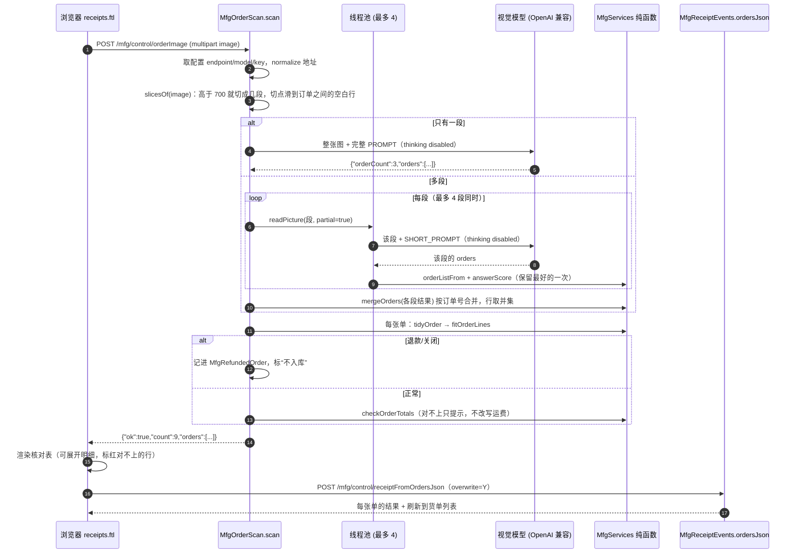
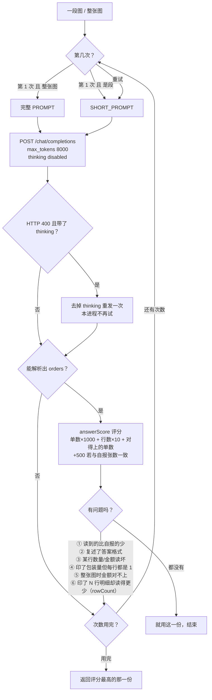
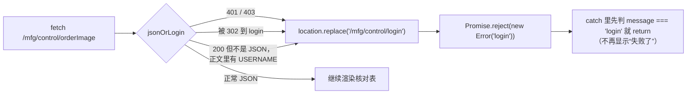

# 订单截图识别：设计说明

> 一句话：**一张淘宝/京东/拼多多的订单截图 → 一个视觉模型 → 一份能对账的订单明细 → 人工核对 → 一次入库。**
> 这份文档讲“为什么这么做、每一步防的是哪种错”，算式本身仍在 `README.md` 的「计算公式一览」。

写给谁看：以后要改这段代码的人（包括几个月后的自己）。这套东西有十来道互相独立的保护，
**任何一道被当成“冗余”删掉，表面上都还能跑，但会悄悄错账**——所以单独写一份。

---

## 1. 一页速览

| 指标 | 最初的实现 | 现在 |
| --- | --- | --- |
| 9 张单的长图 | 1~4 张单，90~300 秒，经常要人点 2~3 次 | **9 张单，3~4 秒** |
| 3 张单的截图连跑 11 次 | 十次里一两次读不出 | **11 次全中** |
| 一张单两件商品 | 有时只读出 1 件，还把钱“对平”了（把差额当运费） | 4 次连跑都是 2 行、货款与实付一致 |
| 数量 | 淘宝整包卖的电阻只回 `1` | `×N × 每件只数`，如 `100`、`200` |
| 模型侧要求 | 会算、会权衡、JSON 一个字符不能错 | **只是照着抄**：不推理、不算账、不解释 |
| 人要做的事 | 检查是否有漏单、核对数量金额 | 同左（**这一步永远保留**） |

关键结论先放这里：

1. **“让模型直接答对”是靠不住的**，靠得住的是**在外面加一层判定与重试**——模型每次都不完美，但每次都不同。
2. 判断“这次读得好不好”不靠模型自评，靠**能对上账**（货款 + 运费 − 优惠 = 实付）。
3. 大图先**切段**（每段 1~2 张单），比“一次看懂 9 张单”容易一个数量级。
4. 请求里 `"thinking":{"type":"disabled"}` 是**分水岭**（300 秒 → 4 秒，1~4 张 → 9 张）。

---

## 2. 演进：每一步都在修一个真实的错

按提交顺序（每一步都有真截图或真机日志为依据，不是“想想应该会好”）。

| Step | 当时的问题（真实症状） | 改法 |
| --- | --- | --- |
| 60 | 没有识别，只能手粘 | `MfgOrderScan.scan` + 系统属性配端点，结果**只填表单**，人不提交不写库 |
| 63/64 | 识别回来是空的 | 地址没写全时 `normalizeVisionEndpoint` 自动补；`max_tokens` 4000；明细可能在 `reasoning_content`；**双重转义的 `\\n`** 让整条明细变 null → 改成一遍扫的 `jsonUnescape` |
| 67 | 每次都要先存图再选文件 | 支持 `Ctrl+V` 粘贴、拖拽（`document` 上的 `paste`，纯图才拦） |
| 86 | 一张截图里好几张单 | 回答变成 `{"orders":[…]}`；`MfgServices.orderListFrom` 手写扫花括号（**不能用正则**，几千字符会 `StackOverflowError`） |
| 89 | 十次里一两次识别不出来 | 自动重试 3 次（`ATTEMPTS`），第 2、3 次换短提示词；按 `answerScore` **保留最好的一次** |
| 90 | 单张和多张两条路，行为不一致 | 删掉“单张填表单”的支路：**永远是 `orders[]` + 核对表** |
| 91 | 模型把“答案格式”当成答案 | `echoesTemplate` 拦模板行；`orderNo` 必须非空 |
| 92 | 一张单两件商品只读出一件 | 金额对不上就重发；`checkOrderTotals` **不再改写**印着的运费（否则等于把漏掉的商品藏起来） |
| 93 | 重新导入是“跳过”不是“覆盖” | 核对表可展开；`overwrite=Y` 走 `mergeOrderLine`（行 + 批次 + 流水一起改） |
| 95 | 红包/满减被报“金额不平” | 新增 `discountAmount`，口径 **实付 = 货款 + 运费 − 优惠**；读不到时用差额反推，**但不许编造** |
| 97 | 数量永远是 1（整包卖） | 提示词写死包装量规则；`ignoredThePackSize` 兜底：出现包装量而每行都是 1 → 重发 |
| 98 | 一行一串制表符，模型转义常出错 | 回答改成 **`items` 一件商品一个对象**；`anyUnreadable` 兜底；旧 `lines` 仍兼容 |
| 99 | 5 张单的图要识别 2~3 次 | **长图切段**（首版是 700 高、重叠 150）+ 并行读 + 按订单号 `mergeOrders`；提示词改成平台中立 |
| 100 | 9 张单的图只读出 1~4 张、90~300 秒 | **`thinking: disabled`**（日志里 `content:""`、`finish_reason:"stop"`，额度全用在思考上） |
| 100b | 切段后重叠区重复行、末尾多出汇总行 | `tidyOrder`：`rowKey` 去 `[交易快照]` 后缀；“能对上实付的那一份赢”删汇总行（Step 103 把“去重”改成了“只按钱删”） |
| 101 | 重启后点识别只红一句“识别请求失败” | 会话过期时 OFBiz 回 **401 + 登录页**；`js/session.js` 的 `jsonOrLogin` 直接跳登录页 |
| 103 | 一块面包板六种颜色：六行被合成一行（还是入库时也只进一行） | 行身份 = 料号 + 数量 + 金额；**重复行只按钱删**，入库时每行**只能被认领一次**；提示词要模型把颜色写进 `code` |
| 104 | 五单的图里第 5 单变成 19.09（= 17.90 + 1.19），明细是两张单混在一起 | **切点找空白行**（700±180 像素内滑），不再把一张单切成“标题在一段、明细在下一段”；另加两条：两张单明细与实付完全相同 → 重发；差一两分钱算四舍五入不算错 |

---

## 3. 现在的架构

### 3.1 组件

| 位置 | 职责 |
| --- | --- |
| `webapp/mfg/receipts.ftl` | 上传（选文件 / 粘贴 / 拖拽）、调用 `/mfg/control/orderImage`、渲染 `#scanOrders` 核对表、`/mfg/control/receiptFromOrdersJson` 批量导入 |
| `MfgOrderScan` | 事件层：读参数、取配置、**切段**、**并行**、每段**重试并保留最优**、汇总后 `tidyOrder` + 对账、写 JSON 答案 |
| `MfgServices` | 纯函数层（**离线可测**）：`orderListFrom` / `itemsIn` / `mergeOrders` / `tidyOrder` / `rowKey` / `checkOrderTotals` / `totalsDisagree` / `answerScore` / `anyUnreadable` / `ignoredThePackSize` / `echoesTemplate` / `fitOrderLines` |
| `MfgReceiptEvents.ordersJson` | 批量导入入口，把 `o<i>.*` 参数交给 `mfgReceiptFromOrder`（`overwrite=Y`） |
| `webapp/mfg/js/session.js` | `jsonOrLogin`：会话没了就跳登录页（所有 JSON 出口共用） |

**分层的意思**：凡是“能算错的地方”都不在事件里，都在纯函数里，所以不联网也能测
（`MfgServicesTest` 有专门的一组用例）。

### 3.2 一次识别（时序图）



### 3.3 一次调用内部的判定（流程图）

“什么算读好了”和“最多试几次”都在这张图里：



> 注意第 12 行那个“评分最高”而不是“最后一次”：实测**第三次会把第一张单弄丢**，
> 所以“最后一份说了算”是错的。

---

## 4. 请求与回答长什么样

请求体（OpenAI 兼容，只用了三个非标准字段）：

```json
{
  "model": "deepseek-flash",
  "max_tokens": 8000,
  "thinking": { "type": "disabled" },
  "messages": [{ "role": "user", "content": [
    { "type": "text", "text": "<PROMPT 或 SHORT_PROMPT>" },
    { "type": "image_url", "image_url": { "url": "data:image/png;base64,..." } }
  ]}]
}
```

要模型回答的东西（**一件商品一个对象**，这是 Step 98 的关键）：

```json
{
  "orderCount": "9",
  "orders": [{
    "orderNo": "4027103184...", "shop": "某某电子", "platform": "淘宝",
    "orderDate": "2026-10-20", "paidTotal": "10.73", "freight": "2.00",
    "discount": "0.27", "refunded": "N", "rowCount": "1",
    "items": [{ "code": "30K", "name": "0603贴片电阻 30K", "qty": "100", "amount": "1.20" }]
  }]
}
```

为什么是 `items` 数组：一行一串制表符（`code\tname\tqty\tamount`）时要模型自己转义 `\t`/`\n`，
实测出现过一行金额变成 `3.24;402530`（第二件商品被第一件吞掉）、整张单丢掉。**旧的 `lines` 仍然兼容**
（mock 图与老单测照旧能用），`itemsIn` 负责把它读回内部的行字符串。

`rowCount`（每张单印了几行明细）是为了捉“一行一张单”那种很隐蔽的错：一块面包板六种颜色印六行，
模型只答一件 `41.28` 时**钱是对的**，`checkOrderTotals` 什么也看不见（Step 103）。

提示词的写法也是设计的一部分：**写成决策，不写成问题**。早先那条长提示词让模型反复权衡
（店铺名带不带「天猫」、1.97 与 2.22 哪个是单价），thinking 模型把输出额度全用在推导上，
`content` 是空串。现在明确写着“照着页面上的数字抄，不要权衡、不要描述画面”。

---

## 5. 数字口径（这部分最容易被改坏）

### 5.1 三条铁律

1. **数量 = `×N` × 每件只数**。淘宝的电阻电容是整包卖的，灰色规格行有四种写法：
   `一件100只` / `（50只）` / `100只装` / `1件=100个`。`30K（一件100只）` 的 `×1` 是 **100 个**。
2. **包装量不进料号**。`30K（一件100只）;1%精度;0603贴片电阻` 的料号是 `30K`——
   否则同一颗料每买一次就成一个新料号。
3. **行的金额是那一行实付的钱**，不是单价：`×2` 的两件商品，行金额 = 单价 × 2；
   整张单只有一件商品时，行金额 = 实付 − 运费。单价由 `收到金额 ÷ 数量` 反算（`lotUnitCost`），
   因为 `currency-amount` 只有两位小数，`2.91 ÷ 100` 存不进去（见 README Step 60）。

### 5.2 对账（`checkOrderTotals`）

$$\text{货款} + \text{运费} - \text{优惠} = \text{实付}$$

- 运费没印 → 记 0；
- **差一两分钱算对得上**：页面把单价四舍五入到分（0.095 印成 0.10），两件就是 1.20 对 1.19 ——放行的额度是
  `0.005 × 总件数 + 0.005`（`roundingSlack`），`checkOrderTotals` 与 `totalsDisagree` 用同一个额度，
  免得“差一分钱”既报红又白白重试三次；
- 货款 + 运费 **已经等于**实付 → 模型报的任何 `discount` 一律清零（它常把划线价当优惠，实测出现过 4.80）；
- 模型报了优惠、但对不上账，而**不带优惠**的读法正好对上 → 那是把划线价当优惠（`0.09` 旁边就是 `0.10 ×2`），
  优惠清零、行金额按“单价 × 数量”重算；真红包（9.00 + 2.00 − 0.27 = 10.73）不会被清掉；
- 优惠没读到但差额 `0 < 货款+运费−实付 < 货款` → 反推成整单优惠（红包 / 满减）；
- 对不上时 `checkOrderTotals` **只提示、不改数字**（改写运费等于把漏读的商品藏起来），
  页面上那一行标红「实付与明细对不上，请核对」，并且 `scan` 会因此再发一次。

### 5.3 切段后的清理（`tidyOrder`）

**行就是行，“长得一样”不等于“重复”**（Step 103）：一块面包板卖六种颜色，页面就印六行，
料号、数量、金额全一样，只有灰色规格行里的 `白色 / 蓝色 / 绿色 …` 不同。所以：

1. **拼段不去重**：`joinRows` 只是把两段的行接起来（同一个行号被两段都读到就出现两次），
   行身份是 `rowKey(code)|qty|amount`（`rowKey` 去掉 `[交易快照]` 这类后缀）；
2. **重复行只按钱删**：`withoutRepeatedRows` 在“行的金额合计 > 实付相关的那一份”时，
   一次删掉一个“出现最多的那一行”的**最后一份**，直到钱对上为止；对不上就把行原样还回去
   ——6 行 × 6.88 = 41.28 与实付一致，所以六行全留；两段把六行读成八行（55.04）时，删两份恰好回到 6 行；
3. **丢汇总行**：规则是“**能对上的那一份赢**”——删掉某一行后其余行能和实付对上（容差 0.06，
   页面四舍五入到分）就删它。不是“最后一行看起来像合计就删”。

没有实付金额时，谁也不区分得出“重叠的复制品”和“真的印了两行”，所以**行保持原样**（宁可让人在
核对表里看到两行，不能默默少掉一件料）；这种情况本来就少见，因为列表页与详情页都印实付。

### 5.4 同一个料号可以有好几行（Step 103）

入库那条路（`receiptFromOrder`）原来把“同一个料号”当成“同一行”：第二行要么被跳过、要么覆盖第一行，
结果六种颜色的面包板只剩一行。现在：

- 行身份 = **料号 + 数量 + 金额**，单据上的每一行**只能被认领一次**（`claimOne`）；
- 重跑同一张单（`overwrite=Y`）时，六行各自认领到自己那一行，**只改数字**，不会变成十二行；
- 同一个料号但数字变了（改单）→ 按行序认领（第 i 行对第 i 行），剩下的旧行会在结果里点名（`leftOverLines`）。

---

## 6. 失败时的说法（`scanFailure`）

话术的原则：**给出下一步动作**，不解释内部细节。

| 情形 | 页面显示 | 人该做什么 |
| --- | --- | --- |
| 连不上 / 超时 | 「识图服务连不上（已自动重试 2 次）：…」 | 过一会儿再点，或手工填 |
| `finish_reason=length` | 「模型这次想得太久、没把结果写完」 | 截图截小一点（只框订单那几行） |
| 自报 N 张却一张没读出 | 「模型说看到 N 张单，但这次的回答被截断了」 | 一次只框一两张单 |
| 读到了但自报更多 | 结果照常给，附「截图上看上去有 N 张，这次只读出 M 张」 | 核对，或再点一次（**不会重复入库**） |
| 未配置 | 「识图服务还没配好：到系统设置页填密钥」 | 也可以手工粘明细 |
| 一张单都没读出 | 「这次没从截图里读出订单…模型的原话：<160 字>」 | 换张图 / 手工填 |

最后那条为什么带“模型的原话”：`这不是订单`、`看不见图`、`我读到了但格式不对` 三种原因，
不带原话在页面上长得一模一样，人没法判断该换图还是该查配置。

---

## 7. 会话过期（Step 101）

OFBiz 对 `auth="true"` 的请求在会话没了时回的是 **401 + 登录页 HTML**（实测 `orderImage`、`orderPeek` 都是 401，
响应体里带 `USERNAME` / `forgotPassword`）。所以 `fetch(...).then(r => r.json())` 必然抛异常，
页面只能红一句“失败了”，再点一百次也一样。



---

## 8. 为什么这样就快了

| 变化 | 效果 |
| --- | --- |
| `thinking: disabled` | 9 单页 90~300 秒 → **3~4 秒**；输出额度不再被思考吃掉 |
| 切段（700 高 / 重叠 150） | 每段只 1~2 张单，模型不用“一次看懂 9 张”，漏单率大幅下降 |
| 并行（最多 4 段） | 4 张小图 ≈ 1 张的时间，串行时 5 张单的图要等几分钟 |
| 短提示词（段 / 重试） | 想得少、答得快，重试不再越试越慢 |
| 保留最优而不是最后一次 | 减少“越重试越差” |

> 一条副作用要记住：`thinking` 字段**只有实测过的 DeepSeek 认**。别的 OpenAI 兼容服务若不认，
> 第一次会回 400，代码会记住并去掉它重发一次（`plainAnswerWorks`），之后本进程不再带。
> 带了这个开关后**日志里不再有 `reasoning_content`**，排查时别以为模型坏了。

---

## 9. 怎么测（三层，都不需要人肉点）

| 层 | 覆盖 | 不联网？ |
| --- | --- | --- |
| 单元测试 `MfgServicesTest` | 回答解析（裸 JSON / 围栏 / chat envelope / `reasoning_content`）、`itemsIn`、`mergeOrders`、`tidyOrder`、对账、评分、包装量、超长回答不爆栈 | ✅ 纯函数 |
| node 小测 | `js/session.js` 的 4 种会话过期形态；页面脚本能 parse | ✅ 假 DOM |
| 巡检 `verify-m47.ps1` | 页面表单、核对表结构（`data-scan-order` / `data-platform` / `data-scan-date`）、未配置时的回答 | ❌ 要实例 |
| 真机 | 4 张真截图连跑多次，比对单数 / 行数 / 金额 | ❌ 要密钥 |

**mock 接口**：`mock-vision.ps1` 起一个 `TcpListener` 回固定回答，端到端不碰真密钥也能验链路。

---

## 10. 已知局限（别为了让提示消失而放宽判据）

1. **页面只印单价的单子仍会标红**（如 0.06 / 0.11 / 0.06，模型把单价当行金额），这是**故意留的**；
2. **只有淘宝/天猫实测过**，京东/拼多多/抖音的提示词写了但没验证；
3. **模型会把答案格式当答案**，`echoesTemplate` 只能挡显式的模板复述；
4. **一张单读完仍可能少一行**——所以“人工核对”这一步不删，永远不删；
5. 状态在进程内（`plainAnswerWorks`），重启后重新试一次 `thinking`；
6. 超长图切段后段数多，最坏情况耗时 ≈ ⌈段数/4⌉ × 单次时间，`SLICE_WAIT_SECONDS` 240 秒兜底；
7. **截图没印实付金额时**，重叠的重复行分不出来，只能原样留给核对表（见 5.3）；
8. 模型如果还是把六行“同款不同色”写成同一个料号，库存里会出现六个同料号的批次，
   汇总按料号相加（数量对，颜色信息丢）——想要颜色进料号，靠提示词让它写进 `code`。

---

## 11. 将来：本地模型 / 手机端

方向已记录（`/memories/repo/vision-local-model.md`，用户 2026-10 暂停）：

- 本机 3060 12 GB 上试 `qwen2.5vl:3b` → `7b`，端点填 `http://localhost:11434/v1/chat/completions`，
  **代码一行都不用改**（我们只认 OpenAI 兼容接口）；
- 验收就用上面那 4 张真截图，标准是“单数 / 行数 / 金额对得上”，通过率不足就做**本地优先、云端兜底**；
- 用户的长期目标更激进：**手机那样的硬件也能干这件事**——所以这套设计刻意把“聪明”留在外面一层纯函数里，
  模型只负责“照着抄”，将来换更小的模型时，损失的是识别率，不是正确性。

---

## 12. 改这段代码时的注意事项

- 改提示词前先看第 4 节：**提示词越长，thinking 模型想得越久**，加规则要同时看 `SHORT_PROMPT`；
- 加新的“读坏了”的判断 → 加在 `readPicture` 的 `if` 链里，并补一条单测（不联网可测）；
- 改数字口径 → 只改 `MfgServices` 的纯函数，**不要**在模板里再算一遍；
- 改金额校验 → 先想清楚“这条提示是帮人发现错，还是帮系统掩盖错”（第 5.2 节）；
- 任何新的 JSON 出口 → 用 `jsonOrLogin`，`catch` 里先判 `'login'`；
- `.ftl` 改完必须重新 `deploy-mfg.bat`（模板缓存不看 mtime），只改 `webapp/js`、`css` 可以直接 `Copy-Item`。
