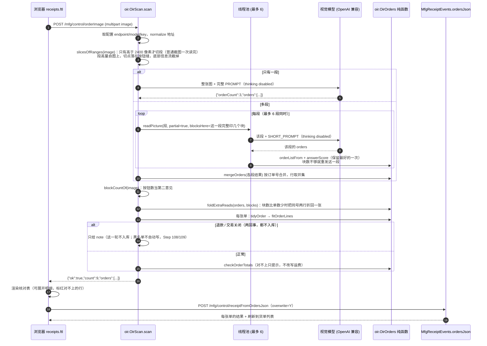
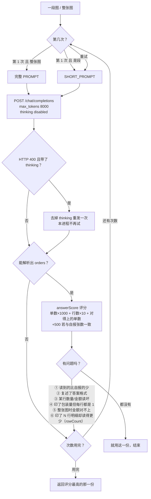
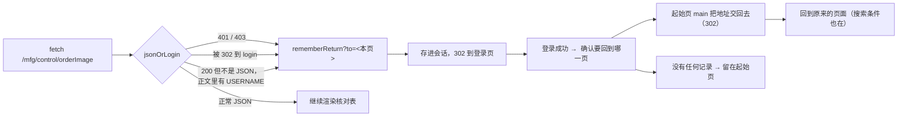

# 订单截图识别：设计说明

> 一句话：**一张淘宝 / 天猫的订单截图 → 一个视觉模型 → 一份能对账的订单明细 → 人工核对 → 一次入库。**
> 这份文档讲“为什么这么做、每一步防的是哪种错”，算式本身仍在 `README.md` 的「计算公式一览」。

写给谁看：以后要改这段代码的人（包括几个月后的自己）。这套东西有十来道互相独立的保护，
**任何一道被当成“冗余”删掉，表面上都还能跑，但会悄悄错账**——所以单独写一份。

---

## 1. 一页速览

| 指标 | 最初的实现 | 现在 |
| --- | --- | --- |
| 9 张单的长图 | 1~4 张单，90~300 秒，经常要人点 2~3 次 | **9 张单，3~4 秒** |
| 3 张单的截图连跑 11 次 | 十次里一两次读不出 | **11 次全中** |
| 一张单两件商品 | 有时只读出 1 件，还把钱“对平”了（把差额当运费） | 4 次连跑都是 2 行、货款与实付一致 |
| 数量 | 淘宝整包卖的电阻只回 `1` | `×N × 每件只数`，如 `100`、`200` |
| 模型侧要求 | 会算、会权衡、JSON 一个字符不能错 | **只是照着抄**：不推理、不算账、不解释 |
| 人要做的事 | 检查是否有漏单、核对数量金额 | 同左（**这一步永远保留**） |

关键结论先放这里：

1. **“让模型直接答对”是靠不住的**，靠得住的是**在外面加一层判定与重试**——模型每次都不完美，但每次都不同。
2. 判断“这次读得好不好”不靠模型自评，靠**能对上账**（货款 + 运费 − 优惠 = 实付）。
3. 大图先**切段**（每段 1~2 张单），比“一次看懂 9 张单”容易一个数量级。
4. 请求里 `"thinking":{"type":"disabled"}` 是**分水岭**（300 秒 → 4 秒，1~4 张 → 9 张）。

---

## 2. 演进：每一步都在修一个真实的错

按提交顺序（每一步都有真截图或真机日志为依据，不是“想想应该会好”）。

| Step | 当时的问题（真实症状） | 改法 |
| --- | --- | --- |
| 60 | 没有识别，只能手粘 | `MfgOrderScan.scan` + 系统属性配端点，结果**只填表单**，人不提交不写库 |
| 63/64 | 识别回来是空的 | 地址没写全时 `normalizeVisionEndpoint` 自动补；`max_tokens` 4000；明细可能在 `reasoning_content`；**双重转义的 `\\n`** 让整条明细变 null → 改成一遍扫的 `jsonUnescape` |
| 67 | 每次都要先存图再选文件 | 支持 `Ctrl+V` 粘贴、拖拽（`document` 上的 `paste`，纯图才拦） |
| 86 | 一张截图里好几张单 | 回答变成 `{"orders":[…]}`；`OirOrders.orderListFrom` 手写扫花括号（**不能用正则**，几千字符会 `StackOverflowError`） |
| 89 | 十次里一两次识别不出来 | 自动重试 3 次（`ATTEMPTS`），第 2、3 次换短提示词；按 `answerScore` **保留最好的一次** |
| 90 | 单张和多张两条路，行为不一致 | 删掉“单张填表单”的支路：**永远是 `orders[]` + 核对表** |
| 91 | 模型把“答案格式”当成答案 | `echoesTemplate` 拦模板行；`orderNo` 必须非空 |
| 92 | 一张单两件商品只读出一件 | 金额对不上就重发；`checkOrderTotals` **不再改写**印着的运费（否则等于把漏掉的商品藏起来） |
| 93 | 重新导入是“跳过”不是“覆盖” | 核对表可展开；`overwrite=Y` 走 `mergeOrderLine`（行 + 批次 + 流水一起改） |
| 95 | 红包/满减被报“金额不平” | 新增 `discountAmount`，口径 **实付 = 货款 + 运费 − 优惠**；读不到时用差额反推，**但不许编造** |
| 97 | 数量永远是 1（整包卖） | 提示词写死包装量规则；`ignoredThePackSize` 兜底：出现包装量而每行都是 1 → 重发 |
| 98 | 一行一串制表符，模型转义常出错 | 回答改成 **`items` 一件商品一个对象**；`anyUnreadable` 兜底；旧 `lines` 仍兼容 |
| 99 | 5 张单的图要识别 2~3 次 | **长图切段**（首版是 700 高、重叠 150）+ 并行读 + 按订单号 `mergeOrders`；提示词改成平台中立 |
| 100 | 9 张单的图只读出 1~4 张、90~300 秒 | **`thinking: disabled`**（日志里 `content:""`、`finish_reason:"stop"`，额度全用在思考上） |
| 100b | 切段后重叠区重复行、末尾多出汇总行 | `tidyOrder`：`rowKey` 去 `[交易快照]` 后缀；“能对上实付的那一份赢”删汇总行（Step 103 把“去重”改成了“只按钱删”） |
| 101 | 重启后点识别只红一句“识别请求失败” | 会话过期时 OFBiz 回 **401 + 登录页**；`js/session.js` 的 `jsonOrLogin` 直接跳登录页 |
| 103 | 一块面包板六种颜色：六行被合成一行（还是入库时也只进一行） | 行身份 = 料号 + 数量 + 金额；**重复行只按钱删**，入库时每行**只能被认领一次**；提示词要模型把颜色写进 `code` |
| 104 | 五单的图里第 5 单变成 19.09（= 17.90 + 1.19），明细是两张单混在一起 | **切点找空白行**（700±180 像素内滑），不再把一张单切成“标题在一段、明细在下一段”；另加两条：两张单明细与实付完全相同 → 重发；差一两分钱算四舍五入不算错 |
| 105 | 六色面包板只剩 2 行 / 又变成 9、10 行；套装数量读成 4 | 没印订单号的那一段的行**挂到上面最近的单号**（`giveTheRowsAnOrder`）；行身份把 `（5个）` 也算掉（`bareCode`）；重复行删到“离实付最近”为止，多出来的凭空行由 `readingThatAddsUp` 丢掉；**套装/组合/套餐 数量 = 1** |
| 106 | 4 单的图第 4 单没了，而且前 3 张单的单号整体错位一格 | **不再给普通截图切段**（`SLICE_HEIGHT` 700 → 2400）：淘宝页“块内空行”与“两块之间空行”都是 32~41 像素，切点落在块中间就会把明细挂到下一张单；金额校验改成**双向**（读多了也算没读好）；标题里裸写的 `5只` 也算包装量 |
| 108 | 一张「交易关闭」的单被当成退款，自动进了黑名单 | 退款只认「退款成功 / 已退款 / 退款中 / 退货退款」；提示词补一句：`退货宝` / `7天无理由退货` / `退换货` 是店铺政策、每行都印，**不是订单状态**。<br>**顺带取消“识别到退款就自动登记黑名单”**：模型把「退货宝」看成退款，一张好单就被永久拦住（开发库真出现过两条这种脏数据），修法是**识别结果只影响这一轮**，黑名单一律由人在页面上登记 |
| 109 | 用户纠回：「交易关闭」不是退款，而是**这笔交易没成交**（一直没付款），货根本没发 | 回答里多一个 `closed` 字段（交易关闭 / 已取消 / 交易失败）；`refunded` 与 `closed` 是两个状态，都**不入库**但说法不同（「已退款，不入库」/「交易关闭，不入库」），页面 `leftOut(order)` 一起挡掉、整张截图都是这种时藏掉「导入」按钮；`closed` **不硬拒**（手工粘明细仍可入库），只有 `refunded=Y` 与服务端黑名单会拒 |
| 139 | 切点落在块中间，明细被挂到下一块 | 切点改成落在**两个橙色按钮之间的最宽缝**（每块印 2~3 个橙色按钮，窄缝在块内、宽缝才是块与块之间） |
| 143–146 | 23 张读出 24 张；217.90 被读成 2.18；14.00 的货款只有 12.00；16.00 那张单被拆成两行 | `onePrintsThePriceOfTheOther`（小的是单价，丢掉）、`moneyOfOnePack`（缺口 = 某行金额 ×(包数−1)）、`withoutTheRowThatIsThePaidTotal`（金额正好等于实付的那一行是「实付款」被当成了明细）、同号同实付的两条并回一张 |
| 147–148 | 900 高的段是手填的，换图就得重调 | 段高**从图上量**（暗度曲线自相关，取全局最大峰 → 689 行），段高 = 2 × 块高，clamp 到 [600, 2000]；切分窗口收紧到 ±25% |
| 149–150 | 识图两千多行混在 1.4 万行的 `MfgServices` 里，第三方没法审 | 拆成 `oir` 包：`OirScan`（联网 / 切段 / 提示词 / 重试）+ `OirOrders`（纯函数：解析 / 合并 / 整理 / 金额核对），带一份 `README.md` 写清规则与要审计的问题 |
| 151 | 第三方审计提了十五条 | 常量集中、正则预编译、线程池 `finally` 收尾、指数退避、重发日志写清原因；容差 / `BigDecimal` / 枚举 / 拆 `tidyOrder` 等**逐条说明为何不改**（写进 `oir/README.md` §9） |
| 152–153 | 「32 个橙色按钮 vs 23 块」，所以不敢数按钮 | 改成数**一行里最长的一段连续橙色**（表头的橙色文字是散落的笔画）→ 25 个锚点 = 23 个块按钮 + 页头 + 推荐区；再按“按钮起始位置”取最多的一组 → **23**，可以当第二意见与读出的单数对账（差 1~2 时提示，不自动删行） |
| 159 | 一张 14 单的图里第 3、4、9 单解析错：13 行的电阻只读出 5 行（差 5.10）、44.93 的单读出 57.30 | **根因是切点**：一块只有一个按钮，所以「两个按钮之间最宽的一段」就是**一个块本身**，取中点等于每次都切在块的中间；这块 2769 行被切成两半，每半只读出几行。改成**一个块一段**（切在块的表头上），比一次调用还高的块自己是一段；`blocksInside` 改成数块数，于是「这一段打印 N 块、答了 N 单 ⇒ 钱可查」成立，第二次问会把丢的钱说出来。另：单行容差从 `0.005×件数` 收紧到**一行最多一毛**（一件100只的电阻行以前能留 4.50 元余地，整行漏读就看不见了） |
| 154–155 | 页面底部 4700 行是「猜你喜欢」，占了 12 段里的 3 段；偶尔一块被读成两行 | 截掉信息流（12297 / 16384，**12 段 → 9 段**）；每段核对 `blocksInside`（印 2 块只答 1 块就重发这一段）；`foldExtraReads` 在“块数 < 单数”时把同号两行折回一张；并行 4 → 6、切片先试 JPEG。实测 20 次：19 次 23 张、1 次 24 张（那一行是模型编的新单号） |
| 156 | 一张单的单号被读成另一串数字（差在中段、位数不变） | 先肯定**不是压缩**：q0.9 的带子与 PNG 笔画一样完整；真因是 19 位数字在模型眼里太小（原图 16.4 px/位，接口压到 1568 后 7.5 px/位）。① 裁掉左右空白（`contentColumns`，审计页 104..2792）；② 每段再裁左侧 1700 宽的带子**只问单号**，两次不一致以放大那次为准并写 note |
| 157 | 50 连测打出真形：44/50 全对，6 次错里 3 次是单号多/少一位，而那 3 次**放大后的带子才是错的** | 取消“放大那次为准”：`settleNumbers` 按**这一页印单号的位数**判（众数），位数对得上的赢，两次等长则保留第一次并把两次都写进 note。重跑 50 次：**47/50 全对（94%）**，无单号位数错误；“明细一模一样”提示改为只在多出一行时说，再两批 50 次得 **48 / 49**，三批合计 **144/150（96%）**，剩下的全是“24 张：多出一个人家编的单号” |
| 183 | 一张 5 单的截图里第 3 单**始终只读出 14 行**（实际 15 行，钱差 3.00），重发也只重复同样的 14 行 | 不是切段也不是提示词：把那一块**单独**发一次也 3 次里错 2 次，是模型对“十几行几乎一样的电容”会漏最后一行。改用**第二意见**：块里每行旁边一张商品图，**图数就是行数**（这一段 15 张图）；读出的行比图少 1~3 张时把数字说出来再问一次。实测同一张图 **3/3 都是 15 行、钱正好**；(26) 17 单、(31) 20 单的回归不变 |
| 184 | 用户问：既然知道模型对一块只能读出 14 行，能不能**分段识别、金额相加** | 能，做在**兜底**上（数图数先试，绝不用它替换）：这一段只含一个块、印了 ≥ 12 行、第二次问还是少行时，把这一块**切成两半**再各问一次——切点在**中间那张商品图的上边缘**（不切任何一行商品），**下半张把块头接在顶上**（一块只印一次块头，不接的话下半张不知道属于哪张单），两张一起交给 `OirOrders.joinHalves`：行按 `rowIdentity` 去重相加、块头用整块那次读数、**单数不许变多**、`rowCount` 丢掉，金额对不对得上由实付判定。把数图数这条临时关掉单测这条路：**4/4 次都是 15 行 38.50**（改之前 14 行 35.50）；开着时仍是 3/3 的 15 行，走不到兜底 |
| 185 | 用户问：`Ctrl+V` 贴图后能不能**按回车**就开始识别 | 能：贴图 / 拖图之后把焦点放到「识别并核对」按钮上（`focus({preventScroll:true})`，滚动仍由 `jumpUnderNav` 管），回车就能激活它；另挂一个 `document` 的 `keydown` 兜底——**只有“有一张图在等着”时的光秃秃回车**才算，焦点在输入框/明细框里不动（那里回车是换行），带 Shift/Ctrl 的也不算，所以结果出来以后再按回车不会把同一张图重读一遍 |
| 186 | 用户问：其它 `Ctrl+V` 的也加上回车吗（贴淘宝导出 xlsx 那块） | 加，但把机制收成**一份**：`webapp/mfg/js/enter.js`（装饰器加载）只有一个 `keydown`，块贴到文件就 `mfgAskEnter(名字, 按钮, 开始)`、开始跑就 `mfgEnterDone(名字)`。**一次只认一个块**——先贴图再贴 xlsx，后贴的接管回车，不会两份各触发一次；贴完焦点落在各自的按钮上，回车本来也能激活（xlsx 那边用 `form.requestSubmit(button)`，**不能** `form.submit()`，那会绕过 submit 事件走真导航）。假 DOM 跑 21 项全过（含“先贴图再贴表只有表启动”） |
| 187 | 用户报“(18).png 最后一单的最后两行经常只识别出一行，数量也解析错” | 不是模型，是**切段**：最后一单印四行（2K / 100K / 100R / 5.1K，各 `¥1.20 x1`、规格行 `（一件100只）`，实付 4.80），比“一个块高”高，旧的兜底“猜一行”（`lastButton + 块高`）正好落在第 3 行里——规格行被切掉（数量读成 1）、第 4 行整行没了，而**被切掉的商品图不在这一段里，数图数那条意见也数不到**。现在：① 以**最后一张商品图的底边**为锚，从 `图底+60` 之后取第一个真空白带；② 没图可锚才用“宽于表内最宽空白一倍且 ≥300”的带；③ 两样都没有就**整张不切**（多读卡片会被金额标出来，切掉一行没人知道）。`bandAfter` 同时修了“切点可以从带子中间开始”。另外四行的**料号**读成了整条规格行（四行同一个料号），`OirOrders.valueOfSpecLine` 现在取 `;` 之前、去掉末尾包装量、`（` 之前 → `2K`；两个提示词也补了“code 是规格行开头的那个值”。实测 (18) 连跑 3 次最后一单都是 **4 行 / 4.80**、料号 `2K / 100K / 100K / 5.1K`（第 3 行页面上是 `100R`，模型抄了上一行，钱和行数都对），单号也不再少一位；(25)(26)(31) 不变 |

---

## 3. 现在的架构

### 3.1 组件

| 位置 | 职责 |
| --- | --- |
| `webapp/mfg/receipts.ftl` | 上传（选文件 / 粘贴 / 拖拽）、调用 `/mfg/control/orderImage`、渲染 `#scanOrders` 核对表、`/mfg/control/receiptFromOrdersJson` 批量导入 |
| `MfgOrderScan` | 事件层入口（`/mfg/control/orderImage`、`visionTest`），只把两个请求**转发**给 `oir.OirScan`；**类名不能删**（`controller.xml` 指向它） |
| `oir.OirScan` | 读参数、取配置、**切段**（段高量的、切点落在按钮缝、截掉底部信息流）、**并行（最多 6）**、每段**重试并保留最优**、按按钮数对账、写 JSON 答案 |
| `oir.OirOrders` | 纯函数层（**离线可测**）：`orderListFrom` / `itemsIn` / `mergeOrders` / `foldExtraReads` / `tidyOrder` / `rowKey` / `checkOrderTotals` / `totalsDisagree` / `answerScore` / `anyUnreadable` / `ignoredThePackSize` / `echoesTemplate` / `fitOrderLines` |
| `MfgProductServices` | 只留**零件号规则**（`fittingComponentCode` / `nameWithFullCode`）与产品业务；识图规则已不在服务类里（`splitCsvLine` 在 `MfgCsv`） |
| `MfgReceiptEvents.ordersJson` | 批量导入入口，把 `o<i>.*` 参数交给 `mfgReceiptFromOrder`（`overwrite=Y`） |
| `webapp/mfg/js/session.js` | `jsonOrLogin`：会话没了就跳登录页（所有 JSON 出口共用） |

**分层的意思**：凡是“能算错的地方”都不在事件里，都在纯函数里，所以不联网也能测
（`MfgOrderReadRulesTest` 有专门的一组用例）。识图这一整套的规则**只看 `oir/OirOrders` 就够**，
联网与切段在 `oir/OirScan`，两份的分工与实测数据写在 `oir/README.md`。

### 3.2 一次识别（时序图）



### 3.3 一次调用内部的判定（流程图）

“什么算读好了”和“最多试几次”都在这张图里：



> 注意第 12 行那个“评分最高”而不是“最后一次”：实测**第三次会把第一张单弄丢**，
> 所以“最后一份说了算”是错的。

---

## 4. 请求与回答长什么样

请求体（OpenAI 兼容，只用了三个非标准字段）：

```json
{
  "model": "deepseek-flash",
  "max_tokens": 8000,
  "thinking": { "type": "disabled" },
  "messages": [{ "role": "user", "content": [
    { "type": "text", "text": "<PROMPT 或 SHORT_PROMPT>" },
    { "type": "image_url", "image_url": { "url": "data:image/png;base64,..." } }
  ]}]
}
```

要模型回答的东西（**一件商品一个对象**，这是 Step 98 的关键）：

```json
{
  "orderCount": "9",
  "orders": [{
    "orderNo": "4027103184...", "shop": "某某电子", "platform": "淘宝",
    "orderDate": "2026-10-20", "paidTotal": "10.73", "freight": "2.00",
    "discount": "0.27", "refunded": "N", "closed": "N", "rowCount": "1",
    "items": [{ "code": "30K", "name": "0603贴片电阻 30K", "qty": "100", "amount": "1.20" }]
  }]
}
```

为什么是 `items` 数组：一行一串制表符（`code\tname\tqty\tamount`）时要模型自己转义 `\t`/`\n`，
实测出现过一行金额变成 `3.24;402530`（第二件商品被第一件吞掉）、整张单丢掉。**旧的 `lines` 仍然兼容**
（mock 图与老单测照旧能用），`itemsIn` 负责把它读回内部的行字符串。

`rowCount`（每张单印了几行明细）是为了捉“一行一张单”那种很隐蔽的错：一块面包板六种颜色印六行，
模型只答一件 `41.28` 时**钱是对的**，`checkOrderTotals` 什么也看不见（Step 103）。

提示词的写法也是设计的一部分：**写成决策，不写成问题**。早先那条长提示词让模型反复权衡
（店铺名带不带「天猫」、1.97 与 2.22 哪个是单价），thinking 模型把输出额度全用在推导上，
`content` 是空串。现在明确写着“照着页面上的数字抄，不要权衡、不要描述画面”。

---

## 5. 数字口径（这部分最容易被改坏）

### 5.1 三条铁律

1. **数量 = `×N` × 每件只数**。淘宝的电阻电容是整包卖的，灰色规格行有四种写法：
   `一件100只` / `（50只）` / `100只装` / `1件=100个`。`30K（一件100只）` 的 `×1` 是 **100 个**；
   标题里的 `带扣（5个）` 也算包装量（×1 → 5 个）；标题末尾裸写的件数也按包装量算
   （`IC测试板 5只` 的 `×3` 是 **15**）；
   **但套装 / 组合 / 套餐 算一件**：`实验板（4块组合套装）` ×1 是 **1**，不是 4（用户明确要这个口径）。
2. **包装量不进料号**。`30K（一件100只）;1%精度;0603贴片电阻` 的料号是 `30K`——
   否则同一颗料每买一次就成一个新料号。
3. **行的金额是那一行实付的钱**，不是单价：`×2` 的两件商品，行金额 = 单价 × 2；
   整张单只有一件商品时，行金额 = 实付 − 运费。单价由 `收到金额 ÷ 数量` 反算（`lotUnitCost`），
   因为 `currency-amount` 只有两位小数，`2.91 ÷ 100` 存不进去（见 README Step 60）。

### 5.2 对账（`checkOrderTotals`）

$$\text{货款} + \text{运费} - \text{优惠} = \text{实付}$$

- 运费没印 → 记 0；
- **差一两分钱算对得上**：页面把单价四舍五入到分（0.095 印成 0.10），两件就是 1.20 对 1.19 ——放行的额度是
  `0.005 × 总件数 + 0.005`（`roundingSlack`），`checkOrderTotals` 与 `totalsDisagree` 用同一个额度，
  免得“差一分钱”既报红又白白重试三次；
- 货款 + 运费 **已经等于**实付 → 模型报的任何 `discount` 一律清零（它常把划线价当优惠，实测出现过 4.80）；
- 模型报了优惠、但对不上账，而**不带优惠**的读法正好对上 → 那是把划线价当优惠（`0.09` 旁边就是 `0.10 ×2`），
  优惠清零、行金额按“单价 × 数量”重算；真红包（9.00 + 2.00 − 0.27 = 10.73）不会被清掉；
- 优惠没读到但差额 `0 < 货款+运费−实付 < 货款` → 反推成整单优惠（红包 / 满减）；
- 对不上时 `checkOrderTotals` **只提示、不改数字**（改写运费等于把漏读的商品藏起来），
  页面上那一行标红「实付与明细对不上，请核对」，并且 `scan` 会因此再发一次；
  判断是**双向**的：明细比实付少是漏了一件，比实付多是把一件读重了或读错了价（Step 106 之前只看前者，
  所以“两行各 2.06”那种多读的回答不会被重发）。
- **钱对不上不一定够**：一块印十五行的订单，模型稳定地只答十四行（最后一行就在按钮上方，它看不见），
  钱差 3.00，重发一次还是十四行——只说“还差 3.00 元”它只是重复同样的答案。所以再加一条**独立的第二意见**：
  块里每一行商品旁边印一张商品图，`OirScan` 已经把图裁出来了，**图数就是行数**；读出的行比图少 1~3 张时，
  第二次问直接把数字说出来（“This block prints 15 article rows … your answer has 14”），实测三次都读全（Step 183）。
  只在“这一段只含一个块、且不是最后一段”时用——最后一段夹着「猜你喜欢」卡片，图数不是行数。
- **数图数也不够时，就把一块切成两半**（Step 184）：用户提的办法，做成最后一道兜底——同一块按**中间那张
  商品图的上边缘**切开（不切任何一行商品），下半张把**块头**（单号/日期/店铺/实付）接在顶上再问，
  两半的行按“料号+数量+金额”去重后相加，金额对不对得上由实付说了算。**触发条件很窄**：这一段只含一个块、
  印了 ≥ 12 行、第二次问之后还是少行——所以一张正常的图根本走不到这里，它只是“模型这次死活读不全”时的保险。
  实测（把数图数那条关掉）：同一块 **4/4 次都是 15 行 38.50**。

### 5.3 切段后的清理（`tidyOrder`）**行就是行，“长得一样”不等于“重复”**（Step 103）：一块面包板卖六种颜色，页面就印六行，
料号、数量、金额全一样，只有灰色规格行里的 `白色 / 蓝色 / 绿色 …` 不同。所以：

1. **拼段不去重**：`joinRows` 只是把两段的行接起来（同一个行号被两段都读到就出现两次），
   行身份是 `bareCode(code)|qty|amount`：`rowKey` 去掉 `[交易快照]`，`bareCode` 再去掉尾部的
   `（5个）` —— 一段读到 `黄色（5个）`、另一段读到 `黄色`，它们是同一件；
2. **重复行只按钱删**：`withoutRepeatedRows` 在“行的金额合计 > 实付相关的那一份”时，
   一次删掉一个“出现最多的那一行”的**最后一份**，并**保留离实付最近的那个状态**
   （不是“对不上就全退回”）；剩下的差距再交给 `readingThatAddsUp` 删一行/按单价×数量重算
   （模型偶尔会凭空多出一行，如一张面包板单里冒出“一次性雨衣 14.9”，就是这一步丢掉的）；
3. **丢汇总行**：规则是“**能对上的那一份赢**”——删掉某一行后其余行能和实付对上（容差 0.06，
   页面四舍五入到分）就删它。不是“最后一行看起来像合计就删”。

没有实付金额时，谁也不区分得出“重叠的复制品”和“真的印了两行”，所以**行保持原样**（宁可让人在
核对表里看到两行，不能默默少掉一件料）；这种情况本来就少见，因为列表页与详情页都印实付。

还有一条跟切段配套的（Step 105）：**一段里可能没印订单号**——一张单很高（六行面包板）时，
第二段只有商品行、没有单号（单号在第一段）。这类行通过 `orderListFrom(reply, partial=true)` 保留下来，
`giveTheRowsAnOrder` 把它们挂到“上面最近的那个单号”上；否则那张单只剩第一段的 2 行（实测踩过）。

### 5.4 同一个料号可以有好几行（Step 103）

入库那条路（`receiptFromOrder`）原来把“同一个料号”当成“同一行”：第二行要么被跳过、要么覆盖第一行，
结果六种颜色的面包板只剩一行。现在：

- 行身份 = **料号 + 数量 + 金额**，单据上的每一行**只能被认领一次**（`claimOne`）；
- 重跑同一张单（`overwrite=Y`）时，六行各自认领到自己那一行，**只改数字**，不会变成十二行；
- 同一个料号但数字变了（改单）→ 按行序认领（第 i 行对第 i 行），剩下的旧行会在结果里点名（`leftOverLines`）。

---

## 6. 失败时的说法（`scanFailure`）

话术的原则：**给出下一步动作**，不解释内部细节。

| 情形 | 页面显示 | 人该做什么 |
| --- | --- | --- |
| 连不上 / 超时 | 「识图服务连不上（已自动重试 2 次）：…」 | 过一会儿再点，或手工填 |
| `finish_reason=length` | 「模型这次想得太久、没把结果写完」 | 截图截小一点（只框订单那几行） |
| 自报 N 张却一张没读出 | 「模型说看到 N 张单，但这次的回答被截断了」 | 一次只框一两张单 |
| 读到了但自报更多 | 结果照常给，附「截图上看上去有 N 张，这次只读出 M 张」 | 核对，或再点一次（**不会重复入库**） |
| 未配置 | 「识图服务还没配好：到系统设置页填密钥」 | 也可以手工粘明细 |
| 一张单都没读出 | 「这次没从截图里读出订单…模型的原话：<160 字>」 | 换张图 / 手工填 |

最后那条为什么带“模型的原话”：`这不是订单`、`看不见图`、`我读到了但格式不对` 三种原因，
不带原话在页面上长得一模一样，人没法判断该换图还是该查配置。

---

## 7. 会话过期（Step 101）

OFBiz 对 `auth="true"` 的请求在会话没了时回的是 **401 + 登录页 HTML**（实测 `orderImage`、`orderPeek` 都是 401，
响应体里带 `USERNAME` / `forgotPassword`）。所以 `fetch(...).then(r => r.json())` 必然抛异常，
页面只能红一句“失败了”，再点一百次也一样。



---

## 8. 为什么这样就快了

| 变化 | 效果 |
| --- | --- |
| `thinking: disabled` | 9 单页 90~300 秒 → **3~4 秒**；输出额度不再被思考吃掉 |
| 切段（700 高 / 重叠 150） | 每段只 1~2 张单，模型不用“一次看懂 9 张”，漏单率大幅下降 |
| **切段改成“只切超长页”（Step 106，2400 高）** | 切段本身会制造新错：切点落在块中间就把明细挂错单。现在四五个单的普通截图一次读完（反而更准），只有超长页才切 |
| **段高量自图上 + 截掉信息流（Step 148/154）** | 一块 689 行 ×2 = 1378 行/段；页面底部 4700 行的「猜你喜欢」不再发（12 段 → **9 段**，少 25% 调用） |
| 并行（Step 155：最多 6 段） | 9 段从 3 波变 2 波；切片先试 JPEG（843 KB → 510 KB），上传小一半 |
| **裁掉左右白边 + 单号再读一次（Step 156）** | 切片宽 3434 → 2688（字大 28%，不增调用）；每段多一次只问单号的带子读（+9 次小调用，整段仍约 13 s） |
| **切段的钱也对账（Step 158）** | 这一段「打印 N 块完整、正好答了 N 单」时没有半块，钱的校验不再因为它是一片切片而跳过；对不上就再问一次，并把这回**丢的钱**写进问题里 |
| 短提示词（段 / 重试） | 想得少、答得快，重试不再越试越慢 |
| 保留最优而不是最后一次 | 减少“越重试越差” |

**实测耗时**（2026-10-25，开发实例 8443，真调 DeepSeek `deepseek-flash`，每张截图连跑 3 次，结果都对）：

| 截图 | 订单 / 行数 | 三次用时 | 平均 |
| --- | --- | --- | --- |
| 4 单页（2860×1576） | 4 单，5 行 | 3.47 / 3.47 / 3.74 s | ≈3.6 s |
| 5 单页（2869×1694） | 5 单，5 行 | 4.20 / 4.13 / 3.41 s | ≈3.9 s |
| 六色面包板（2859×1500） | 1 单，6 行 | 4.82 / 1.90 / 2.62 s | ≈3.1 s |

所以**普通截图一次识别 2~5 秒**；触发一次重读就翻倍（每次 +3~4 秒，重试用短提示词，通常更快），
最坏（3 次都读不好）10 秒上下。时间几乎全花在模型那一次回答上，切图/合并/对账都是毫秒级。
**超长页（23 单、3255×16384）实测 11.8 秒**（9 段、6 段并行）。

> 一条副作用要记住：`thinking` 字段**只有实测过的 DeepSeek 认**。别的 OpenAI 兼容服务若不认，
> 第一次会回 400，代码会记住并去掉它重发一次（`plainAnswerWorks`），之后本进程不再带。
> 带了这个开关后**日志里不再有 `reasoning_content`**，排查时别以为模型坏了。

---

## 9. 怎么测（三层，都不需要人肉点）

| 层 | 覆盖 | 不联网？ |
| --- | --- | --- |
| 单元测试 `MfgOrderReadRulesTest` | 回答解析（裸 JSON / 围栏 / chat envelope / `reasoning_content`）、`itemsIn`、`mergeOrders`、`foldExtraReads`、`tidyOrder`、对账、评分、包装量、超长回答不爆栈、块高/按钮/分段/段内块数 | ✅ 纯函数 |
| 量锚点的工具 | `tools/oir-anchors/run.bat "<截图>"`：打印锚点/切点/每段完整块数（**不调视视服务**） | ✅ 本地 |
| node 小测 | `js/session.js` 的 4 种会话过期形态；页面脚本能 parse | ✅ 假 DOM |
| 巡检 `verify-m47.ps1` | 页面表单、核对表结构（`data-scan-order` / `data-platform` / `data-scan-date`）、未配置时的回答 | ❌ 要实例 |
| 真机 | 4 张真截图连跑多次，比对单数 / 行数 / 金额 | ❌ 要密钥 |

**mock 接口**：`mock-vision.ps1` 起一个 `TcpListener` 回固定回答，端到端不碰真密钥也能验链路。

---

## 10. 已知局限（别为了让提示消失而放宽判据）

1. **页面只印单价的单子仍会标红**（如 0.06 / 0.11 / 0.06，模型把单价当行金额），这是**故意留的**；
2. **只有淘宝 / 天猫做过**：另外几个平台没在用，提示词与文档里提到它们的话已删（2026-10-27）；
3. **模型会把答案格式当答案**，`echoesTemplate` 只能挡显式的模板复述；
4. **一张单读完仍可能少一行**——所以“人工核对”这一步不删，永远不删；
5. 状态在进程内（`plainAnswerWorks`），重启后重新试一次 `thinking`；
6. 超长图切段后段数多，最坏情况耗时 ≈ ⌈段数/6⌉ × 单次时间（`MAX_PARALLEL` 已是 6），`SLICE_WAIT_SECONDS` 240 秒兜底；
7. **截图没印实付金额时**，重叠的重复行分不出来，只能原样留给核对表（见 5.3）；
8. 模型如果还是把六行“同款不同色”写成同一个料号，库存里会出现六个同料号的批次，
   汇总按料号相加（数量对，颜色信息丢）——想要颜色进料号，靠提示词让它写进 `code`；
9. **19 位订单号可能少一位**（实测同一张图读成 `2354235278088500570` 与 `235423527808850570`，
   差在第 15 位附近），而订单号是导入的幂等键：**同一张单两次读到不同的号，会建两套批次**。
   所以“重复导入是覆盖”只在**两次读到的号一样**时成立，核对表里要人对一眼单号；
10. **退款 / 交易关闭只影响这一轮，不写黑名单**（Step 108）：读错一次退款，代价只是这张单这次没进库，
   而不是以后永远进不来。真正退款/关闭的单由人在「退款 / 关闭的单」里点一下登记；
   交易关闭的单**也不入库**（没成交、货没发，Step 109），但手工粘明细仍然能建单（包裹真到了的极端情况）。

---

## 11. 将来：本地模型 / 手机端

方向已记录（`/memories/repo/vision-local-model.md`，用户 2026-10 暂停）：

- 本机 3060 12 GB 上试 `qwen2.5vl:3b` → `7b`，端点填 `http://localhost:11434/v1/chat/completions`，
  **代码一行都不用改**（我们只认 OpenAI 兼容接口）；
- 验收就用上面那 4 张真截图，标准是“单数 / 行数 / 金额对得上”，通过率不足就做**本地优先、云端兜底**；
- 用户的长期目标更激进：**手机那样的硬件也能干这件事**——所以这套设计刻意把“聪明”留在外面一层纯函数里，
  模型只负责“照着抄”，将来换更小的模型时，损失的是识别率，不是正确性。

---

## 11.1 能不能做成 DeepSeek Harness（`dsh`）插件：评估过，暂时不做

用户 2026-10-31 问过这条路，结论是**记下来但不动手**——因为“合理的做法是 TS 重写，而那就把现在这套代码废了”。

**`dsh` 是什么**（查过官方仓库与文档，不是猜的）：DeepSeek 官方开源的 agent harness，
TypeScript、MIT、建在 [Cordis](https://github.com/cordiverse/cordis) 上，口号是
**“Everything is a Plugin”**；`npx @deepseek-ai/dsh web` 起 Web UI，Plugins 页装插件，
另有插件市场（一份 JSON 索引）与 `dsh-plugin` GitHub 话题。

- 插件 = 一个导出 `apply(ctx)` 的 TS 模块；`export const inject = ['tools']` 之后 `ctx.tools.register(…)`
  就能给 agent 加一个工具，`ctx.effect()` 管清理，`cordis.yml` + `--patch` 可本地加载，npm 包里声明
  `dsh.bundle` / `engines.dsh` 即可上市场。
- **它是 developer preview，官方明说会有破坏性变更**（`README` 的 “THERE WILL BE COMPATIBILITY-BREAKING CHANGES”）。
- 参考：`github.com/deepseek-ai/deepseek-harness`、`deepseek-harness.github.io` 的
  `develop/basic/`（first plugin / tool / publish）与 `guide/plugin-market`。

**为什么“TS 重写”才是干净形态**：插件与 dsh 同一个运行时（Node/Cordis），一个 `npm i` 就能装，
没有 JVM、没有子进程、没有 Windows 路径与编码的坑，插件市场里也才站得住。但——

**重写等于把规则作废**。这套识别值钱的地方不是“调了一次视觉接口”，而是 `oir` 里那三块纯函数
（`OirOrders` 2725 行规则、`OirScan` 2787 行问答与切段、`OirShots` 524 行商品图定位）。
它们是**被真实截图一条条逼出来的行为**，不是提示词：数商品图当第二意见（Step 183）、
一块读不全就切两半相加（184）、切点锚在最后一张商品图的底边（187）、`joinHalves` 不许增加单数、
`valueOfSpecLine` 把规格行切成 `2K`、金额对账与“不许为了凑钱改行”、重叠段去重又不敢乱删（103）……
照 TS 重写一遍 = 重新踩一遍这 80 步，224 个单测和 5 张真截图的基线一起作废。

**桥接方案也不是没想过**（能用，但都不“对劲”）：

| 形态 | 做法 | 问题 |
| --- | --- | --- |
| TS 重写识别 | 把 `oir` 三个类搬成 TS | 规则全部重调；而且正是用户否掉的那条 |
| 插件 spawn `oir-cli.jar` | 抽一个无 OFBiz 依赖的 jar，插件 `java -jar` 它 | 要求目标机器有 JVM；每次多 0.5~1 秒；毛病会分散在两个语言里；市场里“装个插件还得装 JDK”说不过去 |
| 插件 POST `/mfg/control/orderImage` | 复用现成端点 | 要实例在线 + 会话 cookie，给外部插件发 cookie 不合适 |
| 插件只做前端 | 读图 → 调我们的服务 → 出核对表 | 和现在的页面重复，收益最小 |

**什么情况下再回头看**：① dsh 去掉 preview、API 稳了；② 真需要“agent 驱动”的流程
（自己翻页、比价、批量补历史订单——那时识别只是其中一个工具）；③ 要给别人用。
到了那一天，**今天这套 Java 是标准答案**：TS 版按同样输入双跑，逐单对比 `orderNo` / 行数 / 金额，
对不上就不许换——这也是保留它、而不是现在重写的理由。

**顺带否掉的两种做法**（别再想）：插件里让模型“自己看图”（等于回到 Step 128 之前，14 行读成 13 行那种）；
让插件直接写 OFBiz 的库（`oir` 的边界就是“只返回订单列表”，写库只发生在页面点“导入”那一刻）。

**2026-10-31 又一次评估（用户主动提出要做），结论仍是搁置，但理由变了**：不再是“规则会作废”——
29 张图的回归（550 单 / 897 行 / 0 差钱）正好可以当 TS 版的验收器；真正拦住的是**法律面三条**：

1. **许可证**：~~`oir` 的头部是 **LGPL v3**~~ —— **2026-10-31 当天已统一改成 Apache-2.0**（见下一段），
   所以这条不再是障碍：Apache-2.0 允许改写成 TS 并以 Apache-2.0 发布，只要保留 `NOTICE` 与版权声明；
2. **个人信息**：真实截图含收件人姓名/手机号/地址，仓库、issue、fixture 里一律不能有（提交过要洗历史），
   示例数据只能用脚本合成的假页面；插件默认只能是“图片发给用户自己配置的模型”；
3. **商标与平台规则**：`淘宝 / 天猫 / Taobao / Tmall` 是注册商标，包名与仓库名不能用它，
   宣传图不能用平台 logo；平台协议也禁止插件自动登录/翻页/抓取——插件的能力边界只能是“只读用户给的图”。

**许可证统一 Apache-2.0（2026-10-31）**：查过之后才发现仓库里是三种头——30 个文件是 LGPL v3（含 `oir` 三个）、
2 个是 Apache 基金会的 ASF 头（`MfgAudit` / `MfgLoginEvents`，从模板粘过来的）、24 个文件**没有任何许可头**
（后来拆出来的服务类，法律上等于“保留所有权利”）。现在两个组件的 56 个 `.java` 全部换成统一的
Apache-2.0 头（`Copyright (C) 2010-2026 Tianjin Langhua Ltd.`），各组件根目录加 `LICENSE` 与 `NOTICE`。
**以后新建文件照抄这个头**，别再粘 LGPL 或 ASF 的模板；`MfgAudit` / `MfgLoginEvents` 原来那段 ASF 头
如果将来确认是从 OFBiz 源码派生的，要单独补出处说明。

要再启动 TS 版，剩下的只是第 2、3 条（写进 README 的能力边界与隐私说明）。

---

## 12. 改这段代码时的注意事项

- **先读 `oir/README.md`**：那份按“问与切 / 规则”分开讲，还带实测数据与要审计的问题；这一份讲演进与为什么；
- 改提示词前先看第 4 节：**提示词越长，thinking 模型想得越久**，加规则要同时看 `SHORT_PROMPT`；
- 加新的“读坏了”的判断 → 加在 `readPicture` 的 `whyAskAgain` 里，并补一条单测（不联网可测）；
- 改数字口径 → 只改 `oir/OirOrders` 的纯函数，**不要**在模板里再算一遍；
- **别把 `MfgOrderScan` 删掉**（`controller.xml` 指向它），也别让 `oir` 写库（它只返回订单列表）；
- 改判定阈值（容差 / 包数上限 / 段高上下限 / 并行数）→ 在 `oir` 的两个类顶部，改完同步 `oir/README.md` 与 `AGENTS.md`；
- 改金额校验 → 先想清楚“这条提示是帮人发现错，还是帮系统掩盖错”（第 5.2 节），**提示消失不等于读对了**；
- 任何新的 JSON 出口 → 用 `jsonOrLogin`，`catch` 里先判 `'login'`；
- `.ftl` 改完必须重新 `deploy-mfg.bat`（模板缓存不看 mtime），只改 `webapp/js`、`css` 可以直接 `Copy-Item`。
